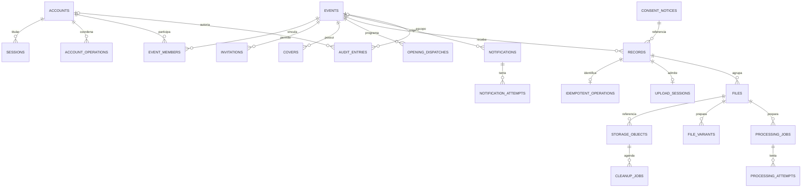

# Modelo físico vigente da base

A F01-STORY-001 instala **24 tabelas de aplicação em um único schema PostgreSQL `scrapbook`**. A lista inclui 21 tabelas de domínio e operação e três estruturas técnicas compartilhadas. O controle do Liquibase fica no mesmo schema sob a identidade migradora. [História no Trello](https://trello.com/c/gSGvlzEZ)

## Inventário

| Finalidade | Tabelas no schema `scrapbook` |
| --- | --- |
| Contas e acesso | `accounts`, `sessions`, `oidc_requests`, `account_operations` |
| Eventos e convites | `events`, `event_members`, `invitations`, `covers`, `opening_dispatches` |
| Registros e mídias | `consent_notices`, `records`, `idempotent_operations`, `upload_sessions`, `files`, `storage_objects`, `file_variants`, `processing_jobs`, `processing_attempts`, `cleanup_jobs` |
| Notificações | `notifications`, `notification_attempts` |
| Estruturas compartilhadas | `outbox_messages`, `processed_messages`, `audit_entries` |

## Relacionamentos principais

O SQL versionado em `scrapbook-liquibase/changelogs/sprint-1/` é a referência executável de colunas, chaves e índices. O [dicionário histórico](../../db/DB-Modelo-Fisico.md) preserva o desenho de origem e a semântica dos campos.

## Decisões da instalação

- As 24 chaves primárias são `id bigint GENERATED ALWAYS AS IDENTITY`. As FKs preservam escopos de evento, registro e arquivo e usam `RESTRICT`. Adicionar as FKs em etapa própria resolve também a dependência entre eventos e capas.
- Datas de negócio são civis em `America/Sao_Paulo`; instantes técnicos são `timestamptz`. A janela, as permissões, as transições e os efeitos são decididos nas Services. O banco protege a forma dos dados, as referências e a unicidade.
- A Outbox impõe unicidade de `message_id` em todo o serviço. O controle de mensagens processadas deduplica por consumidor, fonte e identidade. A auditoria usa a coluna `area`, referência opcional a conta/evento e retenção de 180 dias.
- `upload_sessions` incorpora os campos de lease, contador e reexecução da evolução histórica 049. Os índices de galeria usam `received_at`, em alinhamento à ordem de recebimento da F11.
- A role proprietária dos objetos não tem login. A migração assume essa role. O bootstrap valida associações e privilégios padrão. O comando de migração verifica por JDBC os defaults e os controles preexistentes antes de iniciar o Liquibase. Os controles só admitem grants de tabela e coluna para a proprietária. A aplicação usa DML restrito e só insere na auditoria. A role de consulta de auditoria fica separada. O checkpoint verifica privilégios efetivos nas tabelas protegidas, inclusive por papéis assumíveis.
- A instalação inicial exige catálogo de aplicação e histórico do Liquibase vazios. Cada evolução grava sua geração e assinatura na mesma transação do DDL e preserva as assinaturas anteriores. A reversão exige que o catálogo resultante corresponda à assinatura histórica do destino. O rollback inicial confere assinatura, geração e presença de dados e executa DROP com `RESTRICT` para proteger dependências. A assinatura inclui a persistência das relações e a definição das sequências `IDENTITY`. O rollback da base preserva o schema preparado e os controles do Liquibase.
