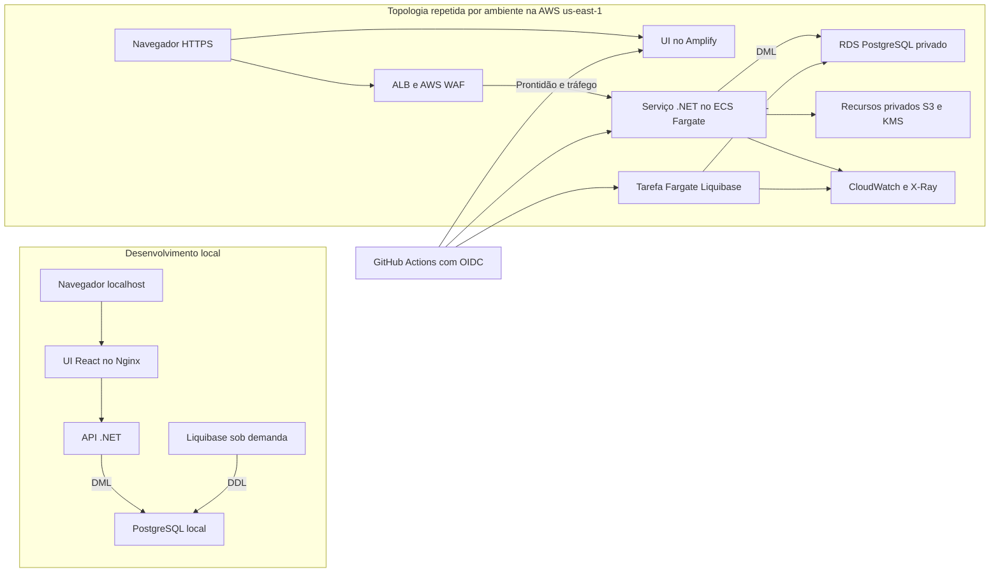

# Especificação técnica da base da aplicação e ambientes

## 1. Visão técnica

A F01 estabelece a primeira base executável do Scrap Book nos seis repositórios existentes. O resultado cobre a aplicação local, o banco preparado pelo Liquibase e os fluxos de publicação para homologação e produção. A Onda 1 começa pela F01, que não tem dependências no PRD e fornece a infraestrutura de que Contas e sessões precisa. [PRD](../PRD.md#8-grafo-de-dependências)

O backend é uma única aplicação .NET, compilada em projetos por camada da Clean Architecture e executada como um único serviço. A UI React e TypeScript tem roteamento, estilos, configuração e uma superfície inicial responsiva. PostgreSQL usa um banco por ambiente e um único schema de aplicação por banco. A instalação inicial materializa todo o modelo físico em uma entrega do Liquibase.

O ambiente local roda em Docker Compose. Em AWS, homologação e produção têm redes, dados, permissões, segredos e publicação separados. A prontidão distingue a disponibilidade do processo da capacidade de atender tráfego com o banco preparado.

### Escopo e contratos

| Limite | Contrato |
| --- | --- |
| Entradas | Configuração por ambiente, referências de segredos, destino de publicação, repositórios e revisão a publicar. O PRD não define dados funcionais consumidos pela F01. |
| Saídas | Solução compilável, shell web, endpoints operacionais, banco com o modelo inicial, ambientes e registros de publicação e recuperação. São contratos de infraestrutura. |
| Incluído | Scaffolding dos projetos, banco completo, configuração privada, execução local, publicação UI/API/Liquibase, isolamento entre ambientes, HTTPS, armazenamento privado, proteção de entrada, observabilidade inicial e compatibilidade da superfície entregue. |
| Entregas dependentes | F02 implementa cadastro, login, Cognito gerenciado, sessões, revogação e calibragem de tentativas nesse fluxo. As demais features implementam seus casos de uso e ampliam a validação de compatibilidade, acessibilidade, mídia e carga. |

### Requisitos técnicos e fluxo de operação

- No desenvolvimento, subir primeiro o PostgreSQL, provisionar as identidades de banco, aplicar o Liquibase por acionamento explícito e então iniciar API e UI. Verificar vitalidade do processo e prontidão com a identidade DML utilizada pela aplicação. Uma reinicialização preserva os volumes e os históricos de migração. [HLD](../HLD.md#fluxo-de-requisições-e-de-dados)
- Em homologação e produção, usar o fluxo de promoção por história e os pipelines próprios de cada repositório. No primeiro deploy, preparar banco e permissões antes de encaminhar tráfego ao backend. Configurar HTTPS e origens do frontend antes de ativar sua publicação. Registrar a ordem para cada candidato. [Git Flow](../guidelines/git-flow.md)
- A UI inicial usa `lang="pt-BR"`, estrutura semântica, foco visível e estados textuais. A verificação operacional, quando habilitada localmente, informa sucesso ou indisponibilidade por ação explícita. Erros transitórios usam “Serviço temporariamente indisponível. Tente novamente em instantes.” e preservam o estado já mantido pela página quando possível. [Design system](../design-system/navigation-accessibility.md)
- Configuração técnica obrigatória inválida interrompe a inicialização com diagnóstico sanitizado. Banco indisponível ou sem a base requerida torna a tarefa não pronta e gera sinal operacional “Ambiente indisponível”. Uma falha de migração registra “Falha ao aplicar a alteração de banco” e exige investigar o alvo, o histórico e os locks antes da recuperação prevista. [Backend](../guidelines/backend.md#operação-e-implantação) · [Liquibase](../guidelines/liquibase.md#8-preconditions-drift-e-recuperação)

## 2. Impacto na arquitetura



| Componente | Responsabilidade na fundação |
| --- | --- |
| `scrapbook-service/` | Host ASP.NET Core com Controllers MVC, composição, tratamento HTTP, configuração validada, vitalidade e sondagem PostgreSQL. Um único `ScrapBookDbContext` scoped na Infrastructure. |
| `scrapbook-ui/` | Build estático React/TypeScript, rotas básicas, estilos, configuração pública por ambiente, fallback da SPA, cabeçalhos e estados acessíveis. |
| `scrapbook-liquibase/` | Changelog inicial, inventário físico inteiro, matriz de permissões, validação descartável, imagem de migração e mecanismo de rollback. |
| `scrapbook-infrastructure/` | Compose, provisionamento manual reproduzível da AWS, fronteiras de rede/identidade e procedimentos operacionais. |
| `scrapbook-tests/` | Suítes manuais da base local, HTTP, navegadores, banco e verificações de fronteira em AWS. |
| `scrapbook-docs/` | Rastreabilidade no PRD, especificação, plano e reconciliação da modelagem vigente com a decisão de schema único. |

### Ambiente local e AWS

| Ambiente | Controle de tráfego e dados |
| --- | --- |
| Local | Nginx publica UI em loopback `5173`, API em `5080` e PostgreSQL em `55432`. Nginx encaminha `/api`, `/health` e `/health/ready` para `service:8080`. A API conecta em `postgres:5432` pela rede do Compose. Contêineres de API/UI não privilegiados, com filesystem somente leitura e área temporária controlada. Volumes persistem entre recriações. |
| Homologação | VPC própria, Amplify, ALB HTTPS e WAF, uma tarefa ECS por padrão e RDS privado Single-AZ, ampliáveis nos ensaios. Segredos, identidades e armazenamento separados de produção. |
| Produção | VPC própria, Amplify, ALB HTTPS e WAF, ao menos duas tarefas ECS em duas zonas com escalabilidade automática e RDS privado Multi-AZ. Backups do RDS por 35 dias e recuperação para ponto no tempo. |

- Na configuração inicial AWS, usar Gateway Endpoint S3, sem NAT Gateway, e tarefas em sub-redes públicas com entrada restrita ao security group do ALB. O RDS fica em sub-redes privadas e recebe apenas as conexões autorizadas da API e do migrador. A tarefa de migração usa identidade própria e não recebe tráfego. Provisionar e documentar os recursos manualmente. [HLD](../HLD.md#arquitetura-geral)
- Usar HTTPS público, frontends e APIs com origens explícitas por ambiente, segredos no Secrets Manager e papéis IAM distintos. Buckets privados por finalidade e ambiente, bloqueio de acesso público, criptografia com chave KMS separada por ambiente e versionamento de lembranças. A futura distribuição de capas e mídias usa as fronteiras definidas no HLD. Validar o isolamento com objetos sintéticos e identidades autorizadas.
- Calibrar a proteção de entrada do WAF com tráfego representativo de IP compartilhado. Versionar limites e registrar os resultados, inclusive a classificação de throttling no edge. Ligar os limites de tentativas de login ao contrato da F02 quando sua integração estiver pronta.
- Aplicar CSP com origens explícitas, proteção contra enquadramento, `no-referrer` e `nosniff` no HTML e fallback da SPA. Ativar permissões de câmera e microfone somente quando os fluxos correspondentes forem implementados. Configuração de build do frontend é pública. [Frontend](../guidelines/frontend.md#10-segurança-desempenho-e-dependências)
- Sinalizar saúde, inicialização, latência, erro e publicação por ambiente com logs estruturados, correlação e instrumentação base. Registrar versão, rotas nominais e classificações seguras. Excluir credenciais, URLs utilizáveis e dados de convidados da coleta. [Observabilidade](../guidelines/observabilidade.md)

## 3. Decisões técnicas

| Decisão | Abordagem | Consequência |
| --- | --- | --- |
| Backend | Um processo e um serviço, com projetos Api, Application, Domain, Infrastructure e UnitTests lado a lado. As pastas de código são organizadas por conceito. | As Services de Application são a fronteira das regras de negócio. A API compõe adaptadores. [Backend](../guidelines/backend.md#1-clean-architecture-por-conceito) |
| Layout e referência do banco | Um schema de aplicação e um DbContext scoped. A instalação inicial contém todas as tabelas previstas. | Reconciliar o inventário físico, constraints, mappings e diagramas antes de materializar o baseline. A orientação de quatro schemas do modelo histórico é substituída para esta entrega. [Modelo físico de referência](../db/DB-Modelo-Fisico.md) |
| Vitalidade e prontidão | `/health` verifica o processo. `/health/ready` verifica o acesso DML ao PostgreSQL e a estrutura exigida pelo build. O ALB usa prontidão. | Uma falha de banco torna a tarefa inelegível para tráfego sem obrigar o reinício do processo. |
| Publicação | Build e unitários nas integrações usuais. Publicação após merge em `hlg` ou `main`, com pipelines próprios para UI, API e Liquibase. | A versão de cada repositório é independente. Evidência do deploy vincula revisão, artefato, configuração, versão, ambiente, execução e resultado. [Git Flow](../guidelines/git-flow.md#9-releases-e-artefatos) |
| Recuperação | Rollback manual de UI e API por artefato conhecido. Para banco, usar exclusivamente o workflow do Liquibase e revisar de antemão origem, histórico e compatibilidade. | A primeira publicação ensaia a reversão em ambiente descartável. Banco compartilhado com dados exige recuperação compatível e preservação dos registros. [Liquibase](../guidelines/liquibase.md#10-validação-própria-e-rollback) |
| Identidade | Identidades de implantação, migração, execução e consulta têm privilégios diferentes e separados por ambiente. O uso de contas e sessões é entregue pela F02. | A opção de identidade local nasce desabilitada e combinações habilitadas fora de Development são rejeitadas pelo host. [HLD](../HLD.md#segurança) |

### Composição, API e publicação

- A matriz de referências de produção é `Api → Application, Infrastructure, Domain`, `Application → Domain`, `Infrastructure → Domain` e `Domain → nenhuma`. Usar biblioteca base do .NET em Domain. Interfaces, contratos e exceptions compartilhadas residem em Domain. Repositórios só executam consultas e gravações explícitas. Classes e arquivos seguem sufixo por conceito, com chamadas I/O assíncronas e propagação de `CancellationToken`. Usar métodos pequenos e código backend sem comentários. [Backend](../guidelines/backend.md)
- A API usa Controllers MVC nos futuros recursos de negócio e mantém o prefixo `/api/v1` para esses contratos. Erros HTTP tratados centralmente por `GlobalExceptionHandler` retornam Problem Details seguros. Endpoints operacionais seguem o contrato específico da seção 5. As opções técnicas são tipadas e validadas ao iniciar, com credenciais e valores sensíveis fora do diagnóstico. [API](../guidelines/api.md)
- Provisionar manualmente a infraestrutura AWS. Separar workflows de PR sem identidade de deploy dos jobs de publicação com OIDC, audiência e escopo de origem restritos. Fixar Actions por SHA completo e imagens por digest. Em `dev`, a entrega integrada é exercitada localmente. `hlg` publica em homologação e `main` publica em produção após o aceite que antecede o merge. [Git Flow](../guidelines/git-flow.md#segurança-dos-workflows)
- Reservar `PATCH` durável por repositório, compartilhado entre `hlg` e `main` para cada combinação `MAJOR.MINOR`. Usar tags Git anotadas e protegidas, criadas de forma atômica no remoto. A anotação identifica a execução e sua tentativa para conferir uma resposta de reserva incerta. Colisão com outra execução requer reler o estado remoto antes de tentar outro número. Cada nova execução de publicação gera um novo build. Tags ECR são imutáveis, com digest registrado. Serializar ativação por destino e evitar que um candidato atrasado substitua uma versão posterior já ativada. A mesma versão reservada deve manter o mesmo conteúdo.
- Publicações de banco, API e frontend são independentes. Na instalação inicial, registrar a migração concluída antes de promover a API apta a receber tráfego. Em releases posteriores, documentar coexistência de artefatos e ordem caso haja dependência. A falha de uma etapa preserva a evidência da última versão ativa e o procedimento de recuperação aplicável.

### Configuração por ambiente

| Parâmetro | Alcance e validação |
| --- | --- |
| `ASPNETCORE_ENVIRONMENT` | Explícito em cada tarefa. Apenas o ambiente local opera como `Development`. |
| `ConnectionStrings__ScrapBook` | Segredo DML obrigatório na API, com banco e schema compatíveis com o alvo. O migrador recebe credenciais próprias a partir de referência separada. |
| `DevelopmentIdentity__Enabled` | Default `false`. A opção habilitada é rejeitada fora de desenvolvimento. Qualquer implementação de simulação futura mantém opt-in local explícito. |
| `VITE_API_BASE_URL` | Configuração pública. O ambiente local usa caminho relativo pelo proxy. O build publicado referencia somente a origem HTTPS da API de seu ambiente. |
| Destino e artefato | Workflows carregam mapeamento explícito de branch para ambiente, região, recursos, versão e revisão. Validar o alvo antes da migração ou ativação. |
| Sondagem do banco | Configurar timeout com orçamento de 2 segundos por tentativa na base, ajustável após medição. A consulta usa a identidade DML e o catálogo. |

### Premissas e decisões de detalhamento

- Usar `scrapbook` como nome do schema único da aplicação. Usar PostgreSQL 18.6 local e confirmar a versão menor disponível e compatível em RDS antes de efetivar a implantação. Fixar SDK .NET 10.0.401, Node 26.13.0, npm 11.20.0, Liquibase 4.33.0 e dependências pelos manifests e lockfiles. Versões de referência e os ajustes aplicáveis estão nos guidelines. [Base técnica](../guidelines/README.md#base-técnica-e-repositórios)
- A instalação inicial tem como alvo um banco novo. Histórico, objetos preexistentes ou dados em um banco candidato devem ser inventariados antes de qualquer aplicação. Uma transição de dados antigos exige procedimento próprio com reconciliação do histórico e recuperação.
- Usar hostnames distintos de UI e API sob um domínio controlado pelo projeto, com origens e certificados registrados por ambiente. Os nomes definitivos, a capacidade de infraestrutura e os limites de tráfego serão parâmetros da implantação. O cookie de sessão, callbacks e proteções relacionadas são detalhados em Contas e sessões. [HLD](../HLD.md#segurança)
- Adotar `/health/ready` como rota operacional da prontidão e tags Git protegidas para reservar versões, com validação de concorrência e permissões no fluxo. Essas são decisões de detalhamento da especificação. [Git Flow](../guidelines/git-flow.md#9-releases-e-artefatos)

### Rastreabilidade ao PRD

| Parte do PRD | Aplicação na especificação |
| --- | --- |
| Capacidades da F01 | Solução, configuração e desenho de ambientes nas seções 1 a 4. Banco físico na seção 6. |
| Experiência da F01 | Operação local, promoção, sondagens de prontidão e estados da interface nas seções 1, 3 e 5. |
| Tratamento de erros da F01 | Falhas no startup, sondagem, migração e recuperação nas seções 1 e 5. |
| Aceite da F01 | Casos locais, de isolamento, publicação e acessibilidade na seção 7. |
| Grafo e integrações | Onda 1 e dependência da F02 na seção 1. F01 não tem integração funcional de consumo no PRD. A infraestrutura entregue é verificada pela seção 7. |

[Funcionalidades](../PRD.md#6-funcionalidades) · [Grafo](../PRD.md#8-grafo-de-dependências) · [Aceite](../PRD.md#9-critérios-de-aceitação)

## 4. Componentes

Os caminhos são relativos à raiz do workspace. Os arquivos são previstos para a implementação. Os repositórios de código atuais têm somente a base documental mínima. Os padrões históricos e os requisitos adotados vêm das referências da seção 3.

| Caminho | Mudança | Responsabilidade |
| --- | --- | --- |
| `scrapbook-service/ScrapBook.sln`, `scrapbook-service/global.json` | Criar | Composição da solução e pin do SDK. |
| `scrapbook-service/ScrapBook.Api/ScrapBook.Api.csproj`, `scrapbook-service/ScrapBook.Application/ScrapBook.Application.csproj`, `scrapbook-service/ScrapBook.Domain/ScrapBook.Domain.csproj`, `scrapbook-service/ScrapBook.Infrastructure/ScrapBook.Infrastructure.csproj`, `scrapbook-service/ScrapBook.UnitTests/ScrapBook.UnitTests.csproj` | Criar | Dependências e camadas aprovadas. Manifestos e lockfiles versionados. |
| `scrapbook-service/ScrapBook.Api/Program.cs`, `scrapbook-service/ScrapBook.Api/appsettings.json` | Criar | Compor MVC, opções, injeção técnica, configuração segura de ambiente e endpoints operacionais. |
| `scrapbook-service/ScrapBook.Api/ExceptionHandlers/GlobalExceptionHandler.cs`, `scrapbook-service/ScrapBook.Api/Writers/HealthHttpResponseWriter.cs` | Criar | Mapear falhas HTTP e produzir o contrato operacional. |
| `scrapbook-service/ScrapBook.Api/HealthChecks/PostgresReadinessHealthCheck.cs`, `scrapbook-service/ScrapBook.Domain/Interfaces/IPostgresReadinessProbe.cs`, `scrapbook-service/ScrapBook.Infrastructure/Probes/EfPostgresReadinessProbe.cs` | Criar | Ligar o health check HTTP à sondagem do banco por contrato técnico, com cancelamento propagado. |
| `scrapbook-service/ScrapBook.Infrastructure/Persistence/ScrapBookDbContext.cs`, `scrapbook-service/ScrapBook.Api/Options/DevelopmentIdentityOptions.cs` | Criar | Configurar o único contexto com EF Core/Npgsql e validar a opção de identidade local. Usar mapeamentos conforme as entidades forem acessadas pelo runtime. |
| `scrapbook-service/Dockerfile`, `scrapbook-service/.github/workflows/check.yml`, `scrapbook-service/.github/workflows/deploy.yml` | Criar | Imagem multi-stage, verificações e publicação ECS rastreável. |
| `scrapbook-ui/package.json`, `scrapbook-ui/package-lock.json`, `scrapbook-ui/tsconfig.json`, `scrapbook-ui/vite.config.ts` | Criar | Stack e comandos fixos. TypeScript estrito, estilo de código e execução reproduzível. |
| `scrapbook-ui/index.html`, `scrapbook-ui/src/main.tsx`, `scrapbook-ui/src/App.tsx`, `scrapbook-ui/src/routes/AppRoutes.tsx`, `scrapbook-ui/src/pages/home/HomePage.tsx`, `scrapbook-ui/src/styles/global.css` | Criar | Composição, roteamento, HTML em pt-BR, superfície inicial e estilo global. Criar pastas adicionais conforme surgirem responsabilidades. |
| `scrapbook-ui/src/config/environment.ts`, `scrapbook-ui/src/lib/httpClient.ts` | Criar | Configuração pública por ambiente e adaptação de HTTP com cancelamento e falha compreensível. |
| `scrapbook-ui/Dockerfile`, `scrapbook-ui/nginx/default.conf`, `scrapbook-ui/customHttp.yml`, `scrapbook-ui/.github/workflows/check.yml`, `scrapbook-ui/.github/workflows/deploy.yml` | Criar | Nginx local, fallback e headers, checks e artefato estático no Amplify. |
| `scrapbook-liquibase/db.changelog-master.yaml`, `scrapbook-liquibase/changelogs/sprint-1/changelog.yaml`, `scrapbook-liquibase/changelogs/sprint-1/sql/`, `scrapbook-liquibase/changelogs/sprint-1/rollback/` | Criar | Inventário inicial, DDL em unidades coesas e reversões explícitas na ordem inversa. |
| `scrapbook-liquibase/config/bootstrap.sql`, `scrapbook-liquibase/Dockerfile`, `scrapbook-liquibase/.github/workflows/deploy.yml`, `scrapbook-liquibase/.github/workflows/rollback.yml` | Criar | Provisionamento de roles e schema com credenciais privadas, imagem de migração, aplicação e rollback por workflow. |
| `scrapbook-infrastructure/compose.yaml`, `scrapbook-infrastructure/README.md`, `scrapbook-infrastructure/runbooks/aws-environments.md`, `scrapbook-infrastructure/runbooks/recovery.md` | Criar ou atualizar | Rede e volumes locais, matriz por ambiente, configuração manual e recuperação. |
| `scrapbook-tests/docker_stack.py`, `scrapbook-tests/playwright/foundation.spec.ts`, `scrapbook-tests/deploy/test_foundation.py`, `scrapbook-tests/.github/workflows/manual.yml` | Criar | Execuções manuais com alvos e evidências separados por ambiente. |
| `scrapbook-docs/db/DB-Modelagem.md`, `scrapbook-docs/db/DB-Modelo-Fisico.md`, `scrapbook-docs/db/DB-Diagrama.md` | Atualizar durante a implementação | Publicar a referência vigente do schema único e preservar a referência histórica. |

## 5. Contratos de API

### Saúde do processo e prontidão

| Método e rota | Consumidor | Verificação | Resposta |
| --- | --- | --- | --- |
| `GET /health` | Healthcheck do contêiner e operador pelo proxy local | Vitalidade do host ASP.NET Core, sem consulta ao banco. | `200` ou `503`, conforme resultado da verificação local. |
| `GET /health/ready` | ALB no target group e verificação operacional local | Configuração validada e leitura limitada do catálogo PostgreSQL com a identidade DML. Confirmar schema esperado, privilégios necessários para a sondagem e presença dos objetos requeridos pela versão. | `200` quando pode receber tráfego e `503` em degradação ou indisponibilidade. |
| `GET /ui-health` | Healthcheck interno da UI local e verificação pelo loopback | Nginx responde pelo contêiner. | `200` quando o Nginx responde. |

As chamadas usam GET sem corpo, parâmetros ou identificadores de negócio. As sondagens AWS usam a rede e as permissões operacionais. O listener público bloqueia o acesso às rotas operacionais. Em local, a exposição é em loopback. A UI e a API usam estados sanitizados. Incluir `Content-Type: application/json` e `Cache-Control: no-store`.

Resposta `200`

```json
{"status":"up"}
```

Resposta `503` em saúde ou prontidão

```json
{"status":"down"}
```

| Campo | Tipo | Regra |
| --- | --- | --- |
| `status` | string | `up` para sucesso e `down` para falha ou degradação. |

A sondagem de prontidão usa um orçamento curto e configurável e observa cancelamento. O diagnóstico restrito registra a categoria e a correlação da falha, sem nomes de objetos, valores de configuração ou detalhes do provedor na resposta. A prontidão da F01 confirma a base instalada. As verificações de drift, índices, tipos e privilégios completos pertencem à validação do Liquibase.

### Tratamento de falhas

| Falha | Comportamento |
| --- | --- |
| Configuração obrigatória ausente ou combinação de ambiente inválida | Encerrar startup e registrar nome da opção e classificação segura. |
| Banco indisponível, lento além do orçamento ou incompleto | Manter o processo vivo, registrar “Ambiente indisponível” e responder `503` na prontidão. Recuperar o estado após a dependência voltar. |
| Migração falha | Registrar “Falha ao aplicar a alteração de banco” com `executionId`, ambiente, revisão e changesets aplicados. Reavaliar histórico, locks e estado antes de repetir ou usar o workflow manual de rollback. |
| Erro HTTP inesperado da aplicação | `500` com Problem Details sanitizado e correlação. Cancelamento do cliente mantém a semântica de cancelamento. |
| Falha de dependência reconhecida em operação de API | `503` com Problem Details e `DEPENDENCY_UNAVAILABLE`. Sondagens operacionais usam o JSON de saúde acima. |
| Limite de entrada excedido | O WAF bloqueia conforme a política publicada. A integração registra a classificação `REQUEST_RATE_LIMITED`. A UI trata respostas HTTP sem JSON. |
| Site não consegue consultar a API | Preservar o estado da página, informar “Serviço temporariamente indisponível. Tente novamente em instantes.” e oferecer nova tentativa em ação que possa ser repetida com segurança. |

Exemplo de Problem Details em uma falha técnica não prevista da API, fora das rotas de saúde

```json
{
  "type": "about:blank",
  "title": "Internal Server Error",
  "status": 500,
  "detail": "Ocorreu uma falha temporária.",
  "code": "UNEXPECTED_ERROR",
  "correlationId": "97dfba56-bdf4-49ba-8f64-3cf9e14c134a"
}
```

Em operações da API, usar `application/problem+json` e devolver a correlação em `X-Correlation-Id`. A superfície HTTP desta fundação é operacional. Os contratos de negócio usam `/api/v1` nas features correspondentes. [Catálogo HTTP](../guidelines/api.md#4-erros-e-catálogo-inicial)

## 6. Modelo de dados

### Inventário vinculante do schema único

A instalação cria **24 tabelas de aplicação em `scrapbook`**, sendo 21 de domínio e operação e 3 técnicas compartilhadas. As duas tabelas de controle do Liquibase ficam no mesmo schema, com acesso restrito ao migrador. Cada ambiente possui seu próprio banco. Os agrupamentos abaixo identificam a finalidade das tabelas no inventário.

As referências de cada linha fixam os campos, tipos, nulabilidade, FKs, CHECKs, índices e chaves candidatas do modelo histórico que continuam aplicáveis. Neste baseline, todos os nomes qualificados passam a `scrapbook.<tabela>`. Aplicar os deltas e a fronteira de regras descritos abaixo. As operações e vínculos permanecem sujeitos ao PRD vigente. [Convenções do dicionário físico](../db/DB-Modelo-Fisico.md#1-convenções-de-leitura)

| Tabela em `scrapbook` | Finalidade e referência por tabela |
| --- | --- |
| `accounts` | Conta local, identidade Cognito e perfil confirmado. [Campos e índices](../db/DB-Modelo-Fisico.md#identityaccounts) |
| `sessions` | Sessão local, versão de segurança, expiração e credenciais protegidas. [Campos e índices](../db/DB-Modelo-Fisico.md#identitysessions) |
| `oidc_requests` | Estado transitório e retorno do fluxo OIDC. [Campos e índices](../db/DB-Modelo-Fisico.md#identityoidc_requests) |
| `account_operations` | Operações recuperáveis entre a conta local e o provedor. [Campos e índices](../db/DB-Modelo-Fisico.md#identityaccount_operations) |
| `events` | Dados do evento, janela de envio e configuração de abertura. [Campos e índices](../db/DB-Modelo-Fisico.md#eventsevents) |
| `event_members` | Vínculos com uma conta por posição e duas posições por evento. [Campos e índices](../db/DB-Modelo-Fisico.md#eventsevent_members) |
| `invitations` | Validade, estado e uso do convite de responsável. [Campos e índices](../db/DB-Modelo-Fisico.md#eventsinvitations) |
| `covers` | Identidade e versão do objeto de capa associado ao evento. [Campos e índices](../db/DB-Modelo-Fisico.md#eventscovers) |
| `opening_dispatches` | Obrigação de aviso por política de abertura e responsável. [Campos e índices](../db/DB-Modelo-Fisico.md#eventsopening_dispatches) |
| `consent_notices` | Versões do aviso de acesso aceito pelo convidado. [Campos e índices](../db/DB-Modelo-Fisico.md#recordsconsent_notices) |
| `records` | Contribuição, autoria, conteúdo textual e confirmação. [Campos e índices](../db/DB-Modelo-Fisico.md#recordsrecords) |
| `idempotent_operations` | Identidade, estado e resultado da tentativa lógica de envio. [Campos e índices](../db/DB-Modelo-Fisico.md#recordsidempotent_operations) |
| `upload_sessions` | Sessão, prazo e controle recuperável do recebimento. [Campos e índices](../db/DB-Modelo-Fisico.md#recordsupload_sessions) |
| `files` | Arquivo lógico, ordem e metadados validados. [Campos e índices](../db/DB-Modelo-Fisico.md#recordsfiles) |
| `storage_objects` | Referência privada à versão do objeto e evidência de armazenamento. [Campos e índices](../db/DB-Modelo-Fisico.md#recordsstorage_objects) |
| `file_variants` | Variante de reprodução ou apresentação vinculada ao arquivo. [Campos e índices](../db/DB-Modelo-Fisico.md#recordsfile_variants) |
| `processing_jobs` | Intenção recuperável de processamento por arquivo e perfil. [Campos e índices](../db/DB-Modelo-Fisico.md#recordsprocessing_jobs) |
| `processing_attempts` | Tentativa, estado e referência de execução externa. [Campos e índices](../db/DB-Modelo-Fisico.md#recordsprocessing_attempts) |
| `cleanup_jobs` | Intenção controlada de limpeza de objetos elegíveis. [Campos e índices](../db/DB-Modelo-Fisico.md#recordscleanup_jobs) |
| `notifications` | Intenção de e-mail e referência ao convite ou aviso. [Campos e índices](../db/DB-Modelo-Fisico.md#notificationsnotifications) |
| `notification_attempts` | Tentativa de encaminhamento e resultado do provedor. [Campos e índices](../db/DB-Modelo-Fisico.md#notificationsnotification_attempts) |
| `outbox_messages` | Outbox transacional única, com publicação selecionada por tipo e versão do contrato. [Campos e índices](../db/DB-Modelo-Fisico.md#identityoutbox_messages) |
| `processed_messages` | Registro único de deduplicação de consumidores lógicos. [Campos e índices](../db/DB-Modelo-Fisico.md#identityprocessed_messages) |
| `audit_entries` | Auditoria compartilhada de alterações sensíveis, com recorte por área. [Campos e índices](../db/DB-Modelo-Fisico.md#identityaudit_entries) |

### Deltas do modelo e integridade

| Objeto | Campo, tipo ou restrição | Aplicação na base |
| --- | --- | --- |
| Tabelas de aplicação | `id bigint GENERATED ALWAYS AS IDENTITY`, PK `pk_<tabela>_id`. | Chaves compostas permanecem candidatas a referências ou salvaguardas de escopo. FKs usam tipos compatíveis, nome explícito e preservam `RESTRICT` conforme o dicionário. |
| Metadados | `created_at timestamptz NOT NULL DEFAULT CURRENT_TIMESTAMP`, `updated_at timestamptz NOT NULL DEFAULT CURRENT_TIMESTAMP` e `version bigint NOT NULL DEFAULT 0` nas mutáveis. | Vínculos, avisos de consentimento e auditoria usam o conjunto imutável do dicionário. Nas mutáveis, a persistência atualiza versão e instante na escrita condicional solicitada. |
| Datas | `timestamp without time zone` para horários de negócio em `America/Sao_Paulo` e `timestamptz` para instantes técnicos. | Conversão explícita nos limites externos. Sem cálculo de janela ou abertura em defaults de banco. |
| `upload_sessions` | `lease_token uuid NULL`, `lease_until timestamptz NULL`, `attempt_count integer NOT NULL DEFAULT 0`, `next_attempt_at timestamptz NOT NULL DEFAULT CURRENT_TIMESTAMP`. | Incluir a evolução histórica 049 na instalação nova. Preservar CHECK de par de lease e contador não negativo e o índice parcial `ix_upload_sessions_worker_due`. |
| `outbox_messages` | `message_id uuid NOT NULL`, UNIQUE global `uq_outbox_messages_message`. Índices parciais históricos por elegibilidade e retenção. | Uma linha por mensagem para todo o serviço. Gravar a intenção na mesma transação do efeito que a originou. Manter `type` e `protocol_version` como roteamento lógico. |
| `processed_messages` | `consumer varchar(80) NOT NULL`, `source varchar(32) NOT NULL`, `message_id uuid NULL` ou identidade externa com `external_id text` e `external_hash bytea`. | Preservar os índices únicos parciais por consumidor, fonte e identidade e o CHECK de exclusividade das identidades. Os nomes dos consumidores ficam em catálogo único do serviço e são estáveis entre réplicas. |
| `audit_entries` | Acrescentar `area varchar(24) NOT NULL`, com CHECK `ck_audit_entries_area` para `identity`, `events`, `records` e `notifications`. Adicionar `ix_audit_entries_area_created_at_id` sobre `area, created_at, id`. | Preservar FK para conta e evento e índices de autoria, evento e retenção. A área preserva a classificação da trilha que antes vinha do nome do schema. Investigações por área, tempo, autoria e evento são restritas. Retenção de 180 dias. |

- Qualificar referências a tabelas, sequências e funções no schema `scrapbook`. Os índices ficam no schema das tabelas correspondentes. Revisar unicidade de nomes de objetos para evitar dependência de precedência no `search_path` ou truncamento de identificadores. Validar, além da contagem, presença, nulabilidade e tipos dos campos, defaults, chaves candidatas, FKs, CHECKs e índices. [SQL](../guidelines/sql.md)
- CHECKs validam forma, limites fixos e consistência da mesma linha. FKs compostas protegem escopos de evento, registro e arquivo. As Services decidem elegibilidade, autorização, prazos, transições, auditoria e Outbox. O modelo histórico inclui triggers diferíveis com regras de negócio. Aplicar a fronteira a seguir ao reconstruir a base. [Integridade histórica](../db/DB-Modelo-Fisico.md#7-integridade-agregada-e-transições) · [SQL](../guidelines/sql.md#integridade-técnica-e-regras-de-negócio)

| Caso do modelo histórico | Salvaguarda declarativa da base | Regra da Service quando o caso de uso for entregue |
| --- | --- | --- |
| `ct_events_members`, `ct_events_cover` | Slots e vínculos únicos, FK composta da capa para o evento correto. | Criar o primeiro vínculo atomicamente, escolher capa pronta, aplicar travamento e permitir alterações conforme o evento. |
| `ct_upload_sessions_operation`, `ct_records_confirmation` | FKs compostas, chaves candidatas e unicidade de escopo, formato e ordem dos registros. | Manter registro, sessão e operação coerentes e confirmar somente após prova de recebimento e persistência integral. |
| `ct_storage_objects_confirmed`, `ct_file_variants_ready` | Integridade entre arquivo, objeto e tentativa, forma dos estados e limites estáticos aplicáveis. | Preservar originais confirmados e selecionar versões prontas elegíveis. |
| `ct_processing_jobs_completion` | Identidade dos jobs e tentativas e estados de linha válidos. | Decidir conclusão e rejeitar resultados atrasados com base no perfil e nas variantes exigidas. |

Compartilhar as tabelas técnicas preserva a gravação atômica de cada intenção e do efeito correspondente. Em particular, a confirmação do primeiro registro e a aplicação do travamento mantêm o fluxo eventual aprovado. ACK e reentrega continuam sujeitos ao commit e à deduplicação do fluxo consumidor. [PRD](../PRD.md#6-funcionalidades) · [Mensageria](../guidelines/mensageria.md)

### Migração, papéis e recuperação

Preparar o banco, a role proprietária sem login e o schema `scrapbook` antes da primeira execução do Liquibase, pelo provisionamento operacional versionado no repositório Liquibase. Assim o migrador pode criar as tabelas de controle no schema já existente. O changelog assume esse pré-requisito, valida seu ownership e mantém IDs, autor e caminhos estáveis. A API usa somente a identidade DML e nunca aplica DDL na inicialização.

| Identidade | Privilégios no banco do ambiente |
| --- | --- |
| Proprietária | Ownership do schema e dos objetos gerenciados, sem login. |
| Migradora | Login exclusivo de migração com acesso ao histórico do Liquibase e capacidade de assumir ownership para aplicar o changelog. |
| Aplicação DML | CONNECT e USAGE no schema e apenas operações explicitadas por tabela/coluna. Sem DDL, sem GRANT e sem acesso às tabelas de controle. Auditoria com inserção autorizada e sem UPDATE, DELETE ou TRUNCATE. |
| Consulta e operação | Diagnóstico e leitura estritamente definidos por finalidade. Expurgo autorizado da auditoria usa identidade separada e política de retenção. |

Versionar a matriz, grants de objetos existentes e defaults da role proprietária efetiva. O default para novas tabelas é restritivo. Cada mudança concede somente as operações necessárias, inclusive sobre sequências quando aplicável. Remover acesso público amplo a objetos gerenciados. Exercitar os privilégios com uma identidade equivalente à aplicação em banco descartável.

Agrupar a instalação numa entrega, com changesets transacionais coesos. Criar tabelas e chaves candidatas primeiro, FKs que fecham ciclos em etapa própria, índices e permissões no ponto em que a estrutura correspondente esteja pronta. Aplicar preconditions para versão, alvo, objetos e estado do histórico. Reaplicação é segura e drift explícito interrompe a execução. Recuperação desfaz apenas efeitos desta base em ordem inversa, recusa remoção com dados, objetos estranhos ou dependência ativa e preserva as tabelas de controle e o schema provisionado. Não tratar remoção de tabelas como restauração de dados.

Exemplo declarativo da adaptação de uma FK ao schema único. O restante da tabela segue o dicionário e seus deltas.

```sql
ALTER TABLE scrapbook.event_members
    ADD CONSTRAINT fk_event_members_accounts_id
    FOREIGN KEY (event_members_accounts_id)
    REFERENCES scrapbook.accounts (id)
    ON UPDATE RESTRICT ON DELETE RESTRICT;
```

[Validação e rollback do Liquibase](../guidelines/liquibase.md#10-validação-própria-e-rollback)

## 7. Estratégia de testes

Os caminhos e nomes abaixo especificam cenários para a implementação. Unitários do backend e do frontend entram na rotina de integração. O Liquibase possui validação própria em PostgreSQL descartável. HTTP, banco integrado, Playwright, isolamento e recuperação em ambientes são acionados manualmente a partir do repositório de testes, conforme a matriz do projeto.

| Arquivo planejado | Caso de teste | Evidência esperada |
| --- | --- | --- |
| `scrapbook-service/ScrapBook.UnitTests/Architecture/ProjectReferencesTests.cs` | `ReferencesMatchArchitecture` | Matriz exata de referências e Domain restrito à biblioteca base. |
| `scrapbook-service/ScrapBook.UnitTests/Options/DevelopmentIdentityOptionsTests.cs` | `IsDisabledByDefault`, `RejectsEnabledIdentityOutsideDevelopment` | A configuração inicial mantém a identidade desabilitada. O host rejeita habilitação em ambiente publicado. |
| `scrapbook-service/ScrapBook.UnitTests/Writers/HealthHttpResponseWriterTests.cs` | `WritesUpForHealthyStatus`, `WritesDownForDegradedOrUnhealthyStatus` | Status HTTP e JSON sanitizados conforme o contrato. |
| `scrapbook-service/ScrapBook.UnitTests/ExceptionHandlers/GlobalExceptionHandlerTests.cs` | `MapsKnownDependencyFailure`, `SanitizesUnexpectedFailure`, `PreservesClientCancellation` | Código e correlação estáveis, segredo omitido e cancelamento preservado. |
| `scrapbook-ui/src/pages/home/HomePage.test.tsx` | `rendersSemanticShell`, `announcesUnavailableStatus` | Estrutura identificável por tecnologia assistiva e estado textual compreensível. |
| `scrapbook-liquibase/tests/test_baseline.py` | `test_install_single_schema_inventory`, `test_reapply_preserves_catalog`, `test_detect_incompatible_existing_object` | Exatamente 24 tabelas esperadas, além de controles. Catálogo, FKs, constraints, tipos e índices validados. Reaplicação estável e divergência interrompida. |
| `scrapbook-liquibase/tests/test_baseline.py` | `test_app_identity_has_only_matrix_permissions`, `test_audit_is_append_only`, `test_shared_technical_uniqueness` | Identidade DML sem DDL, ownership ou acesso ao controle. Permissões de auditoria e unicidade de Outbox/inbox verificadas. |
| `scrapbook-liquibase/tests/test_baseline.py` | `test_failed_changeset_preserves_prior_history`, `test_rollback_and_reapply_empty_baseline`, `test_rollback_refuses_populated_baseline` | Falha parcial preserva evidência, reversão controlada funciona na base vazia e dados não são removidos em base povoada. |
| `scrapbook-tests/docker_stack.py` | `test_database_outage_only_affects_readiness`, `test_stack_recovers_after_database_returns`, `test_database_state_survives_restart` | Em Compose, prontidão fica em `503` sem o banco e recupera `200` depois. Vitalidade e volumes são preservados. A instalação do banco permanece sob o fluxo do Liquibase. |
| `scrapbook-tests/playwright/foundation.spec.ts` | `rendersFoundationOnSupportedDevices`, `keepsKeyboardFocusAndStatusVisible` | Android, iPhone e desktop na matriz aplicável. Verificação de teclado, contraste, reflow, leitor de tela e mensagem de falha. |
| `scrapbook-tests/deploy/test_foundation.py` | `test_environment_identity_and_storage_isolation`, `test_alb_checks_readiness`, `test_deploy_version_reservation`, `test_manual_recovery` | Segredos, roles, endpoints de operação e objetos sintéticos isolados entre ambientes. ALB usa prontidão. Publicações concorrentes não reutilizam versão. Recuperação registra artefato e resultado. |

### Aceite e integração

- **Base local.** Com o banco preparado pelo Liquibase, UI, vitalidade e prontidão respondem pelo fluxo documentado. Com o banco indisponível ou a instalação incompleta, a prontidão retorna `503` e o processo continua observável. Falha de migração exerce diagnóstico, histórico e recuperação em banco descartável.
- **Ambientes.** Identidades técnicas, segredos, dados, banco e objetos sintéticos de um ambiente não operam no outro. Registrar resultado separado por ambiente, além do comportamento de prontidão no ALB e do isolamento dos recursos privados. A autorização por conta e sessão tem execução funcional em F02.
- **Compatibilidade.** Registrar os dispositivos e as duas versões principais testadas de cada navegador, nas plataformas aplicáveis. Validar superfície e fallback entregues contra WCAG 2.2 AA, automatizadamente e por verificação manual de leitor de tela, foco, teclado e contraste. A validação de mídia e das jornadas de produto ocorre nas features correspondentes.
- **Dependência da F02.** O candidato publica uma instalação íntegra com o inventário de contas e sessões, o contexto único e o fluxo de promoção e reversão utilizáveis. As evidências de instalação, acesso DML e isolamento compõem a base que F02 usa antes de publicar credenciais e sessões reais.
- **Evidências.** Registrar SHA, revisão de changelog, versão do artefato, ambiente, resultado, falhas e cenários não executados. Uma verificação local comprova o alvo local. A publicação e as verificações controladas registram seu próprio resultado. [PRD](../PRD.md#9-critérios-de-aceitação) · [Git Flow](../guidelines/git-flow.md#7-prs-revisão-e-checks)
