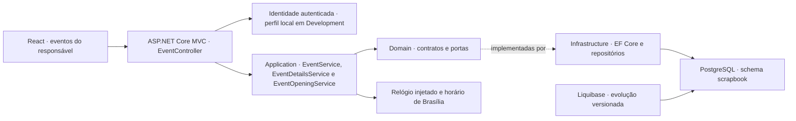

# Especificação técnica de eventos e política de abertura

## 1. Visão técnica

A F03 permite que cada responsável crie, consulte e edite os eventos aos quais está vinculado. O serviço calcula a janela de envio em horário de Brasília e decide quando as lembranças podem ser acessadas. A primeira história entrega criação e listagem com capa e mensagem padrão, usando PostgreSQL local e contas sintéticas. As histórias seguintes completam a edição, a mensagem personalizada e as transições da política de abertura. [PRD §6](../PRD.md#6-funcionalidades) · [Aceite da F03](../PRD.md#9-critérios-de-aceitação)

### Escopo e contratos

| Limite | Contrato |
| --- | --- |
| Entradas | Identidade da conta resolvida pelo backend, nome, data e horário civil, preferência de boas-vindas, modo/data de abertura e versão esperada nas alterações. Na criação, o cliente mantém uma chave por tentativa lógica. |
| Entrega local | Listagem por vínculo, criação com o primeiro responsável, detalhe, edição estrutural, capa padrão, boas-vindas padrão ou personalizadas, política de abertura, registro durável das alterações de política e estado de acesso sem dados de lembranças. |
| Saídas para outras features | Identificador interno e código público estável, nome, capa padrão, mensagem e prazos para F05. Vínculos e trava estrutural para F04 e F09. Estado temporal e política vigente para F11. Data, modo, versão da política e vínculos para F12. Alteração de política com autoria e correlação para F13. |
| Dependências | Base de dados F01 no Liquibase. API, UI e composição local conforme a F01. A dependência de identidade de F02 fica satisfeita em laboratório com contas sintéticas e um mecanismo de identidade exclusivo de Development. |
| Entregas posteriores | F02 conecta contas e sessões reais. A personalização de capa fica adiada por decisão do responsável. A definição de formatos, tamanho e proporção fica para a entrega correspondente. F04 entrega convites, F05 publica QR e página de contribuição, F09 aplica a trava estrutural após confirmação, F11 entrega a galeria e F12 encaminha os avisos. |

### Regras de negócio

1. **Responsabilidade.** Cada conta pode criar vários eventos. A criação grava o evento e o vínculo do criador no slot 1 na mesma transação. Até dois vínculos são possíveis e ambos têm a mesma autoridade. Consultas, alterações e decisões de acesso usam o vínculo do solicitante. O identificador do criador serve à rastreabilidade.
2. **Configuração.** O nome contém de 1 a 120 caracteres e a mensagem personalizada até 2.000. Contar caracteres Unicode de forma compatível com o PostgreSQL. Remover espaços externos e tratar os dois valores como texto simples. A mensagem padrão é “Seja bem-vindo! Compartilhe uma lembrança deste evento.” A capa é o asset padrão da aplicação. A data e o horário são civis em `America/Sao_Paulo`.
3. **Janela de envio.** Se o evento inicia no dia D, a recepção de novos envios abre duas horas antes do início e fecha às 12h de D+1. Uma tentativa já admitida conserva a tolerância até as 13h de D+1. A F03 calcula e persiste os três marcos. F05 e F08 consomem os valores e aplicam, respectivamente, a janela pública e a admissão/conclusão do envio.
4. **Sugestão futura.** O modo padrão é `scheduled`. A sugestão é a data civil do evento mais um ano calendário, com 29/02 ajustado para 28/02. A data escolhida deve ser posterior ao dia corrente em Brasília e sua meia-noite deve ser posterior ao fechamento de novos envios. Uma sugestão incompatível exige outra data antes de salvar. O modo `immediate` usa data de abertura nula.
5. **Trava estrutural.** Quando `locked_at` tiver sido aplicado pela F09, nome, capa, boas-vindas, data e horário ficam protegidos. A política de abertura continua seguindo as transições abaixo. A meta de aplicação da trava pela F09 é de até cinco segundos em condições normais após a primeira confirmação. A UI comunica o bloqueio da edição sem expor o registro que o motivou. [Compatibilização PRD/HLD](../guidelines/README.md#compatibilização-entre-prd-e-hld)
6. **Acesso às lembranças.** A cada pedido, verificar vínculo e política vigente antes de consultar conteúdo. No modo futuro, a liberação começa exatamente às 00h de Brasília da data escolhida. O agendador de e-mail segue o fluxo da F12. Enquanto fechado, a área de lembranças recebe a data de abertura e referência de tempo para a contagem regressiva. Conteúdo, miniaturas, contagens, remetentes e autorizações de mídia ficam protegidos.

#### Transições da abertura

| Estado efetivo | Ações admitidas | Efeito |
| --- | --- | --- |
| `flexible` antes das 12h de D+1 | Alternar entre `immediate` e `scheduled` e definir uma data futura válida. | Uma mudança efetiva incrementa `access_version` e registra auditoria. |
| `scheduled_locked` a partir das 12h em modo futuro | Consultar a configuração. Alterar o modo ou a data da abertura é recusado. | Preservar modo, data e marco da trava. |
| `immediate_once` a partir das 12h em modo imediato | Permanecer em imediato ou aceitar uma única mudança para futuro com data válida. | A mudança congela imediatamente modo e data em `scheduled_locked` e passa a negar novos acessos antes da data. |

A leitura calcula a trava efetiva pelo relógio mesmo quando ainda estiver persistida como `flexible`. Ao editar data ou horário, primeiro avaliar a trava com a janela anteriormente persistida e só depois calcular os novos prazos. Uma trava efetiva permanece com seu marco original. Se a nova janela tornar a abertura futura configurada incompatível, a edição é recusada e a política é preservada. Se a janela nova já terminou e a antiga ainda estava flexível, materializar o estado correspondente na mesma escrita. As 13h são apenas o limite de conclusão de tentativas admitidas.

### Fluxo da interface

- **Meus eventos.** Mostrar somente eventos vinculados, com carregamento, vazio, erro, expiração e paginação. A criação conduz ao detalhe do evento. [S09](../design-system/screens/S09.md) · [S10](../design-system/screens/S10.md)
- **Criar.** Informar nome e data/hora de Brasília, mostrar capa e mensagem padrão e sugerir abertura em um ano. Na primeira história, o modo é futuro e o responsável pode ajustar a data sugerida. Ao completar a F03, a criação oferece também o modo imediato e a mensagem personalizada. Uma resposta perdida mantém a tentativa e sua chave para recuperar o resultado. [S10](../design-system/screens/S10.md)
- **Configurar.** Salvar informações e política de abertura em formulários separados. Preservar rascunho em caso de conflito, carregar a versão atual e exigir novo envio consciente. Na transição única pós-fechamento, explicar que a data ficará travada e solicitar confirmação pela interface. [S11](../design-system/screens/S11.md)
- **Abertura bloqueada.** Fornecer o estado para a tela fechada e a contagem regressiva. Quando F11 estiver integrada, uma mudança para bloqueio interrompe consultas e reprodução, e a UI limpa os dados sob seu controle. URLs já emitidas continuam limitadas pelo vencimento original de até dois minutos. [S28](../design-system/screens/S28.md) · [Navegação e acessibilidade](../design-system/navigation-accessibility.md)

## 2. Impacto na arquitetura



- `scrapbook-ui` implementa rotas do responsável e componentes das telas S09, S10 e S11. Hooks chamam a API e preservam estado local de formulário. O backend é a autoridade para permissões e datas.
- `scrapbook-service` usa os projetos Api, Application, Infrastructure, Domain e UnitTests da F01. Controllers e autenticação ficam em Api. Services em Application decidem autorização, calendário, transições e efeitos de auditoria. Domain abriga portas, contratos, persistência e exceptions. Infrastructure mapeia as entidades no `ScrapBookDbContext` scoped e executa as operações explícitas solicitadas pelas Services.
- `scrapbook-liquibase` controla alterações na base integrada. `scrapbook-tests` concentra a validação manual HTTP/PostgreSQL e Playwright. `scrapbook-infrastructure` fornece o ambiente local da F01 para a execução integrada. [Arquitetura da base](../F01-base-da-aplicacao-e-ambientes/spec.md#2-impacto-na-arquitetura) · [Guideline de backend](../guidelines/backend.md)

## 3. Decisões técnicas

| Decisão | Contrato | Implicação |
| --- | --- | --- |
| Identidade local | O adaptador de autenticação da F01 só opera em `Development` local, desabilitado por padrão. O laboratório provisiona contas sintéticas ativas e uma identidade de teste por sessão ou execução controlada. O backend resolve o ID interno da conta a partir do principal autenticado. | As Services recebem a mesma identidade interna que F02 fornecerá. Requisições anônimas continuam sem acesso. Usar duas contas vinculadas e uma terceira sem vínculo para verificar autorização. |
| Relógio e datas | Injetar `TimeProvider`. Converter o instante do servidor para `America/Sao_Paulo` ao comparar datas de negócio. Usar data/hora sem offset para marcos civis e UTC com offset para instantes técnicos. | O servidor decide bordas, inclusive ao obter o lock da linha após uma espera. Testes avançam o relógio sem mudar a hora do sistema. |
| Autorização e concorrência | Membro do evento e versão da linha são verificados nas escritas de estado. A Service coordena uma transação curta com leitura da linha para atualização, reavalia o estado efetivo e persiste alterações e efeitos duráveis juntos. | Ambas as sessões conseguem ler a mesma versão. Uma escrita baseada em versão anterior recebe conflito. A F09 deve respeitar o mesmo controle ao aplicar a trava. |
| Repetição de criação | Chave UUID v4 por tentativa e por conta criadora. Persistir hash da chave e da entrada canônica junto ao evento. Uma repetição autorizada com a mesma entrada recupera o evento existente, inclusive após edição posterior. O par fica retido enquanto existir o evento. | Duplo envio ou perda da resposta preserva um evento e um vínculo. Chave reutilizada com entrada diferente retorna conflito. |
| Auditoria e F12 | Alteração aceita de modo ou data grava uma entrada em `audit_entries` na mesma transação. O incremento de `access_version` identifica uma nova política para a F12. | Falha no registro de auditoria reverte a mudança. A F12 revalida a versão ao encaminhar o aviso. A abertura por data funciona no laboratório sem serviço externo. |

A base documental integrada vem de `scrapbook-docs/dev` em `b45b319`. O modelo executável de referência está em `scrapbook-liquibase/dev` em `1adeced`. Os repositórios de API, UI, testes e infraestrutura ainda estão na base mínima consultada. A primeira história precisa dos pontos de composição, execução local e identidade de desenvolvimento definidos na F01. As branches das histórias nascem de `dev` atualizado.

### Rastreabilidade com o PRD

| Fonte | Aplicação na spec |
| --- | --- |
| PRD §6 F03, capacidades e experiência | Configuração, papéis de responsável, capa padrão, boas-vindas, janela e transições nas seções 1 e 5. A decisão posterior adia a capa personalizada e preserva o restante do escopo. |
| PRD §8, dependência de F02 | A identidade de laboratório permite desenvolver a F03 localmente. Autenticação e sessões reais integram depois, pela F02. |
| PRD §9 F03 e integrações | Cenários de aceite e verificações com F04, F05, F09, F11, F12 e F13 na seção 7. |
| HLD e compatibilização | Trava estrutural eventual, controle de URLs já emitidas e abertura por data independente do aviso. |

## 4. Componentes previstos

| Local | Mudança | Responsabilidade |
| --- | --- | --- |
| `scrapbook-service/ScrapBook.Api/Controllers/EventController.cs` | Criar | Rotas MVC, ligação de entrada, resposta e propagação de cancelamento. |
| `scrapbook-service/ScrapBook.Api/ExceptionHandlers/GlobalExceptionHandler.cs` | Estender | Converter exceptions específicas em Problem Details seguros. |
| `scrapbook-service/ScrapBook.Application/Services/EventService.cs` | Criar | Listar, consultar, criar com vínculo e repetição segura, editar detalhes e aplicar autorização. |
| `scrapbook-service/ScrapBook.Application/Services/EventOpeningService.cs` | Criar | Avaliar acesso temporal, calcular transições, versionar a política e decidir auditoria. |
| `scrapbook-service/ScrapBook.Domain/{Interfaces,Requests,Responses,Entities,Exceptions}/` | Estender | Portas e contratos de eventos, persistência de evento/vínculo/auditoria e falhas tipadas. Uma declaração por arquivo. |
| `scrapbook-service/ScrapBook.Infrastructure/{Repositories,Configurations,Persistence}/` | Estender | Mapear catálogo e implementar consulta por vínculo, gravação explícita e transações com um contexto scoped. |
| `scrapbook-ui/src/{pages,routes,services,features,assets}/` | Estender | Páginas de lista, criação e configuração, cliente HTTP, estado da feature e asset padrão. |
| `scrapbook-liquibase/changelogs/` | Estender | Evoluir a base inicial para registrar idempotência da criação e validar o rollback da mudança. |
| `scrapbook-infrastructure/` | Estender a fundação local | Documentar composição e credenciais sintéticas para executar a história no ambiente isolado de desenvolvimento. |

## 5. Contratos de API

Todos os recursos usam `/api/v1`, identificadores e versões como strings decimais, JSON em `camelCase` com validação estrita e enum textual em `snake_case`. Campos extra, propriedades duplicadas, comentários, vírgula final e mais de 16 níveis de objetos/arrays são recusados. Limitar o corpo JSON a 16 KiB nos três comandos. A identidade vem da autenticação do servidor. Aplicar proteção de origem/CSRF às escritas e `Cache-Control: no-store` às respostas protegidas. Emitir `X-Correlation-Id` validado ou gerado. Usar um orçamento curto e configurável por operação, propagando cancelamento. [API](../guidelines/api.md) · [Observabilidade](../guidelines/observabilidade.md)

| Método e rota | `operationId` | Acesso e entrada | Sucesso |
| --- | --- | --- | --- |
| `GET /api/v1/events` | `listEvents` | Conta autenticada. `cursor` opcional e `pageSize` de 1 a 50, padrão 20. Itens vêm do vínculo e são ordenados por ID decrescente. Cursor opaco vinculado à conta e à ordenação. | `200`, `items` e `nextCursor` nulo ao fim. Cada item contém `id`, `name`, `startsAt` e capa padrão. |
| `POST /api/v1/events` | `createEvent` | Conta autenticada. `Idempotency-Key` obrigatório, contendo UUID v4. Corpo de criação abaixo. | `201` e `Location` no detalhe. Replay após commit retorna `200` com o mesmo ID e a representação autorizada atual. |
| `GET /api/v1/events/{eventId}` | `getEvent` | Conta autenticada e vinculada. `eventId` é bigint positivo em string decimal. | `200` com representação, estado efetivo e controles de edição. |
| `GET /api/v1/events/{eventId}/opening-status` | `getEventOpeningStatus` | Conta autenticada e vinculada. Reconsultar política e vínculo a cada pedido. | `200` com estado, data de abertura e referência UTC, sem cache. |
| `PUT /api/v1/events/{eventId}/details` | `replaceEventDetails` | Conta vinculada. `name`, `startsAt`, `welcomeMessage` nula ou texto e `expectedVersion` obrigatórios. | `200` com configuração e prazos vigentes. Com versão válida e sem trava estrutural, um envio sem mudanças preserva a versão. |
| `PUT /api/v1/events/{eventId}/opening-policy` | `replaceEventOpeningPolicy` | Conta vinculada. `mode`, `opensOn` nula ou data e `expectedVersion` obrigatórios. | `200` com política efetiva. Uma solicitação sem mudança de modo/data e com versão válida preserva a versão da política e a trilha. |

### Campos e exemplos

| Campo | Tipo | Uso e validação |
| --- | --- | --- |
| `name` | string | Obrigatório na criação e edição de detalhes. De 1 a 120 caracteres úteis. |
| `startsAt` | string | Obrigatório na criação e edição de detalhes. ISO local `YYYY-MM-DDTHH:mm:ss` em Brasília. Recusar fuso/offset e datas sem cálculo válido dos marcos. |
| `welcomeMessage` | string ou nulo | Omissão na criação ou valor nulo usa a mensagem padrão. Texto informado precisa ter 1 a 2.000 caracteres úteis. Na edição, nulo restaura a mensagem padrão. |
| `openingPolicy` | objeto opcional | Na criação, contém `mode` e `opensOn`. Quando omitido, usar `scheduled` e validar a sugestão de um ano. |
| `mode` | enum | `immediate` ou `scheduled`. Obrigatório quando o objeto é enviado e no PUT de política. |
| `opensOn` | string ou nulo | Data civil `YYYY-MM-DD` em scheduled, nulo em immediate. Na criação em scheduled, ausência ou nulo aciona a sugestão. Na edição em scheduled, exigir data explícita. |
| `expectedVersion` | string decimal | Versão não negativa do último detalhe consultado. Verificar dentro da transação. |

Pedido de criação com configuração padrão.

```json
{
  "name": "Festa no jardim",
  "startsAt": "2027-10-15T16:00:00"
}
```

Representação de detalhe após criação.

```json
{
  "id": "101",
  "version": "0",
  "name": "Festa no jardim",
  "startsAt": "2027-10-15T16:00:00",
  "timeZone": "America/Sao_Paulo",
  "cover": { "kind": "default" },
  "welcomeMessage": "Seja bem-vindo! Compartilhe uma lembrança deste evento.",
  "usesDefaultWelcomeMessage": true,
  "submissionOpensAt": "2027-10-15T14:00:00",
  "submissionClosesAt": "2027-10-16T12:00:00",
  "completionDeadlineAt": "2027-10-16T13:00:00",
  "openingPolicy": {
    "mode": "scheduled",
    "opensOn": "2028-10-15",
    "state": "flexible",
    "contentState": "closed",
    "canEdit": true
  },
  "canEditDetails": true,
  "serverTime": "2027-10-15T15:00:00Z"
}
```

`cover.kind` é `default` nesta entrega. `usesDefaultWelcomeMessage` indica que o texto apresentado é o padrão e permite ao formulário reenviar `welcomeMessage: null`. `openingPolicy.state` aceita `flexible`, `scheduled_locked` e `immediate_once`. `contentState` aceita `closed` e `open`. `serverTime` é um instante UTC usado no contador. A interface trata `canEdit` e `canEditDetails` como a permissão do snapshot exibido. Uma escrita sempre revalida essa permissão.

### Tratamento de erros

| HTTP e código | Condição | Comportamento e feedback |
| --- | --- | --- |
| `400 REQUEST_VALIDATION_FAILED` | Campo, JSON, chave, versão/cursor no formato errado, ou data futura incompatível. | Erros por campo. “Confira os campos destacados antes de salvar.” Para abertura inválida, “Escolha uma data futura depois do encerramento dos envios.” |
| `401 IDENTITY_AUTHENTICATION_REQUIRED` | Identidade ausente ou sessão expirada. | Retirar configuração protegida da UI e apresentar o estado de sessão indisponível. |
| `404 RESOURCE_NOT_FOUND` | Evento inexistente ou conta sem vínculo. | “Evento indisponível para esta conta.” O mesmo contrato protege ambos os casos. |
| `409 EVENT_LOCKED` | Tentativa de editar dados estruturais após trava. | “As informações deste evento estão travadas.” |
| `409 EVENT_OPENING_LOCKED` | Mudança de data ou modo fora das transições permitidas. | “A data de abertura deste evento está travada.” |
| `409 EVENT_VERSION_CONFLICT` | Outra escrita venceu com versão mais recente. | Preservar rascunho, carregar estado atual e exigir nova decisão. |
| `409 IDEMPOTENCY_KEY_REUSED` | Chave da conta já aplicada com entrada canônica diferente. | Preservar o evento existente e oferecer consulta da tentativa original. |
| `413 REQUEST_TOO_LARGE`, `415 UNSUPPORTED_MEDIA_TYPE` | Limite de corpo ou tipo de entrada incompatível. | Aplicar o catálogo da API e preservar o formulário. |
| `500 UNEXPECTED_ERROR`, `503 DEPENDENCY_UNAVAILABLE` | Falha interna ou indisponibilidade reconhecida. | Mensagem segura com correlação. Em criação com resultado incerto, manter a chave da tentativa. |

### Estado de abertura e autorização da galeria

A rota de estado usa a mesma regra do detalhe e retorna exclusivamente `contentState`, `opensOn`, `opensAt` e `serverTime`. A data civil `opensOn` é usada para exibição. `opensAt` é o instante UTC equivalente à abertura da data em Brasília. Em modo imediato, os dois campos de data são nulos. `serverTime` é o instante UTC da decisão. A resposta protegida usa `Cache-Control: no-store`.

A área de lembranças usa tempo monotônico ancorado no `serverTime`. Ao terminar o contador, a interface consulta a rota novamente e aguarda a confirmação do servidor. Ao trocar de evento, restaurar a página ou receber um aviso local de mudança de política, a interface cancela consultas pendentes e descarta o estado antigo. A página visível também reconsulta periodicamente. Quando a F02 oferecer troca de conta na mesma página, a sessão será parte da chave de montagem da área e da invalidação das consultas.

A F11 deve resolver a conta e revalidar vínculo e política antes de consultar registros da galeria, metadados, reprodução ou emitir/renovar URLs. A consulta de estado feita pelo cliente serve à interface e a autorização é repetida em cada rota da galeria. Usar um escopo consistente entre autorização e leitura, com o evento vinculado como limite. Para evento inexistente ou sem vínculo, devolver `404 RESOURCE_NOT_FOUND`. Para evento vinculado ainda fechado, devolver `403 EVENT_CONTENT_LOCKED` antes do acesso aos registros. A interface da F11 deve cancelar leituras, interromper reprodução e limpar conteúdo e URLs sob seu controle no bloqueio ou ao mudar o escopo. Respeitar a validade residual já aprovada das URLs emitidas.

Telemetria usa nome da operação, resultado, duração e correlação. Dados pessoais, payload, chaves de idempotência, códigos públicos utilizáveis e URLs privadas ficam fora dos logs.

## 6. Modelo de dados

Reusar o schema `scrapbook` da F01. O catálogo segue sob Liquibase. PostgreSQL mantém chaves, integridade e operações atômicas. Regras de associação, calendário, transições, versionamento de mudanças e auditoria são decididas pelas Services.

| Estrutura | Colunas e invariantes da F03 | Índices e uso |
| --- | --- | --- |
| `events` | PK bigint identity, `events_creator_accounts_id` obrigatório, `code varchar(43)` único gerado no servidor com 32 bytes aleatórios em Base64url. `name varchar(120)` obrigatório e `welcome_message varchar(2000)` nula para padrão. `events_covers_id` fica nulo na entrega atual. | `uq_events_code` sustenta o contrato futuro da página pública. FK de criador e FK composta da capa ficam conforme o baseline. |
| `events`, calendário e estado | `starts_at`, `submission_opens_at`, `submission_closes_at`, `completion_deadline_at` e `opens_at` em timestamp civil. Usar `opening_mode`, `access_state`, `access_frozen_at`, `access_version` e `version`. A F09 usa `locked_at`, `first_record_id` e `first_record_confirmed_at` para a trava estrutural. | Usar `ix_events_opening` para consumidores de políticas agendadas. A versão da linha muda quando uma escrita altera seu estado. A versão da política avança quando modo/data mudam. |
| `event_members` | PK bigint identity. FKs de evento e conta. Slot 1 ou 2. Unicidade por evento/slot e evento/conta. | Listar e autorizar por `ix_event_members_account_events` e pelas restrições de escopo. |
| `audit_entries` | Para alteração de política, área `events`, ator `account` e vínculo de conta/evento, instante UTC, correlação e ação `event.opening.changed`. Guardar modo, data e versão em `before_state` e `after_state`. Retenção de 180 dias. | Reusar os índices de área, evento e retenção. A identidade da aplicação só insere auditoria. |
| `accounts`, `covers` e `opening_dispatches` | Contas sintéticas locais respeitam a FK do baseline. Capa padrão usa referência nula. A F12 consome a política no futuro e controla suas obrigações de aviso. | Preservar as tabelas e restrições da F01. |

### Evolução para repetição segura

Adicionar a `events` o par `creation_key_hash` e `creation_payload_hash`, ambos `bytea` de 32 bytes quando presentes. Registros preexistentes continuam com o par nulo. Um CHECK exige os dois valores juntos, e um índice único parcial em `(events_creator_accounts_id, creation_key_hash)` fecha a disputa entre tentativas. O fingerprint SHA-256 representa a versão canônica dos campos aceitos na criação, incluindo os defaults determinísticos. A mesma entrada mantém o fingerprint mesmo após editar o evento ou avançar o relógio. Autorizar um replay antes de retornar o resultado.

Gravar evento, par de hashes e primeiro vínculo na mesma transação. Em disputa, resolver a unicidade da chave sem produzir segundo evento e comparar o fingerprint gravado após a transação vencedora ficar visível. Tratar colisão no código público de forma separada da repetição do comando.

Publicar a mudança como novo changeset com guarda de geração do catálogo, checkpoint e SQL de reversão explícito. Ensaiar instalação/reaplicação e reversão sem tentativas registradas em banco descartável. Se o rollback descartaria chaves de eventos já criados, recusar a reversão e preservar a capacidade de recuperar essas tentativas. [Modelo vigente da F01](../F01-base-da-aplicacao-e-ambientes/dev-db/modelo-vigente.md) · [Liquibase](../guidelines/liquibase.md) · [SQL](../guidelines/sql.md)

## 7. Estratégia de testes

| Arquivo planejado | Casos | Evidência esperada |
| --- | --- | --- |
| `scrapbook-service/ScrapBook.UnitTests/Services/EventServiceTests.cs` | `CreatesEventAndCreatorMembership`, `ListsOnlyMemberships`, `RejectsStructuralWriteAfterLock`, `RecoversIdenticalCreateRequest` | Regra do primeiro vínculo, isolamento por conta, stale version/trava e semântica de replay. |
| `scrapbook-service/ScrapBook.UnitTests/Services/EventOpeningServiceTests.cs` | `SuggestsFebruary28ForLeapDay`, `FreezesAtNoon`, `PermitsOnePostClosureTransition`, `KeepsFreezeWhenDateMoves`, `OpensAtBrasiliaMidnight` | Relógio controlado, bordas inclusivas/exclusivas, data inválida, no-op, versão, trilha e ausência de dependência de aviso. |
| `scrapbook-ui/src/features/events/` | `showsServerConflictWithoutLosingDraft`, `keepsCreationKeyUntilOutcomeIsKnown`, `rendersLockedInformationSeparatelyFromOpening` | Vitest e Testing Library cobrem comportamento regional, feedback acessível e ausência de sobrescrita silenciosa. |
| `scrapbook-liquibase/tests/` | Instalação, reaplicação, unicidade concorrente e rollback da extensão | Base íntegra com eventos preexistentes, rollback vazio e recusa com dados de replay. |
| `scrapbook-tests/` | Aceite HTTP/PostgreSQL e Playwright acionados manualmente | Exercitar duas contas e dois vínculos, criação concorrente e transições em stack local real. Registrar evidência nas subpastas da feature conforme a etapa. |

### Aceite e integração

| Cenário | Resultado observável |
| --- | --- |
| CA1 · Criar e administrar | Dois eventos da mesma conta permanecem independentes. Cada evento criado tem exatamente um vínculo inicial. Uma conta sem vínculo recebe o mesmo `404` de um ID ausente. Uma conta já vinculada ao slot 2 tem as mesmas permissões. Capa padrão e mensagens padrão/personalizada aparecem conforme a configuração. |
| CA2 · Data e janela | A criação sugere um ano após o evento, incluindo 29/02. Recusa data inválida, do dia corrente, passada ou incompatível com a janela. Testar início às 00h, virada de dia e fim de ano em horário de Brasília. |
| CA3 · Transições e concorrência | Confirmar 11:59:59, 12:00 e 13:00 de D+1 em ambos os modos. Permitir uma transição pós-fechamento de imediato para futuro. Mudar a data do evento preserva trava efetiva. Duas sessões com a mesma versão produzem um vencedor. |
| CA4 · Privacidade da abertura | Um instante antes de 00h a área fechada informa data e contador, sem metadados de recebimento. Às 00h o responsável vinculado passa no controle mesmo com avisos indisponíveis. Após mudar para futuro, a autorização recusa nova leitura e nova URL até a liberação. |
| Integração com F04 e F05 | Um segundo vínculo só é aceito para o evento correto com vaga e sem trava estrutural ao integrar F04. F05 recebe configuração atual e os três marcos, com código estável e capa padrão após alterações permitidas. |
| Integração com F09 e F11 | Simular primeiro registro aplicado em laboratório para provar recusa da edição estrutural. Medir a meta eventual quando F08/F09 estiverem integradas. Em F11, testar lista, detalhe e renovação, com defesa contra troca de conta/evento e queries iniciadas antes da mudança para bloqueio. |
| Integração com F12 e F13 | Uma alteração de política emite a trilha com a mesma correlação e deixa a política antiga obsoleta. A F12 verifica a versão antes de encaminhar aviso. O teste local prova a trilha e a autorização por data, e a execução integrada prova o encaminhamento. |

Validar separadamente a operação com identidade local desabilitada e a recusa da configuração de desenvolvimento em outros ambientes. Exercitar layout e teclado nas telas de responsável. A validação pela identidade real e a entrega de notificações dependem das histórias de integração correspondentes. [Plano de implementação](plan.md)
