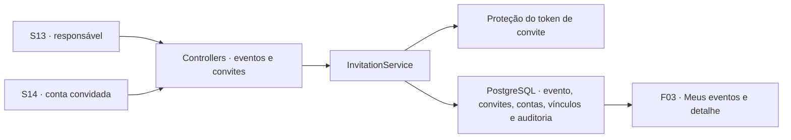

# Especificação técnica do convite do segundo responsável

## 1. Visão técnica

A F04 permite que o único responsável de um evento elegível gere um convite de 24 horas e compartilhe o endereço por QR code. Uma conta diferente, ativa e com e-mail confirmado pode aceitar o convite uma única vez. O aceite cria o vínculo no slot 2 e permite que a conta consulte e administre o mesmo evento pelas permissões já usadas na F03. [Requisitos e aceite da F04](../PRD.md#f04-convite-do-segundo-responsável)

### Escopo e contratos entre features

| Integração | Contrato |
| --- | --- |
| F03 → F04 | Identificador do evento, vínculos atuais, slot disponível e trava estrutural persistida. A F04 reutiliza a mesma linha de evento para serializar suas escritas com as edições da F03. |
| F04 → F03 | Novo vínculo persistido no slot 2, com as mesmas permissões de administração. A conta passa a encontrar o evento em “Meus eventos”. |
| F02 → F04 | Identidade autenticada, conta ativa e e-mail confirmado no aceite. No Docker, usar a identidade explícita de Development e contas sintéticas com os mesmos campos de persistência. A integração com F02 cobre entrar, criar conta, confirmar e retomar a intenção de aceitar. |
| F04 → F12 | Convite identificável pelo evento, ID, validade e endereço recuperável sob autorização enquanto pendente. Na F12, o pedido explícito acrescenta o destinatário informado e a chave da solicitação de envio. O contrato é descrito na seção 5. |
| F09 → F04 | Ao persistir a trava estrutural, a F09 deverá invalidar o convite pendente e limpar o segredo recuperável na mesma transação. A F04 já recusa emissão e aceite quando a trava está persistida. |

O recorte local entrega geração, reexibição, substituição, cópia e leitura de QR, consulta de validade e aceite. O aceite via login real pertence à integração com a F02. O pedido e o encaminhamento por e-mail pertencem à F12. O QR dos convidados da F05 segue sua própria rota e sua finalidade de participação.

### Regras de negócio

1. A emissão exige conta ativa e vinculada, exatamente um responsável e evento estruturalmente editável. Conta sem vínculo recebe a mesma resposta de evento inexistente. A janela de envio de contribuições e a abertura das lembranças seguem regras próprias.
2. Quando a tela mostra um convite pendente, a substituição exige confirmação explícita. Uma emissão concluída invalida o pendente anterior e cria um convite novo. Emissões concorrentes com chaves distintas são serializadas. A última concluída é a única vigente. O novo prazo começa no instante da emissão. Um pendente vencido é tratado como expirado antes da substituição.
3. O intervalo de aceite é `createdAt <= agora < expiresAt`, com `expiresAt = createdAt + 24h` em UTC. O servidor avalia a validade depois de obter os locks necessários. O relógio do navegador serve apenas para exibição. Mostrar a validade em horário de Brasília.
4. O aceite revalida a conta, a posse do token, os vínculos, o prazo e a trava persistida. Só uma conta diferente do responsável atual ocupa o slot 2. Dois aceites concorrentes resultam em um único vínculo. O emissor não consome o convite ao abrir ou inspecionar seu próprio QR.
5. O resultado de um aceite já confirmado pode ser recuperado pela mesma conta ativa, confirmada e ainda vinculada. Esse retorno não altera convite, vínculo ou auditoria, inclusive se o prazo tiver passado ou a trava tiver sido aplicada depois do aceite. Outra conta recebe “Este convite já foi usado.” A confirmação inicial sempre passa pelas regras de elegibilidade.
6. Convite expirado, substituído, invalidado, usado ou bloqueado não cria vínculo. Quando o evento estiver travado, a ação fica indisponível com mensagem neutra sobre a trava. Nenhuma resposta inclui motivo da trava ligado a lembranças, conteúdo, remetentes ou contagens.

### Fluxos de interface

- **S13.** “Convidar responsável” parte do detalhe do evento. Exibe as condições de elegibilidade. Após gerar, mostra QR, endereço copiável e vencimento. Pode reexibir um convite pendente válido após recarregar. Para “Substituir convite”, informar que o link anterior deixa de funcionar e pedir confirmação. Com duas vagas ocupadas ou evento travado, mostrar o motivo e ocultar a ação de geração.
- **S14.** A pessoa abre o endereço do convite e, após identificação válida, vê o nome do evento e “Aceitar convite”. A abertura da página e a consulta do contexto não consomem o convite. O aceite confirmado leva ao detalhe do evento. Em estados terminais, informar o motivo e oferecer retorno sem criar vínculo.
- **Sessão.** Sem identidade, S14 apresenta orientação genérica. Na stack local, o ensaio usa um contexto de navegador com a identidade sintética do destinatário. Na integração F02, entrar ou criar conta retoma a intenção de aceite com uma referência temporária vinculada ao fluxo de autenticação.
- **Acessibilidade.** S13 e S14 operam por teclado, com foco visível e feedback anunciado para carregamento, cópia, falha e sucesso. O QR tem nome acessível e endereço selecionável para cópia manual. Em 320 px, título, validade, mensagens e controles ficam legíveis sem rolagem horizontal. [S13](../design-system/screens/S13.md) · [S14](../design-system/screens/S14.md)

## 2. Impacto na arquitetura



- A UI React/TypeScript mantém telas e cliente HTTP no escopo da feature de eventos. Reutilizar geração de matriz, QR acessível e Clipboard da F05. A origem usa a mesma configuração canônica do frontend. Preservar as rotas públicas e os fluxos da F05.
- A API .NET obtém a conta da autenticação atual, valida origem e formato HTTP, propaga `CancellationToken` e registra correlação. O `GlobalExceptionHandler` traduz falhas de produto e infraestrutura em Problem Details sanitizados.
- `InvitationService` decide elegibilidade, precedência de estados, replay e efeitos de auditoria. Domain define portas, contratos e entidades. Infrastructure usa o `ScrapBookDbContext` existente e operações explícitas de consulta/persistência. O repositório não executa callbacks de negócio.
- As escritas usam uma única transação PostgreSQL. Emissão bloqueia a linha do evento antes do convite. Prévia e aceite leem a conta com lock compartilhado antes de resolver o token, bloqueiam o evento e então releem e bloqueiam o convite. A validação dos vínculos ocorre depois desses locks. Substituição, aceite e a futura trava da F09 compartilham a ordem evento → convite. A criação do vínculo, a marcação de uso, a limpeza do segredo recuperável e a auditoria são atômicas.
- A stack Compose usa PostgreSQL e chaves locais, com identidades sintéticas para pelo menos três contas confirmadas e uma não confirmada nos cenários de autorização e disputa. Liquibase já criou as estruturas necessárias. [API](../guidelines/api.md) · [Backend](../guidelines/backend.md) · [Modelo de concorrência](../db/DB-Modelagem.md#evento-responsáveis-e-convites)

## 3. Decisões técnicas

| Decisão | Abordagem | Consequência |
| --- | --- | --- |
| Endereço de convite | Usar `/convites/aceitar#<token>` com origem canônica da interface. Em ambiente local, permitir a origem loopback conforme a F05. | O fragmento não vai na solicitação inicial ao hosting. O frontend lê o token, retira o fragmento com `history.replaceState` e conserva o valor em memória. Recarregar a página antes do aceite exige reabrir o link original. |
| Segurança do token | Gerar 32 bytes aleatórios no servidor. Usar `v1.<id-da-chave-de-hash>.<segredo-base64url>` com segredo de 43 caracteres e ID de até 64 caracteres em `[A-Za-z0-9_-]`. Persistir HMAC-SHA-256 do token completo e cifrar o segredo recuperável com AES-GCM. Usar chaves independentes de 32 bytes. | O HMAC permite consulta indexada. O conteúdo cifrado permite reexibição do mesmo QR pela conta autorizada. Vincular a cifra ao evento e à operação de emissão com dados autenticados e usar nonce único. |
| Gestão de chaves | Uma chave de emissão ativa por finalidade e ambiente, identificada por ID. Conservar as anteriores necessárias à validação e à reexibição. Compartilhar o conjunto autorizado entre réplicas de um mesmo ambiente. | As chaves locais atendem ao Docker. A configuração presente deve ser completa e válida na inicialização. Sem configuração, as operações de convites retornam `503` e a API continua disponível para os fluxos existentes. A publicação precisa prover as chaves isoladas previstas no HLD. |
| Repetição e substituição | Emissão usa `Idempotency-Key` UUID v4 por tentativa e revalida o emissor antes de recuperar o convite. O mesmo comando recupera o convite pendente válido. Uma chave que identifica convite terminal devolve o estado terminal. | A resposta perdida não estende o prazo. Só uma nova intenção de emissão pode substituir um convite e criar outro prazo. Leitura corrente permite recuperar QR após recarregar. |
| Prévia de aceite | Autenticar e verificar a conta antes de consultar contexto usando POST JSON. A interface sem sessão apresenta orientação genérica. | A API evita expor estados do convite antes de identificar a conta. GET da página, prévias de mensageiros e leitura do QR não geram efeitos no evento. |
| Auditoria | Gravar emissão e aceite efetivo com IDs internos, ação, instante e correlação. Substituição registra a transição do convite anterior na mesma transação. | Falha em escritura de auditoria reverte a operação. Telemetria usa templates fixos e dimensões de baixa cardinalidade. Token, link completo, ciphertext, e-mail e conteúdo do evento ficam fora dos logs, da auditoria e dos exemplos com dados reais. |

As respostas da F04 preservam `Cache-Control: no-store`. Aplicar `Referrer-Policy: no-referrer` e `X-Robots-Tag: noindex, nofollow` à página de aceite no Nginx local e no artefato publicado. Evitar token em path/query de API, estado persistido no navegador, logs de corpo, mensagens de erro e telemetria. Para a integração F02, a retomada usa estado protegido e de uso único, pelo prazo definido no contrato de autenticação.

### Premissas e rastreabilidade

- A base observada em `dev` é `ab11a1a` no serviço, `423682f` na UI, `6842126` em testes, `f5d1632` no Liquibase, `c1b8c9f` na infraestrutura e `b626de8` na documentação. A pendência de publicação da F05 em `hlg` não impede validar o recorte local.
- Os requisitos do PRD definem validade, uso único, capacidade e concorrência. A seção de experiência e o design system orientam as telas. Os estados da seção de erros do PRD mapeiam os Problem Details da seção 5. O aceite e as integrações da seção 9 do PRD mapeiam os cenários da seção 7.
- A rota com fragmento, a prévia autenticada, a recuperação do QR após recarregar e a fronteira de escopo das duas telas são decisões desta spec. A confirmação de e-mail vem da persistência de contas. A intenção de envio por e-mail terá sua própria implementação na F12. [PRD](../PRD.md#f04-convite-do-segundo-responsável) · [HLD](../HLD.md)

## 4. Componentes

| Arquivo | Alteração e responsabilidade |
| --- | --- |
| `scrapbook-service/ScrapBook.Api/Controllers/EventController.cs` e `scrapbook-service/ScrapBook.Api/Controllers/InvitationController.cs` | Consulta corrente e emissão reutilizam o controller da F03. A story de aceite adiciona as rotas de prévia e aceite. Os controllers extraem identidade e correlação e aplicam as políticas HTTP. |
| `scrapbook-service/ScrapBook.Api/ExceptionHandlers/GlobalExceptionHandler.cs` | Alterar. Vincula exceções específicas aos códigos da seção 5. |
| `scrapbook-service/ScrapBook.Api/Program.cs` | Alterar. Registra serviço, repositório e proteção do token. Reutiliza políticas de origem e CORS. |
| `scrapbook-service/ScrapBook.Application/Services/InvitationService.cs` e `scrapbook-service/ScrapBook.Application/Services/InvitationAcceptanceService.cs` | Regras de emissão, prévia e aceite. Os serviços coordenam transações, estados, replay e auditoria. |
| `scrapbook-service/ScrapBook.Domain/Interfaces/IInvitationRepository.cs` e `scrapbook-service/ScrapBook.Domain/Interfaces/IInvitationTokenCodec.cs` | Novos. Portas de persistência e proteção do token. |
| `scrapbook-service/ScrapBook.Domain/Entities/InvitationEntity.cs`, `scrapbook-service/ScrapBook.Domain/Requests/InvitationTokenRequest.cs` e `scrapbook-service/ScrapBook.Domain/Responses/InvitationStatusResponse.cs` | Novos. Entidade e contratos HTTP. Contratos adicionais de emissão, prévia e aceite seguem um tipo por arquivo. |
| `scrapbook-service/ScrapBook.Domain/Entities/AuditEntryEntity.cs` e `scrapbook-service/ScrapBook.Infrastructure/Repositories/EventWriteRepository.cs` | Permitir um ID explícito de recurso na auditoria e preservar o mapeamento das entradas da F03. O subject de convites é o ID do convite e a referência do evento fica no campo próprio. |
| `scrapbook-service/ScrapBook.Infrastructure/Repositories/InvitationRepository.cs` e `scrapbook-service/ScrapBook.Infrastructure/Configurations/InvitationConfiguration.cs` | Novos. Consultas, locks, alterações explícitas e mapeamento da tabela existente. |
| `scrapbook-service/ScrapBook.Infrastructure/Codecs/InvitationTokenCodec.cs` e `scrapbook-service/ScrapBook.Infrastructure/Persistence/ScrapBookDbContext.cs` | Adicionar codec e integrar o mapeamento ao contexto único. Usar primitivas criptográficas da plataforma .NET. |
| `scrapbook-ui/src/features/events/EventDetailsPage.tsx`, `scrapbook-ui/src/features/events/EventInvitationPage.tsx` e `scrapbook-ui/src/features/events/invitationService.ts` | Adicionar entrada para S13, interface de emissão e cliente HTTP. |
| `scrapbook-ui/src/features/events/AcceptInvitationPage.tsx` e `scrapbook-ui/src/routes/AppRoutes.tsx` | Adicionar S14 e as rotas `/meus-eventos/{eventId}/convidar` e `/convites/aceitar`. |
| `scrapbook-ui/src/utils/publicEventUrl.ts` e `scrapbook-ui/src/utils/invitationUrl.ts` | Reutilizar a validação de origem da F05 e compor a rota de convite. |
| `scrapbook-ui/nginx/default.conf` e `scrapbook-ui/.github/scripts/package_amplify.py` | Aplicar os headers do convite e manter as rotas existentes. |
| `scrapbook-infrastructure/compose.yaml`, `scrapbook-infrastructure/.env.example` e `scrapbook-infrastructure/scripts/create_local_env.py` | Documentar e mapear a proteção de convites. A inicialização local gera segredos somente em arquivo privado e preserva o `.env` existente. Incluir instrução para habilitar a F04 numa stack local já criada. |
| `scrapbook-liquibase/changelogs/sprint-1/sql/002-eventos.sql` e `scrapbook-liquibase/changelogs/sprint-1/sql/005-relacionamentos.sql` | Referência da estrutura existente. A entrega inicial usa as migrations aplicadas. |

## 5. Contratos de API

Todos os endpoints exigem uma conta autenticada e ativa. A consulta corrente e a emissão exigem vínculo. Prévia e aceite exigem e-mail confirmado e posse do token. Identificadores públicos de recursos autenticados são strings decimais. Corpos JSON usam camelCase, validação estrita e limite de 16 KiB. POST usa a política de origem já aplicada às escritas da F03. Emitir `X-Correlation-Id`, usar o tratamento central de erros e propagar cancelamento à persistência. As durações da API seguem os orçamentos e critérios do projeto.

| Método e rota | Operation ID | Entrada | Sucesso |
| --- | --- | --- | --- |
| `GET /api/v1/events/{eventId}/invitations/current` | `getCurrentEventInvitation` | `eventId` válido no path. | `200`. Estado `available`, `pending`, `locked` ou `full`. Somente `pending` traz o convite recuperável. |
| `POST /api/v1/events/{eventId}/invitations` | `createEventInvitation` | `eventId` no path, `Idempotency-Key` UUID v4 e objeto JSON vazio. A emissão substitui o pendente anterior se existir. | `201` com convite e `Location` da consulta corrente. Replay autorizado de convite ainda elegível retorna `200` com os mesmos valores. |
| `POST /api/v1/invitations/preview` | `previewEventInvitation` | Campo `token` string obrigatório em JSON. | `200` com nome do evento, estado `eligible` e prazo. Para o destinatário que já aceitou e segue autorizado, retorna `accepted` e `eventId`. |
| `POST /api/v1/invitations/accept` | `acceptEventInvitation` | Campo `token` string obrigatório em JSON. A identidade vem da sessão do servidor. | `200` com `eventId` e `state: accepted`, inclusive no replay autorizado. |

O corpo da emissão é `{}`. A resposta de consulta corrente a seguir representa um convite pendente. Na emissão, o objeto interno `invitation` é a representação da resposta. Nas demais situações da consulta corrente, `invitation` é `null`. O token abaixo é sintético.

```json
{
  "state": "pending",
  "invitation": {
    "id": "93",
    "token": "v1.local_01.AAAAAAAAAAAAAAAAAAAAAAAAAAAAAAAAAAAAAAAAAAA",
    "expiresAt": "2032-02-29T20:00:00Z"
  }
}
```

Prévia e aceite usam o mesmo corpo.

```json
{
  "token": "v1.local_01.AAAAAAAAAAAAAAAAAAAAAAAAAAAAAAAAAAAAAAAAAAA"
}
```

Resposta de prévia elegível. Na prévia de convite já aceito pela mesma conta, retornar `state` e `eventId`, como na resposta de aceite.

```json
{
  "state": "eligible",
  "eventName": "Celebração",
  "expiresAt": "2032-02-29T20:00:00Z"
}
```

```json
{
  "state": "accepted",
  "eventId": "42"
}
```

### Erros e precedência

| HTTP | Código | Condição e feedback |
| --- | --- | --- |
| `400` | `REQUEST_VALIDATION_FAILED` | Estrutura JSON, campo ausente ou tipo incorreto, identificador administrativo ou chave de idempotência inválidos. |
| `401` | `IDENTITY_AUTHENTICATION_REQUIRED` | Identidade ausente, expirada ou conta sem condição de autenticação ativa. |
| `403` | `REQUEST_ORIGIN_REJECTED` | Origem recusada nas operações POST. |
| `403` | `INVITATION_ACCOUNT_UNCONFIRMED` | Conta autenticada sem e-mail confirmado na prévia ou no aceite. Orientar confirmação do e-mail. |
| `404` | `RESOURCE_NOT_FOUND` | Evento ausente ou conta sem vínculo nas rotas administrativas. Token malformado, desconhecido ou de outro ambiente nas rotas de convite. Na S14, exibir “Este convite não está mais disponível. Solicite um novo.” |
| `409` | `INVITATION_UNAVAILABLE` | No aceite, expirado, substituído ou invalidado sem trava. Na reemissão, replay terminal. Exibir a mensagem de indisponibilidade do PRD. |
| `409` | `INVITATION_ALREADY_USED` | Convite aceito por outra conta. Exibir “Este convite já foi usado.” |
| `409` | `INVITATION_EVENT_FULL` | Evento com dois responsáveis em uma operação que exigiria um vínculo novo. Exibir “Este evento já tem dois responsáveis.” |
| `409` | `INVITATION_EVENT_LOCKED` | Evento estruturalmente travado. Exibir “Os convites deste evento estão travados.” |
| `409` | `INVITATION_ACCOUNT_ALREADY_LINKED` | Conta já vinculada tenta consumir convite ainda pendente. Orientar abertura dos próprios eventos. |
| `409` | `IDEMPOTENCY_KEY_REUSED` | A chave de emissão daquele evento pertence a outro emissor. Nenhum segredo é devolvido. |
| `503` | `DEPENDENCY_UNAVAILABLE` | PostgreSQL ou material criptográfico indisponível. Orientar repetição segura com a mesma chave ou o mesmo token. |

Após autenticação, confirmação de e-mail e resolução do token, convite aceito tem precedência para distinguir replay autorizado de uso por outra conta. Para estados ainda não aceitos, verificar trava, estado terminal ou prazo, disponibilidade do slot e vínculo repetido, nessa ordem. Usar o catálogo da API para falhas comuns de mídia, tamanho e falhas internas. A consulta corrente prioriza trava sobre lotação e pendência.

### Contrato futuro de e-mail

A F12 recebe uma intenção autenticada com `eventId`, `invitationId`, destinatário e chave de idempotência do pedido. Antes de preparar a notificação, resolve o endereço e `expiresAt` pelo identificador e revalida vínculo e convite pendente. Antes do encaminhamento, revalida a versão do convite. Os envelopes de mensageria carregam referências. A falha de encaminhamento preserva o QR e a validade da emissão já concluída. [Notificações](../db/DB-Modelagem.md#notificações-e-auditoria)

## 6. Modelo de dados

O schema é `scrapbook`. Os tipos e constraints a seguir já existem em Liquibase. A duração de 24 horas é regra do Service. A constraint física verifica que a expiração é posterior à criação e que o aceite é anterior à expiração.

| Colunas de `invitations` | Tipo e nulabilidade | Uso |
| --- | --- | --- |
| `id` | `bigint` identity, obrigatório | Identificador interno/administrativo. |
| `created_at`, `updated_at` | `timestamptz`, obrigatórios | Instantes persistidos em UTC, com timestamps coerentes na transação. |
| `version` | `bigint`, obrigatório, padrão 0 | Controle monotônico das transições. |
| `invitations_events_id`, `invitations_issuer_event_members_id` | `bigint`, obrigatórios | Evento e vínculo emissor no próprio evento. |
| `invitations_recipient_accounts_id` | `bigint`, anulável | Destinatário efetivo, preenchido somente no aceite. |
| `request_key` | `uuid`, obrigatório | Identidade da emissão por evento. |
| `hash_key_id`, `token_hash` | `varchar(64)`, `bytea`, obrigatórios | Chave de consulta com hash de 32 bytes. |
| `encryption_key_id`, `token_ciphertext` | `varchar(64)`, `bytea`, anuláveis | Envelope recuperável obrigatório enquanto pendente. Limpar ambos nas transições terminais. |
| `state` | `varchar(24)`, obrigatório | `pending`, `accepted`, `superseded`, `invalidated` ou `expired`. |
| `expires_at`, `accepted_at`, `invalidated_at` | `timestamptz`. Somente `expires_at` é obrigatório. | Prazo e marcos terminais. |

| Estrutura existente | Garantia |
| --- | --- |
| `pk_invitations_id` e `uq_invitations_event_scope` | Identidade e referência no escopo do evento. |
| `uq_invitations_request` e `uq_invitations_token_hash` | Uma operação por evento/chave. Localização única do hash no conjunto da chave. |
| `uq_invitations_active` | Índice único parcial por evento onde `state = 'pending'`. Ao emitir, materializar o vencimento e limpar o ciphertext pendente antigo antes de inserir. |
| `ix_invitations_expires_at`, `ix_invitations_issuer` e `ix_invitations_recipient` | Acesso por prazo e suporte a referências. O relógio da aplicação decide a validade mesmo sem transição materializada. |
| FKs e checks de convite | Emissor do próprio evento. Destinatário e `accepted_at` são obrigatórios só no estado aceito. Hash, lifetime e presença de ciphertext pendente obedecem aos checks existentes. |
| `event_members` | IDs `bigint`, slot `smallint` limitado a 1 ou 2, `joined_at timestamptz`. Unicidade de evento/slot e evento/conta. |
| `accounts` | Leitura da conta pelo ID `bigint`, `state varchar(32)` e `email_verified boolean`. Os dados de perfil ficam fora das respostas de convite. |
| `audit_entries` | Política append-only com ator, evento, ID do convite, ação, correlação e estados mínimos. Usar a retenção existente de 180 dias. |

Estados terminais nunca voltam a pendente. A leitura do pendente avalia o prazo sem escrita. Na próxima operação que encerra ou substitui o convite, persistir a transição e remover o ciphertext. Um convite vencido sem nova operação fica cifrado e indisponível para leitura até o saneamento. O hash e os metadados permitem distinguir as respostas históricas autorizadas. O fluxo de recuperação de chaves, se necessário, não repõe segredos de convites encerrados. [Modelo físico](../db/DB-Modelo-Fisico.md#eventsinvitations) · [Modelo de estados](../db/DB-Modelagem.md)

## 7. Estratégia de testes

| Nível e arquivo proposto | Cenários a verificar |
| --- | --- |
| Unitário · `scrapbook-service/ScrapBook.UnitTests/Services/InvitationServiceTests.cs` | `ReplaysPendingInvitationWithoutExtendingExpiryAsync`, `RejectsAtExactExpirationAsync`, `RejectsLockedOrFullEventAsync`, `RequiresConfirmedAccountToAcceptAsync`, `RecoversAcceptedResultForTheSameLinkedAccountAsync`. Relógio controlado e cancelamento preservado. |
| Unitário · `scrapbook-ui/src/features/events/EventInvitationPage.test.tsx` e `scrapbook-ui/src/features/events/AcceptInvitationPage.test.tsx` | `confirma antes de substituir`, `oferece cópia manual quando o clipboard falha`, `só aceita após ação explícita`, `mostra o estado terminal da API` e `retira o fragmento da URL após leitura`. |
| HTTP/PostgreSQL · `scrapbook-tests/invitation_stack.py` | `verify_invitation_rotation`, `verify_concurrent_acceptance`, `verify_acceptance_rolls_back_on_audit_failure`, `verify_structural_lock_race`, `verify_same_account_replay`. Conferir que vínculo, convite e auditoria convergem com a transação. |
| E2E · `scrapbook-tests/invitations/invitation.spec.ts` | Responsável gera o QR. Uma conta sintética distinta lê o link e confirma. O evento aparece em “Meus eventos” com acesso equivalente. Exercitar cópia, teclado, falha de prévia e bordas da validade. Decodificar o QR com o decodificador já usado pela F05. |
| Segurança, desempenho e regressão | Confirmar 401 anônimo, 404 uniforme de vínculo, recusa da conta não confirmada, origem e isolamento de ambientes, ausência de segredo em logs e validação da origem canônica. Medir concorrência de emissão e aceite e a latência da operação na stack Docker conforme o perfil definido na validação. Reexecutar jornadas F03 e F05 afetadas. |

### Aceite rastreado ao PRD

| Critério | Evidência esperada |
| --- | --- |
| F04 · Convite válido | QR de S13 abre S14. Conta confirmada aceita de forma explícita, obtém a vaga e passa a acessar o mesmo evento via F03. |
| F04 · Prazo, substituição e uso único | Checar um instante anterior à expiração e o instante exato da borda. Gerar outro convite e provar que o anterior falha. Após uso, outra conta é recusada. |
| F04 e F03 → F04 · Trava e concorrência | Ausência de terceiro vínculo em corrida. Convite pendente é recusado com trava persistida ou sem vaga. No teste local, a fixture pode persistir a trava que a F09 fornecerá. |
| F04 → F12 · Pedido de e-mail | Na integração F12, verificar destinatário, endereço e validade do convite correspondente. Simular falha de encaminhamento e conferir que o QR vigente funciona. O aceite local desta entrega cobre a validade e a resolução identificada do convite. |
| F02 → F04 · Sessão real | Na integração F02, abrir como pessoa sem sessão, entrar ou cadastrar e confirmar, retomar o mesmo convite e aceitar. Verificar a autorização em sessão expirada e após logout. |

Guardar evidências nas subpastas de etapa da F04. Distinguir o resultado com contas sintéticas do aceite com F02 e F12 e da implantação efetiva em homologação.
