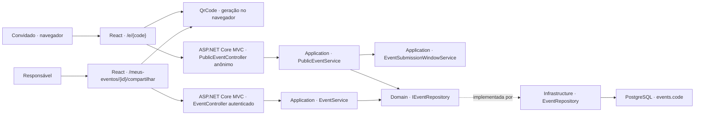

# Especificação técnica da página pública, QR code e prazos

## 1. Visão técnica

A F05 publica a página dos convidados de cada evento e entrega aos responsáveis o link e o QR code que levam a ela. A página abre sem conta, mostra nome, capa, data e boas-vindas e informa se os envios ainda não abriram, estão abertos ou terminaram. O servidor calcula o estado da janela em horário de Brasília a partir dos marcos já persistidos pela F03. A F05 fornece o ponto de entrada e o contrato de janela que F06, F07 e F08 consomem. [PRD §6](../PRD.md#6-funcionalidades) · [Aceite da F05](../PRD.md#9-critérios-de-aceitação)

### Escopo e contratos

| Limite | Contrato |
| --- | --- |
| Entradas | Código público do evento na URL, sem identidade. Para o responsável, identidade autenticada e `eventId` vinculado. Nome, capa, boas-vindas, início e marcos da janela vêm da F03. |
| Entrega | Consulta pública por código, estado da janela calculado no servidor, página dos convidados nos estados `before`, `open` e `closed`, consulta do link pelo responsável, tela de compartilhamento com cópia do link, QR code em PNG e SVG, versão de impressão e QR na página dos convidados. |
| Saídas para outras features | Contexto público identificado pelo código, com nome, capa e boas-vindas, para F06. Janela de contribuição com estado, abertura, encerramento de novos envios, limite de conclusão e próxima transição para F07 e F08. Regra de janela no servidor, reutilizável pela admissão da F08. Destinos de ingresso `/e/{code}/depoimento` e `/e/{code}/momento`. |
| Dependências | F03 integrada em `dev`: `events.code` gerado na criação, com `uq_events_code` e CHECK de formato, e os três marcos da janela persistidos. Base F01 de API, UI, Compose, headers de segurança e observabilidade. A F05 reutiliza o schema vigente. A validação local da área do responsável usa a identidade de Development. O aceite com sessões reais depende da F02. |
| Entregas posteriores | F06 implementa identificação e concordância. F07 implementa os destinos de ingresso. F08 admite e conclui envios com a mesma regra de janela. A capa personalizada segue a decisão adiada na F03. A calibração do WAF segue a F01 com o perfil de tráfego registrado aqui. |

### Regras de negócio

1. **Página única por evento.** Cada evento tem exatamente uma página pública, identificada por `events.code`: 43 caracteres Base64url derivados de 32 bytes aleatórios, gerados pela F03 na criação e imutáveis. O link canônico é `{origem pública da UI}/e/{code}`. O QR dos convidados codifica exatamente esse link, sem parâmetros extras, e é distinto do convite a responsável da F04. O identificador interno do evento nunca aparece na superfície pública. [DB-Modelagem P-03](../db/DB-Modelagem.md)
2. **Acesso sem conta.** A consulta pública não exige sessão nem senha adicional. O código permite ler os dados públicos e iniciar a participação. Ele não dá acesso a lembranças, contagens, remetentes, responsáveis, política de abertura ou estado de travamento.
3. **Dados públicos.** A resposta contém nome, capa, boas-vindas, data e horário de início e a janela. A mensagem personalizada é texto simples. Sem ela, vale a mensagem padrão da F03. A capa é o asset padrão até a entrega da capa personalizada.
4. **Janela de novos envios.** Para início no dia D às H, `opensAt` é H menos 2 horas e pode cair em D-1. `closesAt` é D+1 às 12h e `completionDeadlineAt` é D+1 às 13h. Os três marcos são civis em `America/Sao_Paulo` e persistidos pela F03. O estado é `before` antes de `opensAt`, `open` de `opensAt` inclusive até antes de `closesAt` e `closed` a partir de `closesAt` inclusive. O limite de conclusão não altera o estado da página e só vale para tentativas já admitidas pela F08.
5. **Relógio do servidor.** O servidor converte o instante atual para Brasília pelo banco de fusos (`TimeProvider` e `TimeZoneInfo`), sem offset fixo, compara com os marcos e informa a próxima transição como instante UTC. A interface só antecipa a exibição da transição e confirma com o servidor. A F08 aplica a admissão com a mesma regra no instante em que recebe o pedido.
6. **Alterações da F03.** Nome, boas-vindas e horário editados antes da trava estrutural aparecem na próxima consulta pública. Uma mudança de horário recalcula os marcos na F03, e a página reflete os novos valores ao reconsultar. Link e QR continuam válidos porque o código não muda.
7. **Sem rastreio de leitura.** Não registrar acessos por evento ou código nem contar leituras do QR. [Rastreabilidade da modelagem](../db/DB-Modelagem.md#rastreabilidade-funcional)

### Fluxo da interface

- **Compartilhar.** Na configuração do evento, a ação “Compartilhar com convidados” abre `/meus-eventos/{eventId}/compartilhar`. A tela usa o detalhe autenticado da F03 para obter o nome do evento e a consulta de compartilhamento para obter o código. Mostra o nome do evento, o link completo em campo somente leitura, “Copiar link”, a prévia do QR, “Baixar PNG”, “Baixar SVG” e “Imprimir”. A cópia usa a Clipboard API e anuncia “Link copiado.”. Se a cópia falhar, a tela seleciona o campo e orienta a cópia manual. A impressão usa folha de estilo própria: fundo branco, nome do evento, QR com pelo menos 6 cm de lado e link em texto, sem navegação nem botões. [S15](../design-system/screens/S15.md)
- **Página dos convidados.** `/e/{code}` usa o shell `guest`, sem a navegação de “Meus eventos”. Mostra capa, nome como título principal, data e horário do evento, boas-vindas e o bloco da janela. Em `open`, mostra “Deixe um depoimento” e “Registre um momento”. A entrega inicial apresenta essas ações desabilitadas e informa “A participação estará disponível em breve.” A integração da F07 ativa os links para os destinos de ingresso. A página e o QR podem ser validados com eventos de teste antes dessa integração. Em `before`, informa “Novos envios ainda não estão disponíveis.” e “Os envios abrem em {dd/mm/aaaa} às {hh:mm} (horário de Brasília).”, sem as ações. Em `closed`, informa “O prazo para novos envios terminou.” e não oferece as ações. Em todos os estados, a seção “Compartilhar com outro convidado” mostra o QR do próprio link. A rota considera somente o caminho e ignora a query string acrescentada por mensageiros. [S16](../design-system/screens/S16.md)
- **Link inválido e falhas.** Código malformado ou inexistente mostra “Evento indisponível.”, sem pistas sobre outros eventos. Código malformado não chega a chamar a API. Falha de rede, `429`, `5xx` ou resposta não JSON mostra “Serviço temporariamente indisponível. Tente novamente em instantes.” com “Tentar novamente”, sem retentativa automática imediata. [S35](../design-system/screens/S35.md)
- **Transições com a página aberta.** A interface ancora o tempo em `serverTime` com relógio monotônico. Ao atingir `nextTransitionAt` rumo a `closed`, retira as ações imediatamente. Rumo a `open`, mostra as ações somente depois da confirmação do servidor. Se a atualização falhar, mantém as ações indisponíveis até obter uma nova resposta válida. Nos dois casos, reconsulta com atraso aleatório de até 2 segundos. A interface também reconsulta quando a página volta a ficar visível e a cada 5 minutos enquanto visível. Nenhum temporizador ultrapassa o intervalo de reconsulta, o que evita estouro com aberturas distantes. A mudança de estado é anunciada em região `aria-live` educada.

## 2. Impacto na arquitetura



- `scrapbook-ui` recebe a rota pública e o shell `guest`, a feature `public-event`, a tela de compartilhamento na feature `events` e o componente global `QrCode`, usado pelas duas features. Também recebe um utilitário puro de URL pública, a configuração `VITE_PUBLIC_SITE_ORIGIN` e o header `X-Robots-Tag` para `/e/`.
- `scrapbook-service` recebe `PublicEventController` anônimo em Api. `PublicEventService` e `EventSubmissionWindowService` ficam em Application, e `EventService` ganha a consulta do link. Domain recebe responses, exception e o novo método da porta. Infrastructure implementa a busca por código sem rastreamento.
- `scrapbook-liquibase` não muda. A busca usa `uq_events_code`, e `ck_events_name` já garante o formato do código.
- `scrapbook-tests` recebe a stack pública com relógio por fixture, cenários Playwright de compartilhamento, QR e estados, leitura do QR baixado e carga da consulta pública. `scrapbook-infrastructure` documenta `VITE_PUBLIC_SITE_ORIGIN` por ambiente e o perfil de tráfego para o WAF. [Arquitetura da F03](../F03-eventos-e-politica-de-abertura/spec.md#2-impacto-na-arquitetura) · [Guideline de frontend](../guidelines/frontend.md)

## 3. Decisões técnicas

| Decisão | Contrato | Implicação |
| --- | --- | --- |
| Rotas curtas | UI em `/e/{code}`. API em `GET /api/v1/public-events/{code}`. | O caminho curto reduz o conteúdo codificado. Selecionar a versão do QR pela capacidade necessária para a URL completa. [Tabela de capacidades da DENSO WAVE](https://www.qrcode.com/en/about/version.html) |
| Origem do link | A UI compõe `{VITE_PUBLIC_SITE_ORIGIN}/e/{code}`. A variável é obrigatória e HTTPS em builds publicados. Em Development local, a ausência usa `window.location.origin`. O backend devolve somente o código. | Evita QR apontando para um alias, como o domínio padrão do Amplify, ou para outro ambiente. Os códigos diferem por ambiente porque os bancos são isolados, então o QR do piloto deve sair da produção. |
| Link do responsável em rota própria | `GET /api/v1/events/{eventId}/public-link` exige vínculo. `EventResponse` não ganha o código. | O código não circula nas respostas de criação, edição e listagem nem nos rascunhos de formulário. |
| QR gerado no navegador | Biblioteca MIT sem dependências transitivas, com `qrcode-generator` como proposta, encapsulada em `lib/qrCodeMatrix.ts`. A história registra versão exata, origem, licença e avisos. Usar correção M, zona de silêncio de 4 módulos e preto sobre branco independente do tema. SVG inline na prévia, PNG de pelo menos 1024 px desenhado em canvas com escala inteira e SVG para gráficas. | Não há chamada ao servidor, QR armazenado nem mudança de CSP, pois `img-src 'self' data:` já atende. O contrato do componente é a matriz gerada a partir do link canônico. [Guia de impressão da DENSO WAVE](https://www.qrcode.com/en/howto/generate.html) |
| Resposta pública sem cache | `Cache-Control: no-store`, sem cache de negócio. URLs com código não passam por caches compartilhados. | Edições da F03 e transições aparecem na consulta seguinte. O custo é uma leitura por chave única. |
| `404` uniforme | Código malformado responde `404` sem acessar o banco. Código inexistente responde o mesmo `404`. | As duas falhas apresentam o mesmo status, código e mensagem. A correlação acompanha cada requisição. |
| Privacidade da superfície | `Referrer-Policy: no-referrer` da F01, `X-Robots-Tag: noindex, nofollow` nas respostas de `/e/`, logs com a rota nominal `api/v1/public-events/{code}` e exceptions sem o código. | O link compartilhado não vaza por Referer, indexação ou telemetria. Pré-visualização rica do link em mensageiros fica fora do escopo. |
| Proteção de entrada | Usar o WAF da F01. Simular 100 convidados atrás de um IP, com carga inicial, reconsultas periódicas, retorno à aba e mudanças na janela. Medir picos em homologação antes de ativar bloqueios. | O perfil inclui o Wi-Fi compartilhado no evento. |

A base consultada é `scrapbook-docs/dev` em `c014668`, `scrapbook-service/dev` em `d5f940e`, `scrapbook-ui/dev` em `b56a764`, `scrapbook-tests/dev` em `822778b` e `scrapbook-liquibase/dev` em `f5d1632`. O código público já é gerado em `EventService.CreateAsync`, com até três tentativas em colisão. As branches das histórias nascem de `dev` atualizado. As ações desabilitadas antes da F07 são uma premissa de entrega incremental. Na versão integrada da jornada, as duas ações ficam utilizáveis durante a janela.

### Riscos e pendências

| Risco ou pendência | Mitigação | Contingência |
| --- | --- | --- |
| QR impresso com origem ou ambiente errado | Origem obrigatória nos builds publicados, link completo visível na tela e leitura do QR impresso antes da tiragem. | Reimprimir a partir da produção. |
| Falha de leitura do impresso | Correção M, zona de silêncio, tamanho mínimo, alto contraste e teste em Android e iPhone. | Compartilhar o link por mensagem. |
| Link divulgado fora do evento | O código não dá leitura. `noindex`, `no-referrer`, código fora dos logs e WAF. | A primeira versão não prevê rotação do código. Se ocorrer, a decisão é de produto, porque rotacionar invalida QRs impressos. |
| Convidados no mesmo IP limitados no edge | Perfil registrado para o WAF e atraso aleatório nas transições. | Ajustar a regra no edge. |
| Download de arquivo no Safari iOS | Testar no iPhone da matriz. | Usar a impressão direta. |
| Domínio definitivo (Q04) | O desenvolvimento local usa a origem local. | Bloqueia apenas a impressão do QR do piloto. |
| Textos novos | “Compartilhar com convidados”, “Link copiado.”, a orientação de cópia manual, “Compartilhar com outro convidado” e “A participação estará disponível em breve.” são propostas. | Revisar com o design antes do aceite. |

### Rastreabilidade com o PRD

| Fonte | Aplicação na spec |
| --- | --- |
| PRD §6 F05, capacidades e experiência | Regras 1 a 7 e fluxo da interface na seção 1. |
| PRD §9 F05 e integrações F03 → F05, F05 → F06, F05 → F07 e F05 → F08 | Cenários de aceite e integração na seção 7. |
| HLD, interfaces públicas | Página pública externa sem login e sem listagem de lembranças, com janela verificada pelo servidor. |
| DB-Modelagem P-03 e FR-005 | Código de 43 caracteres separado da PK e QR derivado, sem registro de leitura. |
| Design system S15, S16 e S35 | Estados `default`, `loading`, `error`, `print`, `before`, `closed` e `not-found`. |

## 4. Componentes previstos

| Local | Mudança | Responsabilidade |
| --- | --- | --- |
| `scrapbook-service/ScrapBook.Api/Controllers/PublicEventController.cs` | Criar | Rota anônima, `Cache-Control: no-store` e propagação de cancelamento. |
| `scrapbook-service/ScrapBook.Api/Controllers/EventController.cs` | Estender | `getEventPublicLink` com identidade e vínculo. |
| `scrapbook-service/ScrapBook.Api/ExceptionHandlers/GlobalExceptionHandler.cs` | Estender | Converter `PublicEventNotFoundException` em `404 RESOURCE_NOT_FOUND` com “Evento indisponível.”. |
| `scrapbook-service/ScrapBook.Application/Services/EventSubmissionWindowService.cs` | Criar | Converter o instante para Brasília e decidir estado e próxima transição. A F08 reutiliza para a admissão. |
| `scrapbook-service/ScrapBook.Application/Services/PublicEventService.cs` | Criar | Validar o formato do código, consultar por código e montar a resposta com os campos permitidos. |
| `scrapbook-service/ScrapBook.Application/Services/EventService.cs` | Estender | Consultar o link do evento vinculado. |
| `scrapbook-service/ScrapBook.Domain/Responses/{PublicEventResponse,PublicEventWindowResponse,EventPublicLinkResponse}.cs` | Criar | Contratos das duas rotas. Uma declaração por arquivo. |
| `scrapbook-service/ScrapBook.Domain/Exceptions/PublicEventNotFoundException.cs` | Criar | Falha específica, sem o código na mensagem. |
| `scrapbook-service/ScrapBook.Domain/Interfaces/IEventRepository.cs`, `scrapbook-service/ScrapBook.Infrastructure/Repositories/EventRepository.cs` | Estender | `FindByCodeAsync` sem rastreamento, com comparação ordinal pelo índice único. |
| `scrapbook-ui/src/routes/AppRoutes.tsx`, `scrapbook-ui/src/App.tsx`, `scrapbook-ui/src/layouts/` | Estender | Rotas `/e/{code}` e `/meus-eventos/{id}/compartilhar`. Shell `guest` sem a navegação do responsável. |
| `scrapbook-ui/src/features/public-event/` | Criar | Página, serviço, hook da janela com reconsulta e estados. |
| `scrapbook-ui/src/features/events/{ShareEventPage.tsx,eventService.ts,EventDetailsPage.tsx}` | Criar e estender | Tela de compartilhamento, consulta do link e acesso pela configuração. |
| `scrapbook-ui/src/components/QrCode.tsx`, `scrapbook-ui/src/lib/qrCodeMatrix.ts` | Criar | Componente compartilhado e adaptador da biblioteca: prévia SVG e arquivos PNG e SVG. |
| `scrapbook-ui/src/utils/publicEventUrl.ts`, `scrapbook-ui/src/config/environment.ts` | Criar e estender | Composição pura do link e origem pública validada. |
| `scrapbook-ui/src/assets/default-cover.jpg` | Mover | Capa padrão compartilhada pelas features `events` e `public-event`. |
| `scrapbook-ui/nginx/default.conf`, `scrapbook-ui/.github/scripts/package_amplify.py` | Estender | Aplicar `X-Robots-Tag` às rotas públicas no Nginx e no Amplify, inclusive no fallback da SPA. Preservar os demais headers de segurança. |
| `scrapbook-ui/.github/workflows/publish.yml`, `scrapbook-ui/.github/scripts/build_amplify.sh` | Estender | Passar a origem canônica da UI já configurada para o ambiente ao build publicado e validar a URL resultante. |
| `scrapbook-ui/package.json`, `scrapbook-ui/package-lock.json` | Estender | Biblioteca de QR com versão exata. |
| `scrapbook-tests/` | Estender | Stack pública, Playwright, decodificador de QR fixado e cenário de carga. |
| `scrapbook-infrastructure/` | Estender | Documentar `VITE_PUBLIC_SITE_ORIGIN` por ambiente e o perfil de tráfego. |

## 5. Contratos de API

As rotas usam o prefixo `/api/v1`, JSON em `camelCase`, enums textuais em `snake_case`, `X-Correlation-Id` validado ou gerado e Problem Details com `code` e `correlationId`. Adotar orçamento inicial de até 2 s na API, incluindo o banco, com cancelamento propagado. As duas rotas são `GET`, sem corpo, ignoram parâmetros de consulta e respondem com `Cache-Control: no-store`. [API](../guidelines/api.md) · [Observabilidade](../guidelines/observabilidade.md)

| Método e rota | `operationId` | Acesso e entrada | Sucesso |
| --- | --- | --- | --- |
| `GET /api/v1/public-events/{code}` | `getPublicEvent` | Anônimo. `code` com 43 caracteres `[A-Za-z0-9_-]`. Uma identidade presente é ignorada. | `200` com dados públicos e janela. |
| `GET /api/v1/events/{eventId}/public-link` | `getEventPublicLink` | Conta autenticada e vinculada. `eventId` segue a validação da F03. | `200` com `code`. |

### Campos e exemplos

Resposta pública antes da abertura, para início às 16h.

```json
{
  "name": "Festa no jardim",
  "startsAt": "2027-10-15T16:00:00",
  "timeZone": "America/Sao_Paulo",
  "cover": { "kind": "default" },
  "welcomeMessage": "Seja bem-vindo! Compartilhe uma lembrança deste evento.",
  "submissionWindow": {
    "state": "before",
    "opensAt": "2027-10-15T14:00:00",
    "closesAt": "2027-10-16T12:00:00",
    "completionDeadlineAt": "2027-10-16T13:00:00",
    "nextTransitionAt": "2027-10-15T17:00:00Z"
  },
  "serverTime": "2027-10-15T15:30:00Z"
}
```

| Campo | Tipo | Semântica |
| --- | --- | --- |
| `name` | string | Nome atual do evento, de 1 a 120 caracteres, em texto simples. |
| `startsAt` | string | Data e horário civil de início em Brasília, `YYYY-MM-DDTHH:mm:ss`. |
| `timeZone` | string | Sempre `America/Sao_Paulo`. |
| `cover.kind` | enum | `default` nesta entrega. A UI exibe a capa padrão para valores desconhecidos, o que mantém a compatibilidade com a capa personalizada. |
| `welcomeMessage` | string | Mensagem personalizada ou padrão. Texto simples, exibido com as quebras de linha preservadas e nunca como HTML. |
| `submissionWindow.state` | enum | `before`, `open` ou `closed`, decidido pelo servidor no instante `serverTime`. |
| `submissionWindow.opensAt`, `closesAt`, `completionDeadlineAt` | string | Marcos civis em Brasília, usados na exibição e por F07 e F08. |
| `submissionWindow.nextTransitionAt` | string ou nulo | Instante UTC da próxima mudança de estado: `opensAt` em `before`, `closesAt` em `open` e nulo em `closed`. |
| `serverTime` | string | Instante UTC da decisão, usado como âncora do relógio da interface. |

Ficam fora do contrato público o identificador interno, o próprio código (já presente na URL), versões, criador, responsáveis, política e estado de abertura, trava estrutural, contagens e qualquer dado de registro. Os testes verificam a lista exata de propriedades.

Resposta do link para o responsável.

```json
{ "code": "_lv5Uj97Qkq7kckeOtjXoY3jHviZqegNrKxNPEp8yXQ" }
```

### Tratamento de erros

| HTTP e código | Condição | Comportamento e feedback |
| --- | --- | --- |
| `404 RESOURCE_NOT_FOUND` | Código malformado ou inexistente na rota pública. | “Evento indisponível.” Mesmo código e mensagem nos dois casos. Código malformado não chega ao banco. |
| `401 IDENTITY_AUTHENTICATION_REQUIRED` | Rota do link sem identidade ou com sessão expirada. | Estado de sessão encerrada da F03. |
| `400 REQUEST_VALIDATION_FAILED` | Rota do link com `eventId` inválido. | Usar a validação e o Problem Details da F03. |
| `404 RESOURCE_NOT_FOUND` | Rota do link para evento inexistente ou sem vínculo. | “Evento indisponível para esta conta.” |
| `429` | Proteção de entrada no edge. O status basta para tratar respostas sem Problem Details. | “Serviço temporariamente indisponível. Tente novamente em instantes.” Respeitar `Retry-After` quando disponível ao navegador. |
| `500 UNEXPECTED_ERROR`, `503 DEPENDENCY_UNAVAILABLE` | Falha interna ou banco indisponível. | Mesma mensagem segura, com correlação e “Tentar novamente”. |

### Contrato de janela para F07 e F08

Na interface, as rotas de ingresso recebem o contexto público da página, formado pelo código da rota e pela resposta. Uma página recém-carregada em `before` ou `closed` não oferece ingresso, e a F07 aplica a mesma consulta antes de abrir a composição. No servidor, `EventSubmissionWindowService` decide o estado para um evento e um instante. A F08 resolve o evento pelo código e usa os marcos vigentes no instante em que o servidor recebe o pedido após “Enviar”. A tentativa admitida guarda a janela usada na decisão. O recebimento integral até `completionDeadlineAt` inclusive permite validar e confirmar depois. Recebimento integral posterior ao limite é recusado.

Telemetria usa as operações `events.public_page.get` e `events.public_link.get`, com rota nominal, status, duração, resultado e correlação. Código, nome do evento, boas-vindas, IP e User-Agent ficam fora dos logs e spans da aplicação. Validar também os caminhos e headers efetivamente coletados na hospedagem e na entrada da API. O Nginx já registra a UI como rota `spa` e a API como `/api`, sem o código. A métrica HTTP por rota nominal e status permite acompanhar `404` na rota pública como sinal de varredura, sem alerta nesta entrega. Os alertas pertencem à F13.

## 6. Modelo de dados

A F05 não cria changeset. Reusar o schema `scrapbook` mantido pelo Liquibase.

| Estrutura | Uso na F05 |
| --- | --- |
| `events.code varchar(43)`, `uq_events_code` e `ck_events_name` | Busca da página pública por igualdade no índice único. O CHECK garante o formato `^[A-Za-z0-9_-]{43}$`. O código não muda após a criação. |
| `events.name`, `welcome_message`, `starts_at`, `submission_opens_at`, `submission_closes_at`, `completion_deadline_at` | Leitura dos dados públicos e da janela. A escrita continua exclusiva da F03. |
| `events.events_covers_id` | Nulo nesta entrega, com capa padrão. |

A consulta pública lê somente as colunas necessárias, sem rastreamento e sem juntar vínculos, auditoria ou registros. Não criar tabela de QR, de leitura ou de acesso. [Modelo vigente da F01](../F01-base-da-aplicacao-e-ambientes/dev-db/modelo-vigente.md) · [SQL](../guidelines/sql.md)

## 7. Estratégia de testes

| Arquivo planejado | Casos | Evidência esperada |
| --- | --- | --- |
| `scrapbook-service/ScrapBook.UnitTests/Services/EventSubmissionWindowServiceTests.cs` | `IsBeforeJustBeforeOpening`, `OpensTwoHoursBeforeStart`, `StaysOpenJustBeforeNoon`, `ClosesAtNoonOfNextDay`, `OpensOnPreviousDayForEarlyStart`, `ClosesAcrossYearEnd`, `ReportsNextTransition` | Relógio controlado, bordas inclusivas e exclusivas e conversão por fuso sem offset fixo. |
| `scrapbook-service/ScrapBook.UnitTests/Services/PublicEventServiceTests.cs` | `RejectsMalformedCodeWithoutQuery`, `RejectsUnknownCode`, `ReturnsOnlyPublicFields`, `UsesDefaultWelcomeMessage`, `ReflectsEditedDetails` | `404` uniforme, lista de campos, mensagem padrão e ausência de consulta para código malformado. |
| `scrapbook-service/ScrapBook.UnitTests/Services/EventServiceTests.cs` | `ReturnsPublicLinkForMember`, `HidesPublicLinkFromNonMember` | Vínculo exigido e mesmo `404` da F03. |
| `scrapbook-service/ScrapBook.UnitTests/ExceptionHandlers/GlobalExceptionHandlerTests.cs` | `MapsPublicEventNotFound` | Problem Details seguro, sem o código do evento. |
| `scrapbook-ui/src/features/public-event/PublicEventPage.test.tsx` | `rendersBeforeWithoutActions`, `showsDisabledActionsUntilCompositionAvailable`, `rendersOpenActionsWithComposition`, `removesActionsAtClosingInstant`, `confirmsOpeningWithServer`, `showsUnavailableForUnknownLink`, `ignoresQueryStringInRoute` | Vitest com temporizadores falsos, anúncios acessíveis e ausência de campos privados. |
| `scrapbook-ui/src/features/events/ShareEventPage.test.tsx` | `copiesPublicLink`, `fallsBackToManualCopy`, `downloadsPngAndSvg`, `hidesControlsWhenPrinting` | Link composto pela origem configurada, feedback e downloads. |
| `scrapbook-ui/src/components/QrCode.test.tsx`, `scrapbook-ui/src/utils/publicEventUrl.test.ts` | Matriz determinística, zona de silêncio, nome acessível e origem obrigatória fora de Development | O conteúdo do QR é o link canônico. |
| `scrapbook-tests/` | HTTP/PostgreSQL e Playwright acionados manualmente, com o relógio controlado por `EventFixtureTimeProvider` | Bordas da janela, privacidade da resposta, `no-store`, `X-Robots-Tag`, decodificação do PNG baixado e contextos sem sessão. Registrar evidências nas subpastas da feature. |

### Aceite e integração

| Cenário | Resultado observável |
| --- | --- |
| CA1 · Link e QR | O responsável copia o link e baixa PNG e SVG. O conteúdo decodificado do QR é exatamente `{origem}/e/{code}`. Uma conta sem vínculo recebe `404`. O link aberto em contexto sem sessão leva à página do evento correto. |
| CA2 · Página sem conta | Sem cookies nem identidade, a página mostra nome, capa, data, boas-vindas e QR. A resposta contém somente os campos públicos e `no-store`, e `/e/{code}` responde com `X-Robots-Tag`. Resposta, HTML e logs não contêm lembranças, contagens, remetentes nem política de abertura. |
| CA3 · Janela em Brasília | Com relógio controlado e início às 16h: 13:59:59 em `before`, 14:00:00 em `open`, 11:59:59 de D+1 em `open` e 12:00:00 em `closed`. Início à 01:00 abre às 23:00 de D-1. Com a página aberta, as ações saem no fechamento previsto e a abertura só é exibida após a confirmação do servidor, sem recarregar manualmente. |
| CA4 · Link inválido | Código malformado, inexistente ou de outro ambiente mostra “Evento indisponível.”. No GET direto à API, os códigos malformados e desconhecidos recebem o mesmo `404`. |
| CA5 · Impressão e leitura | O QR impresso com pelo menos 6 cm é lido pela câmera nativa de Android e iPhone e abre a página correta. Registrar aparelho, sistema, navegador e resultado. |
| Integração F03 → F05 | Editar nome, boas-vindas e horário antes da trava atualiza a consulta pública seguinte e seus marcos. Link e QR continuam válidos. A capa padrão é verificável nesta entrega. Quando a F03 oferecer a capa personalizada, verificar a troca usando o mesmo link e QR. |
| Integração F05 → F06 | Páginas de dois eventos no mesmo navegador expõem códigos distintos como identidade do contexto. Com a F06 integrada, o nome e a concordância são recuperados apenas no evento correspondente. |
| Integração F05 → F07 | Em `before` e `closed`, a página fica sem ações de ingresso. Em `open`, a entrega inicial apresenta as ações desabilitadas com a mensagem temporária. Com a F07 integrada, as ações levam a `/e/{code}/depoimento` e `/e/{code}/momento` do mesmo evento. A entrada direta reconsulta a janela. |
| Integração F05 → F08 | A F08 usa `EventSubmissionWindowService` com o relógio do servidor. O teste confirma a recusa de novo pedido às 12h, a conclusão às 13h inclusive para tentativa admitida e a recusa após esse limite. Também verifica que uma edição anterior ao pedido é considerada na admissão e que uma edição posterior preserva a janela já admitida. |
| Desempenho | Medir desde a navegação com cache frio até capa, conteúdo e controles da janela estarem disponíveis, em até 3 segundos no perfil 4G documentado. Carregar os módulos de responsável sob demanda. Medir p95 de até 500 ms na consulta pública. Usar 200 convidados em dois eventos para o ensaio isolado da F05 e medir o perfil de 200 envios simultâneos com a F08 integrada. |

Validar teclado, leitor de tela, ampliação e contraste em S15 e S16, incluindo o nome acessível do QR e o link em texto ao lado. Exercitar a cópia com e sem a Clipboard API e o download no Safari iOS. O domínio definitivo é necessário antes de imprimir o QR do piloto, e os textos novos dependem da revisão de design listada nos riscos. Vincular o lançamento público à revisão de privacidade prevista no PRD. [Plano de implementação](plan.md)
