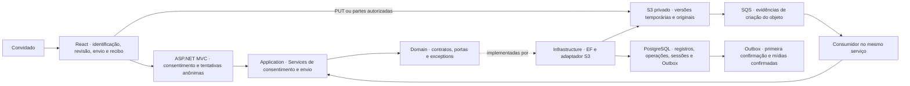

# Especificação técnica da F08 — Envio e confirmação

Proposta de implementação · 25/11/2026. [Plano](plan.md) · [PRD da F08](../PRD.md#f08-envio-e-confirmação-1) · [HLD](../HLD.md#fluxo-de-requisições-e-de-dados)

## 1. Visão técnica

A F08 recebe a contribuição revisada na F07 após a ação **Enviar**. A API verifica a janela da F05, a identificação e o aviso aceito na F06 e o conteúdo recebido. O convidado acompanha a tentativa e recebe um recibo genérico quando a contribuição estiver integralmente persistida.

### Escopo e contratos

| Integração | Contrato |
| --- | --- |
| F05 → F08 | Código público e os marcos civis de abertura, encerramento de novos envios e conclusão. A admissão usa os marcos persistidos do evento, com relógio do servidor. |
| F06 → F08 | Nome ou apelido confirmado e concordância com a versão vigente do aviso, vinculados no servidor ao evento. A F06 já tem interface e reutilização local. O aviso sintético pode ser usado em testes descartáveis. A ativação pública exige aviso aprovado e servido pela API. |
| F07 → F08 | Categoria e formato, corpo de texto ou manifesto ordenado de arquivos e legenda opcional. A revisão de texto e mídias está integrada em `dev` e `hlg`. |
| F08 → F09 | Fato durável da primeira confirmação, com identificadores internos do evento e registro e instante da confirmação. A F09 consome o fato e aplica a trava. |
| F08 → F10 | Um fato por arquivo de registro confirmado, com identificadores internos e referência resolvível à versão privada validada. A F10 prepara as variantes. |
| F08 → F11 | Registro integral com autoria, categoria, formato, corpo ou arquivos em ordem, legenda e instante de recebimento. A F11 autoriza a leitura conforme sua política. |
| F08 → F13 | Falha classificada por tentativa lógica, etapa, instante e correlação. As métricas usam dimensões de baixa cardinalidade, com a correlação técnica em evidência restrita. |

O primeiro incremento entrega depoimento em texto de ponta a ponta com API, UI e PostgreSQL local. Ele também valida admissão, confirmação e recuperação da mesma tentativa. O incremento de mídia acrescenta S3 privado, PUT, multipart, validação dos bytes e limpeza de temporários. A publicação dos efeitos assíncronos e o aceite do armazenamento real são tratados na etapa de integração correspondente.

### Regras de negócio

1. **Admissão.** Registrar o instante UTC no ingresso da requisição de criação da tentativa, antes da leitura do corpo. Aplicar `opensAt ≤ ingresso < closesAt` usando a janela civil persistida em `America/Sao_Paulo`, convertida com as regras de fuso existentes. Proteger a leitura e a persistência da janela contra edições concorrentes da F03. Fixar os três marcos na sessão. Descobrir o evento pelo código público. Seleção, gravação e identificação sozinhas não reservam a janela.
2. **Conclusão.** Somente tentativas admitidas podem concluir. Comparar a evidência de recebimento integral com `completionDeadlineAt` inclusivo, preservando a precisão da fonte. No texto, o backend observa o fim da leitura do corpo completo. Na mídia, usar o maior instante de recepção entre as versões aceitas de todos os arquivos esperados. Com recebimento integral tempestivo, validação, preservação do original e confirmação podem terminar depois do limite.
3. **Concordância.** O servidor aceita apenas nome presente e normalizado, aceitação explícita e prova válida do aviso no evento e nome informados. Uma nova tentativa usa a versão de aviso vigente na admissão. A prova atesta a ação de concordância do convidado e autoriza esse uso específico. Capturar seu instante no servidor. A UI reaproveita o nome e apresenta o aviso seguindo a F06. Alteração de nome ou aviso exige nova concordância.
4. **Idempotência e recuperação.** O navegador gera uma UUID de tentativa e um segredo independente de 32 bytes antes do primeiro POST. Mantém ambos e o conteúdo em memória enquanto a página os conservar. Uma operação autorizada com o mesmo evento, chave e conteúdo retorna o estado já persistido, inclusive após o fechamento. Conteúdo diferente com a mesma chave retorna conflito somente ao portador da credencial correta. Um resultado incerto é investigado com as mesmas credenciais. Uma nova tentativa lógica exige nova ação explícita.
5. **Validação.** Contar escalares Unicode como a F07. Conservar espaços e quebras do texto salvo, com quebras normalizadas em LF. Exigir texto com conteúdo após verificação de espaços em branco, recusar NUL e sequências Unicode malformadas. Aplicar a mesma contagem a nome e legenda. O nome tem até 120 escalares após aparar as bordas. Usar vetores compartilhados para espaços, emoji, caracteres combinantes, quebras e contagem.
6. **Confirmação integral.** O estado `confirmed` só é visível depois do commit do registro, da sessão e da operação. Para mídia, o commit exige todos os arquivos esperados válidos e cada original vinculado a uma versão privada preservada. Gravar a Outbox pertinente na mesma transação. Uma falha parcial ou rejeição de qualquer foto impede confirmar o conjunto inteiro. Confirmação e recebimento persistidos são imutáveis.

| Categoria | Formato | Quantidade | Limites e conteúdo |
| --- | --- | --- | --- |
| Depoimento | Texto | Zero arquivos | 1 a 5.000 escalares Unicode, com conteúdo. |
| Depoimento | Foto | 1 | 20.000.000 bytes por foto. |
| Momento | Fotos | 1 a 10 | 20.000.000 bytes por foto, com ordem e confirmação única. |
| Depoimento | Vídeo | 1 | 500.000.000 bytes, duração positiva até 300 s. |
| Momento | Vídeo | 1 | 500.000.000 bytes, duração positiva até 60 s. |
| Depoimento | Áudio | 1 | 50.000.000 bytes, duração positiva até 300 s. |

Legenda opcional de até 500 escalares, compartilhada pelas fotos, somente para mídia. Validar conteúdo efetivo e decodificação. Fotos JPEG, PNG ou HEIC/HEIF. Vídeos MP4, MOV ou WebM. Áudios MP3, M4A, WAV, Ogg ou WebM. Aplicar limites técnicos de decodificação, memória, disco, concorrência e tempo em perfil validado com arquivos legítimos. [Seleção na F07](../F07-composicao-e-revisao/dev-front/f07-story-003.md) · [Guideline de mídias](../guidelines/mensageria.md#6-validação-e-confirmação)

### Fluxo da interface

- **S17 e S25.** Exibir o aviso fornecido pela API. Recuperar dados da F06 apenas para o mesmo evento e aviso. Ao confirmar identificação, obter prova de concordância. Habilitar **Enviar** quando categoria, formato, revisão e identificação estiverem completos. Se a prova vencer, preservar o rascunho e renovar a identificação explicitamente.
- **S26.** Travar acionamentos concorrentes no navegador enquanto a tentativa está ativa. Para texto, apresentar envio e validação sem percentual simulado. Para mídia, medir bytes transferidos com progresso de upload, contar partes já reconhecidas uma vez e mostrar validação separadamente. Consultar status a cada 5 s enquanto pendente, sem consultas sobrepostas. Em conexão interrompida ou resposta perdida, preservar a tentativa e usar status ou repetição com as mesmas credenciais. Usar D01 na saída com trabalho pendente e cancelar operações locais ao confirmar a saída.
- **S27.** Mostrar “Recebimento confirmado” e liberar os dados locais e as URLs de prévia. O recibo contém estado e instante de confirmação, sem conteúdo ou ações de leitura e exclusão. Exibir “Deixar outro depoimento” e “Registrar um momento” somente depois de confirmar que a janela vigente permite novo envio. Cada ação inicia uma nova composição.

[S17](../design-system/screens/S17.md) · [S25](../design-system/screens/S25.md) · [S26](../design-system/screens/S26.md) · [S27](../design-system/screens/S27.md) · [D01](../design-system/screens/D01.md)

## 2. Impacto na arquitetura



- API valida envelope e limites HTTP, resolve correlação e propaga cancelamento. Services coordenam autorização, prazos, validação e transações. Repositórios executam leitura e gravação explícitas, locks e atualizações condicionais. Chave e versão do objeto ficam nos contratos técnicos do backend. O SDK do armazenamento pertence a Infrastructure.
- O incremento de texto usa um único `ScrapBookDbContext` scoped, PostgreSQL e relógio de servidor. Persiste sessão já terminal de texto, registro e operação confirmados, além do fato inicial quando aplicável. Nenhuma chamada de armazenamento ou mensageria participa desse commit. Os efeitos podem permanecer na Outbox local até seu consumidor existir.
- Na mídia, persistir intenção e manifesto antes de emitir autorizações. Receber evidência de criação por fila com origem e prefixo restritos. Separar leitura da prova, decodificação, preservação do original e commit final. O worker usa lease e atualização condicional. Após falha entre cópia e commit, reconciliar a referência planejada antes de repetir o efeito externo. [Backend](../guidelines/backend.md) · [Mensageria](../guidelines/mensageria.md)

## 3. Decisões técnicas

| Decisão | Contrato proposto | Implicação para entrega |
| --- | --- | --- |
| Prova de concordância | Emitir prova opaca autenticada, com chave versionada, ligada ao evento, à versão do aviso, ao nome canônico e ao instante do servidor. Prazo inicial de 30 minutos. Nenhum texto, nome ou identificador interno legível no token. | Validação local com aviso próprio do laboratório e chave descartável. Aviso oficial e chaves do ambiente são condições de ativação pública. A prova é específica para admissão. |
| Acesso à tentativa | Usar UUID no `Idempotency-Key` e segredo independente no cabeçalho `Authorization: Bearer`. Persistir HMAC do conteúdo canônico e do segredo da tentativa, com propósitos criptográficos distintos dos usados na prova de concordância. | Aplicar prazo inicial de 30 dias para acesso ao status, conforme P-04, a partir do ingresso. Preservar a chave lógica e seu vínculo após aposentar os hashes. Rotação mantém a validação das tentativas ainda elegíveis. [Modelagem P-04](../db/DB-Modelagem.md#decisões-de-detalhamento-propostas) |
| Texto primeiro | Corpo integral na solicitação de admissão, confirmação síncrona após commit e recuperação pelo mesmo protocolo de status. | Exercita a F08 com PostgreSQL local. A UI mantém a ativação pública condicionada ao aviso vigente e à configuração do ambiente. |
| Prova de recepção da mídia | Usar `eventTime` de `ObjectCreated:Put` ou `ObjectCreated:CompleteMultipartUpload` da origem confiável, associado a bucket, chave, operação e `VersionId`. Persistir a evidência e conferir a versão com o armazenamento. | Entrega tardia da notificação não muda o instante de recepção. O início do multipart e o vencimento da URL não comprovam conclusão. Antes de habilitar mídia, verificar em homologação a precisão da evidência, autenticação da origem, reconciliação e duplicatas fora de ordem. [Eventos S3](https://docs.aws.amazon.com/AmazonS3/latest/userguide/notification-content-structure.html) · [Metadados S3](https://docs.aws.amazon.com/AmazonS3/latest/userguide/metadata-tables-schema.html) |
| Transferência de mídia | Proposta inicial de multipart a partir de 32 MiB para vídeo, em partes de 16 MiB, com última parte menor. Para cada operação, usar autorização curta, restrita à chave ou ao número da parte, checksum e tamanho quando suportado e verificado. Limitar a validade ao menor prazo entre 10 minutos, expiração da credencial e limite de conclusão. | App autoriza e reconcilia `CreateMultipartUpload`, `ListParts` e `CompleteMultipartUpload`. O navegador transmite bytes e repete as partes faltantes. O adaptador precisa comprovar as restrições em homologação. [URLs pré-assinadas](https://docs.aws.amazon.com/AmazonS3/latest/userguide/using-presigned-url.html) |
| Integridade e recuperação | Fixar uma versão tempestiva da chave planejada. Calcular SHA-256 integral em leitura limitada dessa versão, comparar ao manifesto e verificar conteúdo. Guardar checksum de transporte separadamente quando composto. Copiar apenas a versão validada e verificar a versão do original. | Tempo de processamento, ETag, ordenação da fila e relato do cliente não servem de prova de bytes ou prazo. Resultado sem prova suficiente fica pendente de reconciliação até decisão fundamentada. [Integridade S3](https://docs.aws.amazon.com/AmazonS3/latest/userguide/checking-object-integrity-upload.html) |

### Primeira confirmação e obrigações

Durante a transação final, obter lock curto na linha do evento antes de decidir se já existe confirmação. Consultar o índice parcial de registros confirmados, o fato inicial na Outbox pela chave lógica estável e a trava persistida quando já aplicada pela F09. Usar ordem consistente de locks em admissão, confirmação e operações da F03. A confirmação inicial gera `event.first-record-confirmed.v1`. Cada arquivo da contribuição confirmada gera `record.media-confirmed.v1`. A unicidade da Outbox impede duplicatas em retentativas. O payload tem somente IDs internos e instante de confirmação em UTC. Consumidores resolvem as referências privadas por contrato e deduplicam na execução. Conservar a evidência mínima do primeiro fato enquanto o evento existir, inclusive em saneamento autorizado. Qualquer descarte do fato na Outbox depende de prova durável da primeira confirmação e tratamento do horizonte de replay. A F09 preenche os campos de trava e a F10 decide a preparação.

### Retenção e recuperação

Após 13h, impedir novas autorizações e reconciliar submissões em aberto com a origem de prova. Rejeitar chegada comprovadamente tardia. Se ainda houver notificação ou resultado externo incerto, manter estado consultável e escalar a reconciliação com diagnóstico sanitizado. Expirar só após uma decisão irreversível de incompletude. Proposta de âncora de limpeza a partir do limite final para incompletos ou da rejeição definitiva para rejeitados, com 24 h de elegibilidade e confirmação da reconciliação antes da exclusão. Abortar multiparts abertos e remover somente versões correspondentes de objetos rejeitados, temporários ou órfãos. Saneamento de nome, texto ou legenda aplica-se a registros nunca confirmados conforme P-05. Medir o atraso real entre elegibilidade e limpeza. [Modelagem de contribuições](../db/DB-Modelagem.md#contribuições-e-confirmação-integral) · [Retenção de mensagens](../guidelines/mensageria.md#retenção-da-deduplicação-e-horizonte-de-replay)

### Rastreabilidade

As entradas e saídas vêm de **Consome** e **Fornece** da F08. A janela, a tentativa lógica, a validação e a transação seguem **Capacidades**. As telas S25–S27, o progresso e os estados de recuperação seguem **Experiência** e **Tratamento de erros**. A seção 7 cobre o aceite da F08 e as integrações de prazos, identificação, composição, trava, processamento, galeria e operação. Os prazos técnicos, o particionamento e a prova de concordância acima são propostas de implementação. [PRD §6](../PRD.md#6-funcionalidades) · [PRD §9](../PRD.md#9-critérios-de-aceitação)

## 4. Componentes previstos

| Repositório e caminho | Mudança | Responsabilidade |
| --- | --- | --- |
| `scrapbook-ui/src/features/guest-identification/GuestIdentificationStep.tsx` | Alterar | Obter aviso, reusar os dados por evento e integrar a prova de concordância. |
| `scrapbook-ui/src/features/testimonials/GuestContributionPage.tsx` | Alterar | Ligar a revisão e o rascunho ao envio, mantendo contexto e proteção de saída. |
| `scrapbook-ui/src/features/submissions/submissionService.ts` e `scrapbook-ui/src/features/submissions/useSubmission.ts` | Criar | Contrato HTTP tipado, credenciais em memória, polling e recuperação. Reusar `scrapbook-ui/src/lib/httpClient.ts`. |
| `scrapbook-ui/src/features/submissions/SubmissionProgress.tsx` e `scrapbook-ui/src/features/submissions/SubmissionReceipt.tsx` | Criar | Integrar S26/S27, progresso real e confirmação. |
| `scrapbook-service/ScrapBook.Api/Controllers/SubmissionController.cs` | Criar | Rotas públicas de participação, corpo limitado, credencial de tentativa e status. |
| `scrapbook-service/ScrapBook.Application/Services/SubmissionService.cs` e `SubmissionConsentService.cs` | Criar | Regras de admissão, concordância, recuperação e confirmação. |
| `scrapbook-service/ScrapBook.Domain/Interfaces/ISubmissionRepository.cs` e `ISubmissionStorage.cs` | Criar | Portas explícitas de dados e armazenamento. Contratos, comandos, responses, entidades e exceptions ficam nas pastas correspondentes de Domain. |
| `scrapbook-service/ScrapBook.Infrastructure/Repositories/SubmissionRepository.cs` | Criar | Acesso ao schema vigente, locks e escritas explícitas no DbContext scoped. Configurações por entidade em `ScrapBook.Infrastructure/Configurations/`. |
| `scrapbook-service/ScrapBook.Infrastructure/Storage/S3SubmissionStorage.cs` | Criar na mídia | Autorizações, multipart, leitura e cópia da versão, reconciliação e operações de limpeza. Consumidor no mesmo serviço. |
| `scrapbook-service/ScrapBook.Api/ExceptionHandlers/GlobalExceptionHandler.cs` | Alterar | Mapear exceptions e erros de domínio e técnicos para Problem Details seguros. |
| `scrapbook-liquibase/changelogs/sprint-1/sql/003-registros.sql` e `004-notificacoes-e-operacao.sql` | Referência | Base existente a reaproveitar. Adições de prova de recepção entram em novo changeset e rollback, conforme a seção 6. |
| `scrapbook-tests/submission_stack.py` e `submissions/submission.spec.ts` | Criar | Exercitar caminhada completa, concorrência, banco e controles locais com fonte de tempo sintética. |
| `scrapbook-infrastructure/README.md` e configuração do ambiente de mídia | Alterar na mídia | Documentar/testar S3, SQS, versionamento, permissões, CORS, perfil operacional e desligamento por ambiente. |

As referências entre projetos seguem API → Application, Infrastructure e Domain, Application → Domain e Infrastructure → Domain. `Program.cs` compõe dependências. Reutilizar `TimeProvider`, `EventSubmissionWindowService` e a origem de tempo controlada da stack de testes. [Guideline de API](../guidelines/api.md) · [Guideline de frontend](../guidelines/frontend.md)

## 5. Contratos da API

Base pública `/api/v1/public-events/{code}`. JSON camelCase estrito, DTOs por operação, `Cache-Control: no-store` e `X-Correlation-Id`. Rota anônima de convidado com autorização específica da tentativa nas operações indicadas. A origem cross-origin autorizada da UI precisa admitir `Authorization` e `Idempotency-Key`. O código público e a chave não autorizam leitura por conta própria. Limite inicial de 64 KiB no corpo de admissão cobre texto com até 5.000 escalares, inclusive representação JSON escapada, além da identificação. Arquivos trafegam diretamente ao armazenamento.

| Método e caminho relativo | Acesso e resultado |
| --- | --- |
| `GET /contribution-notice` | Aviso vigente com `code` e `body` de texto simples. `503` se a participação estiver indisponível por configuração ou aviso ausente. |
| `POST /submission-consents` | Recebe `guestName`, `noticeCode` e `accepted: true`. Com evento aberto e aviso vigente, `200` com `consentProof` e `expiresAt` UTC. |
| `POST /submissions` | UUID em `Idempotency-Key`, segredo em `Authorization`. `201` e `Location` para o status na primeira admissão confirmada de texto ou autorizada de mídia. Repetição autorizada devolve `200` com o estado atual. |
| `GET /submissions/{attemptKey}` | Segredo da tentativa em `Authorization`. `200` com estado e metadados mínimos. Recuperação funciona após a janela da F05 durante o prazo da credencial. |
| `POST /submissions/{attemptKey}/files/{fileKey}/upload-authorizations` | Na mídia, autoriza PUT ou partes pendentes do arquivo esperado. Retorna método, URL, cabeçalhos assinados e validade. Depois do limite, somente status e reconciliação interna. |
| `POST /submissions/{attemptKey}/completion` | Na mídia, sinaliza conclusão do transporte. `202` enquanto o backend reconcilia e `200` se já terminal. A operação é repetível pela mesma tentativa. A evidência de recepção pode chegar sem este sinal. |

Exemplo de solicitação de texto em `POST /submissions`. O exemplo usa valores fictícios.

```json
{
  "category": "testimonial",
  "format": "text",
  "identification": {
    "guestName": "Convidada de teste",
    "noticeCode": "notice-test-1",
    "consentProof": "<prova-opaca>"
  },
  "text": "Que alegria celebrar com vocês!"
}
```

Para mídia, omitir `text` e informar `files` e, se houver, `caption`. Cada item contém `fileKey` UUID, `position` consecutiva iniciando em 1, `declaredMediaType`, `sizeBytes` e `sha256` integral em Base64. Calcular o hash no navegador em partes e em worker, com memória limitada mesmo para vídeos grandes. O manifesto nunca contém nome do arquivo. A modalidade e os limites vêm do formato e categoria do registro. A solicitação de conclusão informa apenas o arquivo e as partes alegadamente reconhecidas quando necessário. O servidor confere a lista com o armazenamento.

```json
{
  "category": "moment",
  "format": "photo",
  "identification": {
    "guestName": "Convidada de teste",
    "noticeCode": "notice-test-1",
    "consentProof": "<prova-opaca>"
  },
  "caption": "O brinde",
  "files": [
    {
      "fileKey": "868218bb-52ad-40be-91fb-51fcefeeb0f0",
      "position": 1,
      "declaredMediaType": "image/jpeg",
      "sizeBytes": 142076,
      "sha256": "AAAAAAAAAAAAAAAAAAAAAAAAAAAAAAAAAAAAAAAAAAA="
    }
  ]
}
```

Exemplo de recibo retornado apenas após o commit. Para `authorized` ou `receiving`, o status informa `completionDeadlineAt` e posições pendentes. Para `validating`, informa a etapa. Para `rejected` ou `expired`, informa código e, quando pertinente, os erros por posição, sem conteúdo ou metadados de armazenamento.

```json
{
  "state": "confirmed",
  "confirmedAt": "2032-03-01T14:30:00.000Z"
}
```

### Tratamento de erros e repetição

| Resposta | Código ou estado | Comportamento |
| --- | --- | --- |
| `400` | `REQUEST_VALIDATION_FAILED` | Preservar rascunho. Corrigir campos, limites declarados ou credenciais sintaticamente inválidas. |
| `404` | `RESOURCE_NOT_FOUND` | Mesma resposta para evento desconhecido e tentativa ausente, expirada para consulta ou com segredo inválido. Após resposta perdida, verificar reapresentando a mesma tentativa quando ainda couber. |
| `409` | `UPLOAD_WINDOW_CLOSED` | Usar a extensão `windowState` com `before` ou `closed` para distinguir “Novos envios ainda não estão disponíveis.” de “O prazo para novos envios terminou.” |
| `409` | `UPLOAD_COMPLETION_DEADLINE_EXCEEDED` | “O prazo para concluir este envio terminou.” Remover opções de novos bytes na tentativa. |
| `409` | `SUBMISSION_CONSENT_REQUIRED` | Atualizar o aviso e solicitar confirmação. Preservar a proposta de conteúdo. |
| `409` | `IDEMPOTENCY_KEY_REUSED` | Conteúdo divergente após autenticar a tentativa. Preservar o resultado persistido. |
| `413`, `415`, `429`, `503` | Catálogo da API | Mensagem segura. Respeitar `Retry-After` quando informado. Falhas de transporte e corpo de erro não JSON também têm recuperação. |
| `200` com estado terminal | `rejected`, `expired` | Aplicar motivo estável e posição. Para foto em conjunto, mostrar “O conjunto não foi enviado. Confira os arquivos indicados.” |
| Resposta incerta ou queda | Estado a consultar | “Estamos verificando o estado do envio.” Quando puder retomar a transferência, “O envio foi interrompido. Tente novamente.” A ação recupera a mesma tentativa. |

Consultar a operação existente e autenticar o segredo antes de reavaliar uma nova admissão. Usar fingerprint canônico e HMAC versionado de categoria, formato, identificação canônica, versão do aviso, conteúdo, legenda e manifesto em ordem. A serialização de transporte e a renovação da prova de concordância não mudam a identidade do conteúdo. Ao vencer o acesso ao status, conservar a unicidade mesmo após aposentar os segredos. Mensagens, métricas e logs omitem texto, legenda, nome, hashes, URL assinada, código público e credenciais. [Erros e idempotência](../guidelines/api.md#4-erros-e-catálogo-inicial) · [Observabilidade](../guidelines/observabilidade.md)

## 6. Modelo de dados

As tabelas abaixo já existem no schema físico `scrapbook`. IDs relacionais são `bigint GENERATED ALWAYS AS IDENTITY`. A aplicação usa a transação local com os mappings EF e preserva os grants vigentes. Verificar os esquemas aplicados e o papel DML na stack descartável. [Modelo físico](../db/DB-Modelo-Fisico.md) · [Liquibase](../guidelines/liquibase.md)

| Tabela | Campos decisivos e tipos | Restrições e índices relevantes |
| --- | --- | --- |
| `consent_notices` | `code varchar(32)`, `body text`, `body_hash bytea`, `effective_at timestamptz`. Aviso vigente é o mais recente efetivo, com desempate por ID. | `uq_consent_notices_code`, `ix_consent_notices_effective`, versão imutável por política. O aviso sintético é inserido por fixture local. |
| `records` | FKs de evento e aviso `bigint`, categoria/formato, `sender_name varchar(120)`, `message varchar(5000)`, `caption varchar(500)`, `expected_file_count smallint`, `state varchar(24)`, `consented_at`, `submitted_at`, `received_at`, `confirmed_at` civis. | `ck_records_kind`, `ck_records_content`, `ck_records_confirmation`, `uq_records_event_scope`, índice parcial `ix_records_gallery`. |
| `idempotent_operations` | FKs por evento e registro, `operation varchar(40)`, `key uuid`, HMACs `bytea` de 32 bytes, `hash_key_id varchar(64)`, `authorization_expires_at`, `completed_at`, `retired_at` técnicos UTC. | `uq_idempotent_operations_scope_key`, uma operação por registro, FK composta e `ix_idempotent_operations_retire`. |
| `upload_sessions` | FKs de registro/operação no evento, janela e `started_at` civis, `state varchar(24)`, `sealed_at` e `terminal_at` UTC, lease e revisão técnica. | Sessão única por operação e registro, `ck_upload_sessions_window`, índices de prazo e trabalho. O texto grava sessão terminal com a janela admitida. |
| `files` | Posição, `client_key uuid`, tamanho real `bigint`, MIME e container, codecs, `duration numeric(12,6)`, `sha256 bytea`, estados e recebimento civil. | FKs e unicidade de posição e chave por registro. `ck_files_size`, `ck_files_media` e `ck_files_validation`. |
| `storage_objects` e `cleanup_jobs` | Bucket, chave opaca, `version_id text`, SHA-256, tamanho, `last_modified_at` e instantes técnicos UTC. Intenções e jobs persistidos antes de efeito externo. | Chave única por bucket, índice parcial de original único por arquivo, ação de limpeza única por objeto e índice de elegibilidade. |
| `outbox_messages` | `message_id uuid`, `type varchar(100)`, versão, `payload jsonb`, correlação, estado e tempos UTC. | Chave lógica única, índices de despacho/retenção, envelope objetivo de referências dentro de 16 KiB. |

O incremento de texto parte do DDL atual. Para mídia, propor `receipt_event_at timestamptz` e `receipt_event_kind varchar(32)` em `storage_objects`, com presença conjunta e valores `put` ou `complete_multipart` para a versão temporária observada. Preservar `last_modified_at` como metadado do provedor. Guardar identificadores técnicos adicionais de prova apenas se a reconciliação exigir, após validar o envelope real. A migração integra um novo changeset e rollback proporcional sob Liquibase. Conferir constraints legadas, grants, compatibilidade de versionamento e restauração. Regras de comparação fazem a decisão sobre o instante completo antes de persistir (sem arredondar uma chegada tardia para dentro do prazo).

O primeiro fato e as informações de negócio persistidas permanecem consistentes sob nova tentativa e concorrência. Ao limpar um conjunto, conferir registro, sessão, versão e lease dentro das respectivas operações condicionais. Preservar tombstones de tentativa para que expiração de credencial ou limpeza pessoal não autorize duplicação.

## 7. Estratégia de testes

| Camada | Cenários e funções previstas |
| --- | --- |
| xUnit em `ScrapBook.UnitTests/Services/SubmissionServiceTests.cs` | `AdmiteNaAberturaERecusaNoFechamentoAsync`, `RecebimentoIntegralExatoNoLimiteAsync`, `RecusaConclusaoAposOLimiteAsync`, `ConfirmaTextoComOutboxNaMesmaTransacaoAsync`, `RecusaConsentimentoDeOutroEventoAsync`, `RecuperaResultadoAutorizadoAposAJanelaAsync`, `PreservaConjuntoAoRejeitarArquivoAsync`. Cobrir cancelamento e UTC/Brasília, evento editado, 29/02, precisão dos marcos e validação posterior ao prazo. |
| Vitest em `src/features/submissions/useSubmission.test.tsx` | `reutiliza a tentativa em resposta perdida`, `interrompe polling na saída`, `apresenta transferência e validação separadamente`, `reflete erros por posição`, `descarta prévias após confirmação`. Exercitar recuperação com erro HTTP e JSON inválido. |
| Integração HTTP/PostgreSQL em `submission_stack.py` | `test_concurrent_replay_commits_once`, `test_lost_response_returns_same_receipt`, `test_first_record_fact_is_unique_under_concurrency`, `test_outbox_and_record_rollback_together`, `test_notice_and_secret_are_bound_to_event`. Validar corrida com edição F03, autorização e limpeza após expirar. Testar recusa de requisição grande, mesma chave com payload alterado e unicidade após aposentar a credencial. |
| Playwright em `submissions/submission.spec.ts` | “Envia texto e recebe somente recibo”, “Recupera confirmação após resposta perdida”, “Retoma partes sem repetir registro”, “Rejeita conjunto por uma foto faltante”, “Retira novos envios ao fechar”. Cobrir mobile a 320 px, teclado, anúncio das etapas e confirmação com zero links de conteúdo. |
| Integração S3 em homologação | `test_exact_boundary_with_provider_evidence`, `test_delayed_duplicate_event_does_not_change_receipt`, `test_complete_multipart_after_deadline_is_rejected`, `test_pinned_version_survives_later_put`, `test_copy_succeeds_before_database_recovery`, `test_cleanup_preserves_confirmed_original`. Incluir recusa de checksum, parte fora do limite, conteúdo disfarçado, callback tardio e verificação de atraso operacional da limpeza. |
| Segurança defensiva e carga | Verificar credencial ausente/divergente/expirada, isolamento entre eventos, impossibilidade de leitura ou exclusão pelo convidado e sanitização de logs. Ensaiar 200 envios simultâneos em dois eventos de 100, com a mistura documentada na mídia, e p95 de até 500 ms nas operações de API sem a transferência. Registrar o perfil local de texto e o perfil integrado com S3 separadamente. |

### Integrações obrigatórias do PRD

| Integração | Evidência |
| --- | --- |
| F05 → F08 | Janela correta por código. Início exatamente na abertura, recusa às 12h e conclusão elegível até as 13h inclusive apenas para tentativa admitida. |
| F06 → F08 | Nome confirmado persiste como autoria do evento certo. Ausência, aviso inválido ou prova de outro evento impedem a confirmação. |
| F07 → F08 | Categoria, formato, texto ou ordem dos arquivos e legenda correspondem à revisão. Limites reais e conjunto integral valem no servidor. |
| F08 → F09 | Um fato inicial por evento com IDs e instante confiáveis. Registro parcial ou rejeitado mantém o evento editável. Aplicação da trava fica no teste da F09. |
| F08 → F10 | Somente mídia confirmada fornece fato com versão privada do original. Texto e conjunto rejeitado não geram fatos de mídia. |
| F08 → F11 | Somente registro confirmado e seus arquivos em ordem são elegíveis pela projeção de registros. Testar no contrato com a autorização da F11 quando integrada. |
| F08 → F13 | Uma tentativa lógica falha independentemente do número de partes e retentativas. Verificar classificação e correlação sanitizadas. O alerta de três tentativas pertence ao aceite da F13. |

Os testes unitários acompanham a rotina do projeto. Integração, Playwright, segurança e carga ficam em `scrapbook-tests`. O aceite local usa Docker, PostgreSQL, relógio controlado e aviso sintético. O aceite publicado depende da configuração de mídia e da validação com o aviso oficial. [Critérios de aceitação](../PRD.md#9-critérios-de-aceitação)
