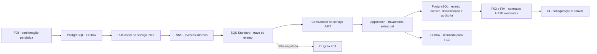

# F09 — Travamento após primeiro registro

## 1. Visão técnica

A primeira confirmação persistida pela F08 inicia o travamento estrutural do evento, inclusive quando a contribuição é um depoimento em texto. A F09 consome o fato em segundo plano, congela as informações estruturais e invalida o convite pendente na mesma transação. Em condições normais, a meta é aplicar a trava em até 5 segundos da confirmação. O recibo do convidado continua sendo emitido pela F08 após o commit da contribuição. [PRD](../PRD.md#f09-travamento-após-primeiro-registro-1) · [HLD](../HLD.md) · [Spec da F08](../F08-envio-e-confirmacao/spec.md)

### Escopo e contratos entre features

| Origem ou destino | Contrato |
| --- | --- |
| F03 → F09 | Evento com identificador interno, versão, política de abertura, vínculos e campos de trava. A edição e a trava disputam a mesma linha de evento. |
| F08 → F09 | `event.first-record-confirmed.v1` com o evento, o primeiro registro confirmado, o instante em UTC, identidade lógica e correlação. O fato já é gravado na Outbox na transação da confirmação. |
| F09 → F04 | Invalidação do convite pendente, retirada do segredo recuperável e recusa de novas emissões e aceites após a trava. Vínculos já confirmados são preservados. |
| F09 → F13 | Resultado durável com identificador do evento, instante da primeira confirmação, instante da aplicação ou falha, classificação técnica e correlação. |

### Regras de negócio

1. A primeira contribuição que confirma é a registrada no fato único da F08, segundo a serialização da confirmação por evento. Um envio parcial, inconcluso, expirado ou rejeitado mantém o evento editável. O consumo de um fato atrasado ou repetido preserva o registro e o instante da primeira confirmação.
2. Após a trava, o backend recusa alteração de nome, capa, mensagem de boas-vindas, data e horário e bloqueia a emissão, substituição e o novo aceite de convites. A capa personalizada continua no escopo definido na F03. O estado de trava se aplica a uma futura operação de capa quando ela existir. [Spec da F03](../F03-eventos-e-politica-de-abertura/spec.md)
3. A aplicação da trava incrementa a versão geral do evento uma única vez. A versão da política, o modo, a data de abertura, os marcos da janela e os vínculos permanecem com os valores vigentes no momento da aplicação. Mudanças de abertura autorizadas pela regra temporal da F03 permanecem disponíveis, com a versão atual da linha.
4. Na mesma transação, o convite pendente passa a `invalidated`, recebe o instante de invalidação e perde o ciphertext e a referência da chave de cifragem. O hash do token continua disponível para reconhecer o convite e aplicar as precedências já definidas na F04. Um aceite que venceu a corrida antes da trava segue válido e pode ser recuperado pela mesma conta autorizada. [Spec da F04](../F04-convite-do-segundo-responsavel/spec.md)
5. Edição, emissão e aceite que concluem antes da aplicação da trava são admitidos pelas regras vigentes naquele instante. Depois do commit da trava, as operações concorrentes que adquirirem o lock reavaliam o estado persistido e recebem a decisão aplicável. A janela eventual começa na primeira confirmação e termina na aplicação da trava.

### Fluxos de interface

- **Configuração do evento.** A consulta autorizada orienta a disponibilidade pelo `canEditDetails` existente. Se a edição aberta receber conflito de versão ou trava, atualiza os dados e mostra “As informações deste evento estão travadas.” quando a trava for confirmada. O formulário de abertura usa sua própria permissão. [S11](../design-system/screens/S11.md)
- **Convites.** Ao observar o estado `locked` na consulta ou nas operações, retirar ações de gerar, substituir, copiar ou exibir o QR do convite pendente. A prévia e o aceite apresentam “Os convites deste evento estão travados.” conforme o contrato já existente. A consulta na entrada ou no retorno à tela, e a revalidação após uma operação recusada, atualizam o estado. O backend sustenta a decisão quando uma tela ainda mostra dados anteriores. [S13](../design-system/screens/S13.md) · [S14](../design-system/screens/S14.md)
- As mensagens são neutras e acessíveis. O responsável recebe as permissões atuais de edição e convites. Identidade do convidado, conteúdo, formato, contagem e dados do registro que motivou a trava ficam restritos à origem autorizada.

## 2. Impacto na arquitetura



- API, publicador e consumidor rodam no mesmo serviço e usam escopos DI próprios para cada trabalho. Application coordena regras e transações pelo Domain. Infrastructure encapsula SQL e SDKs. Program.cs compõe as dependências e valida a configuração de início. [Guideline de backend](../guidelines/backend.md)
- Em desenvolvimento, PostgreSQL local e SNS/SQS emulados exercitam o caminho completo sob o mesmo contrato. Em homologação, o candidato usa tópico e fila Standard filtrada pelo tipo da F08, DLQ dedicada e permissões mínimas da role da tarefa. A ativação depende da configuração de mensageria do próprio ambiente. [HLD](../HLD.md) · [Guideline de mensageria](../guidelines/mensageria.md)

## 3. Decisões técnicas

| Decisão | Aplicação e consequência |
| --- | --- |
| Proveniência do primeiro fato | A mensagem da fila referencia a Outbox original. O consumidor lê a evidência durável pelo `messageId`, confere tipo, versão, evento, registro, instante e correlação, e resolve o registro no evento correto. Usa `confirmed_at` para reconhecer a confirmação também enquanto a mídia estiver em preparação, pronta ou com falha de processamento. Hora de entrega, instante de recepção e ordem da fila ficam fora da decisão sobre a primeira confirmação. |
| Publicação recuperável | O publicador reivindica apenas `event.first-record-confirmed.v1` elegível, com lease persistida e escopo por tipo. Consultas concorrentes bloqueiam apenas as linhas reivindicadas, com `FOR UPDATE SKIP LOCKED`. O publish ocorre fora da transação. Só registrar `published` com aceite do SNS e token de lease atual. Expiração ou queda permite recuperação e republicação com o mesmo `messageId`. |
| Consumo idempotente | Deduplicar por consumidor `event-structural-lock`, origem `internal` e `messageId`. O hash da identidade de negócio usa campos normalizados de contrato, com tolerância a acréscimos opcionais. Repetição idêntica conclui sem efeito extra. Uma entrega divergente vai para quarentena e o registro da execução legítima conserva seu estado. Se a trava já estiver aplicada, uma entrega compatível pode encerrar a deduplicação sem escrever de novo. |
| Atomicidade e concorrência | Na operação de consumo, bloquear primeiro a deduplicação e depois o evento e o convite, na ordem `deduplicação → evento → convite`. Reusar a linha bloqueada pela F03 e F04. Aplicar trava, fechar o convite, gravar auditoria e o fato de sucesso e concluir deduplicação na mesma transação. Acusar recebimento na fila após o commit. Se a exclusão da mensagem falhar, o próximo consumo reconhece o efeito. |
| Falhas e recuperação | Distinguir falha transitória, contrato inválido e falha definitiva. Sinalizar atraso ou pendência com diagnóstico operacional sanitizado. Após esgotamento de publicação, deixar o fato recuperável na Outbox. No consumo, reter entregas esgotadas na DLQ. Persistir a falha terminal correlacionada quando a origem for verificável e o banco estiver disponível. A revisão operacional reconcilia ocorrências na DLQ que chegaram durante a indisponibilidade do banco, sem reclassificar mensagens inválidas como fatos legítimos. |
| Ativação e histórico | Processar fatos `pending` e recuperar leases expiradas após ativação. Se houver confirmação histórica sem fato verificável, registrar a divergência para reconciliação e preservar a configuração. A trilha de recuperação registra o seletor, a causa, o candidato corretivo e o resultado. Desabilitar o consumo preserva as travas já aplicadas e o trabalho recuperável. |

### Parâmetros operacionais propostos

Os valores abaixo são o perfil inicial de ensaio. Medir e registrar a configuração candidata antes de ativar o fluxo publicado. A indisponibilidade do transporte pode aumentar o atraso da trava, com recuperação sem desfazer confirmações já persistidas. [Mensageria](../guidelines/mensageria.md#4-consumidores-deduplicação-e-falhas) · [Observabilidade](../guidelines/observabilidade.md)

| Parâmetro | Perfil inicial |
| --- | --- |
| Publicação | Consulta ociosa da Outbox a cada 500 ms, até 10 reivindicações por rodada, no máximo 4 em processamento por réplica. Lease de 30 s com deadline de rede inferior à lease. Cinco tentativas automáticas com backoff inicial de 2 s e teto de 30 s. A queda de réplica deixa a lease expirar e o trabalho volta a ficar elegível. |
| Consumo | Recebimento longo de 10 s e até 4 entregas em processamento por réplica. Ajustar `MaxNumberOfMessages` às vagas livres. Visibilidade inicial de 30 s e orçamento de 8 s por execução. Limite inicial de cinco recebimentos antes da DLQ, com reagendamento limitado e cancelável para falhas conhecidas. Encerramento para novas buscas e libera ou deixa expirar o trabalho sem confirmação durável. |
| Retenção e replay | Fila principal com 4 dias e DLQ com 14 dias. Repetição ordinária até 30 dias a partir de `confirmedAt`, inclusive. Manter a deduplicação concluída por pelo menos 37 dias do mesmo marco, incluindo a margem operacional, e enquanto houver trabalho recuperável associado. Fora do horizonte, reconciliar a fonte durável e a trava antes de autorizar a retomada operacional. A evidência mínima do primeiro fato permanece enquanto o evento existir. |
| Métricas e alcance | Medir tempo de confirmação até trava, idade da pendência, volume e resultado de publicações e consumos, reentregas e DLQ. Dimensões limitadas por tipo, etapa e resultado. IDs técnicos e correlação em evidência restrita. Alerta operacional para falha terminal e DLQ, com configuração do canal publicado verificada em homologação. |

A configuração proposta `EventStructuralLock__Enabled` é explícita e vem desabilitada por padrão. Quando habilitada, requer região, ARN do tópico, URL da fila e parâmetros coerentes de execução. Endpoints do emulador são aceitos somente em desenvolvimento. Em homologação, a identidade da tarefa publica no tópico e recebe, altera visibilidade e confirma entregas na fila própria. O redrive usa identidade operacional distinta. A assinatura entrega o envelope JSON e filtra pelo atributo de tipo da primeira confirmação.

Antes do redrive, validar a causa corrigida, reconciliar o estado da Outbox, da execução e do evento e reabrir somente a execução recuperável selecionada. Uma reentrega de execução concluída segue a deduplicação. O redrive de uma entrega em quarentena exige autorização de retomada para o `messageId` original e preserva a falha terminal já registrada.

### Premissas e rastreabilidade

- F03 e F04 já expõem e aplicam as permissões derivadas da trava. F08 já produz o fato inicial, por texto e mídia. A entrega fecha a passagem da Outbox para a transição real do evento. Usar os contratos existentes de identidade local no laboratório e o fluxo de autenticação do ambiente para o aceite publicado.
- FR-016 e os critérios da F09 definem a consistência eventual e as corridas aceitas. As integrações F03 → F09 e F08 → F09 definem a origem e o efeito da trava. F09 → F13 define os resultados técnicos. F10, F11, F12 e a implementação dos consumidores da F13 seguem seus próprios escopos. [Aceite e integrações do PRD](../PRD.md#9-critérios-de-aceitação)

## 4. Componentes

Os caminhos novos são propostos. Reusar os contratos e o código existentes quando cumprirem as responsabilidades previstas.

| Caminho | Situação | Responsabilidade |
| --- | --- | --- |
| `scrapbook-service/ScrapBook.Application/Services/EventStructuralLockService.cs` | Novo | Validar a origem, decidir transição e efeitos da trava e coordenar a transação. |
| `scrapbook-service/ScrapBook.Application/Services/OutboxPublisherService.cs` | Novo | Coordenar despacho, retries e encerramento de tentativas para o tipo habilitado. |
| `scrapbook-service/ScrapBook.Domain/Models/FirstRecordConfirmedModel.cs` | Novo | Representar os dados mínimos da mensagem de entrada. |
| `scrapbook-service/ScrapBook.Domain/Interfaces/IOutboxRepository.cs` e `scrapbook-service/ScrapBook.Domain/Interfaces/IEventStructuralLockRepository.cs` | Novos | Consultar a evidência, reivindicar trabalho e persistir estado técnico e efeito explícito. |
| `scrapbook-service/ScrapBook.Domain/Interfaces/IOutboxPublisher.cs` | Novo | Definir a porta de publicação que Application usa para encaminhar o envelope. |
| `scrapbook-service/ScrapBook.Infrastructure/Repositories/OutboxRepository.cs` e `scrapbook-service/ScrapBook.Infrastructure/Repositories/EventStructuralLockRepository.cs` | Novos | Aplicar claims, deduplicação, leitura do registro associado e gravação parametrizada da trava. Reusar o DbContext scoped. |
| `scrapbook-service/ScrapBook.Infrastructure/Repositories/EventWriteRepository.cs` e `scrapbook-service/ScrapBook.Infrastructure/Repositories/InvitationRepository.cs` | Existentes | Reusar a leitura da linha de evento, auditoria e fechamento explícito do convite. |
| `scrapbook-service/ScrapBook.Infrastructure/Messaging/SnsOutboxPublisher.cs` e `scrapbook-service/ScrapBook.Infrastructure/Messaging/SqsEventStructuralLockConsumer.cs` | Novos | Adaptar envelope e transporte. Limitar volume, classificar falhas técnicas e propagar cancelamento. |
| `scrapbook-service/ScrapBook.Api/Workers/OutboxPublisherWorker.cs`, `scrapbook-service/ScrapBook.Api/Workers/EventStructuralLockWorker.cs` e `scrapbook-service/ScrapBook.Api/Program.cs` | Novos e existente | Subir execução quando configurada, abrir escopos e separar falhas de polling das decisões de negócio. |
| `scrapbook-ui/src/features/events/EventDetailsForm.tsx`, `scrapbook-ui/src/features/events/EventInvitationPage.tsx` e `scrapbook-ui/src/features/events/InvitationEntryPage.tsx` | Existentes | Reusar `canEditDetails`, os estados de convite e o tratamento de conflito. Ajustar a atualização dos controles se a verificação integrada revelar estado desatualizado. |
| `scrapbook-infrastructure/config/messaging/event-structural-lock.template.json` | Novo | Descrever tópico, filtro do tipo, fila, DLQ, políticas IAM e monitoramento mínimo. |
| `scrapbook-tests/event_structural_lock_stack.py` e `scrapbook-tests/event-structural-lock/event-structural-lock.spec.ts` | Novos | Exercitar o fluxo real confirmado → trava, com expiração, concorrência, privacidade e recuperação. |

## 5. Contratos de API e mensagens

### HTTP existente

As rotas preservam autenticação, revalidação do vínculo ou do token conforme a operação, `Cache-Control: no-store` e `X-Correlation-Id`. Erros usam Problem Details com o código existente. [F03](../F03-eventos-e-politica-de-abertura/spec.md#5-contratos-de-api) · [F04](../F04-convite-do-segundo-responsavel/spec.md#5-contratos-de-api) · [Guideline de API](../guidelines/api.md)

| Operação | Entrada e autorização | Efeito do travamento |
| --- | --- | --- |
| `GET /api/v1/events/{eventId}` | Conta vinculada e ID decimal do evento. | `200` com `canEditDetails: false` após a trava. `openingPolicy.canEdit` usa a regra da F03. |
| `PUT /api/v1/events/{eventId}/details` | Conta vinculada, DTO da F03 e `expectedVersion`. | `409 EVENT_LOCKED` com versão atual. Uma versão anterior recebe `409 EVENT_VERSION_CONFLICT`; a nova consulta revela as permissões atuais. |
| `PUT /api/v1/events/{eventId}/opening-policy` | Conta vinculada e DTO da F03 com versão. | `200` para alteração ainda permitida. `409 EVENT_OPENING_LOCKED` para uma alteração fora da regra temporal. Conflito de versão mantém a semântica existente. |
| `GET /api/v1/events/{eventId}/invitations/current` | Conta vinculada. | `200` com `state: "locked"` e `invitation: null`. |
| `POST /api/v1/events/{eventId}/invitations` | Conta vinculada e chave idempotente conforme F04. | Nova emissão ou substituição recebe `409 INVITATION_EVENT_LOCKED`. Repetição de uma emissão invalidada mantém o tratamento de convite indisponível do contrato atual. |
| `POST /api/v1/invitations/preview` e `/accept` | Conta ativa com e-mail confirmado e token no corpo conforme F04. | Para convite ainda sem aceite, validar o token antes de informar a trava e recusar a operação com `409 INVITATION_EVENT_LOCKED`. Recuperação autenticada de aceite já persistido mantém a semântica da F04. |

Exemplo de resposta da consulta de convite após a trava.

```json
{"state":"locked","invitation":null}
```

### Mensagem de entrada

O envelope é a projeção da Outbox com `messageId` e `correlationId` UUID, `type` igual a `event.first-record-confirmed.v1`, `version` inteiro `1`, `occurredAt` UTC e `eventId` decimal positivo como string. `data` carrega o `recordId` decimal positivo e o `confirmedAt` UTC do fato original, dentro do limite de 16 KiB do contrato interno. O `eventId` do payload persistido aparece uma vez no envelope. O transporte usa a mesma identidade em retries e redrive.

```json
{
  "messageId": "797e003a-e78b-5ade-a746-de13475a04f1",
  "type": "event.first-record-confirmed.v1",
  "version": 1,
  "eventId": "42",
  "occurredAt": "2026-11-26T14:00:00.120Z",
  "correlationId": "da771942-1b5b-4c4b-885a-62260ad1fc65",
  "data": {"recordId": "237", "confirmedAt": "2026-11-26T14:00:00.120Z"}
}
```

O consumidor recusa versão desconhecida, corpo excessivo, mensagem sem correspondência na Outbox ou divergência do registro associado. Evidência sem origem verificável segue para a quarentena do transporte, com classificação técnica e sem efeito no evento. Uma falha transitória provoca nova tentativa. Falha definitiva em fato verificável preserva o trabalho e produz o resultado operacional. Logs preservam a mensagem técnica sem reproduzir corpo da fila, chaves privadas ou conteúdo de convidado.

### Resultados para F13

Os tipos propostos são `event.structural-lock.applied.v1` e `event.structural-lock.failed.v1`. Cada resultado tem uma identidade própria estável, o `causationId` da primeira confirmação, o mesmo `correlationId` e o identificador do evento. Sucesso leva `confirmedAt` e `lockedAt`. Falha terminal leva `confirmedAt`, `failedAt`, etapa (`publish` ou `consume`) e código técnico limitado. A mesma falha terminal por fato e etapa permanece única durante reentregas. Uma recuperação posterior pode produzir o sucesso. A Outbox guarda esses contratos até a F13 habilitar o seu encaminhamento. IDs e horários técnicos são restritos à operação.

## 6. Modelo de dados

Reusar as tabelas do Liquibase já aplicadas à F03/F04/F08. Os três campos de trava já existem e formam uma unidade verificada por `ck_events_locking`. A F09 escreve pela primeira vez seus valores no fluxo normal da aplicação. [Modelo físico](../db/DB-Modelo-Fisico.md) · [Liquibase](../guidelines/liquibase.md)

| Tabela | Campos e tipo principais | Escrita e proteção |
| --- | --- | --- |
| `events` | `id bigint`, `version bigint`, `access_version bigint`, `locked_at timestamptz`, `first_record_id bigint`, `first_record_confirmed_at timestamp without time zone`. Os três campos de trava são inicialmente anuláveis. | Ler pela PK com lock de atualização. Aplicar os três valores juntos e avançar `version` uma vez. Usar UTC para `locked_at` e converter a confirmação para hora civil de Brasília em `first_record_confirmed_at`. |
| `records` | `id bigint`, `records_events_id bigint`, `state varchar(24)`, `confirmed_at timestamp without time zone`. | Resolver o registro pelo evento e ID, dentro da transação do consumidor. Conferir a presença e o valor da confirmação civil derivada do instante UTC da Outbox, preservando o UTC original no contrato. |
| `invitations` | `state varchar(24)`, `invalidated_at timestamptz`, `token_ciphertext bytea`, `encryption_key_id varchar(64)`, `version bigint`. | O índice único parcial `uq_invitations_active` limita a um pendente. Atualizar o pendente do mesmo evento e limpar o segredo no mesmo commit da trava. |
| `outbox_messages` | `message_id uuid`, `type varchar(100)`, `protocol_version smallint`, `payload jsonb`, `correlation_id uuid`, `causation_id uuid`, `state varchar(24)`, `attempt_count integer`, `available_at timestamptz`, `lease_token uuid`, `lease_until timestamptz`. | Reusar `uq_outbox_messages_message` e `ix_outbox_messages_eligible`. Verificar plano de execução com fatos de mídia coexistentes. Condicionar atualizações à lease vigente. Conservar o fato inicial após publicação enquanto o evento existir. |
| `processed_messages` | `consumer varchar(80)`, `source varchar(32)`, `message_id uuid`, `payload_hash bytea`, `state varchar(24)`, `attempt_count integer`, `completed_at timestamptz`, `error_code varchar(80)`. | Reusar `uq_processed_messages_internal` e o hash SHA-256. A conclusão fica no mesmo commit da trava. O terminal em quarentena mantém uma causa recuperável. Limpar somente após horizonte e margem, com estado técnico resolvido. |
| `audit_entries` | `audit_entries_events_id bigint`, `actor_type varchar(16)`, `action varchar(80)`, `outcome varchar(16)`, `correlation_id uuid`, `created_at timestamptz`, `expires_at timestamptz`. | Registrar ação sistêmica `event.structural_lock.applied` na área `events`, com o estado de trava e sem dados da contribuição. O índice por evento e a retenção vigente de 180 dias sustentam a consulta operacional autorizada. |

A proposta usa o schema existente. Verificar os grants da role DML e os índices em PostgreSQL real. Qualquer ajuste demonstrado pelo ensaio segue changeset aditivo com rollback técnico pelo Liquibase. A reversão operacional do candidato preserva a trava, a invalidação, os fatos pendentes e a auditoria. [SQL](../guidelines/sql.md) · [Política de evolução do Liquibase](../guidelines/liquibase.md)

## 7. Estratégia de testes

| Suíte proposta | Cenários e asserções |
| --- | --- |
| `scrapbook-service/ScrapBook.UnitTests/Services/EventStructuralLockServiceTests.cs` | `AppliesTheLockAndInvalidatesPendingInvitationAsync`, `PreservesExistingLockAndMembersOnReplayAsync`, `RejectsAnUnverifiedConfirmationAsync`, `DoesNotChangeTheOpeningPolicyAsync`, `KeepsAcceptedInvitationReplayAsync`. Verificar conteúdo dos comandos, efeitos atômicos solicitados, datas e cancelamento. |
| `scrapbook-service/ScrapBook.UnitTests/Services/OutboxPublisherServiceTests.cs` | `MarksPublishedOnlyAfterTransportAcceptsAsync`, `RepublishesWithTheSameMessageIdAfterLeaseExpiryAsync`, `PreservesFailedMessageForRecoveryAsync`. Cobrir erro transitório, lease substituída e limite de tentativas. |
| `scrapbook-ui/src/features/events/EventDetailsForm.test.tsx` e `EventInvitationPage.test.tsx` | `mostra trava após reconciliação de versão`, `preserva controles permitidos de abertura` e `retira ações de convite após consultar a trava`. Conferir teclado, leitura do feedback e ausência de dados do registro. |
| `scrapbook-tests/event_structural_lock_stack.py` | `test_first_submissions_lock_only_their_events`, `test_mutations_race_with_lock`, `test_retries_and_replays_preserve_the_first_lock`, `test_transaction_rolls_back_on_audit_failure`, `test_does_not_lock_on_partial_or_rejected_submission`, `test_reconciles_dlq_without_duplicate_effect`. Exercitar Postgres, Outbox e SNS/SQS local com duas réplicas. |
| `scrapbook-tests/event-structural-lock/event-structural-lock.spec.ts` | `edita antes da trava e reconcilia uma tela aberta`, `bloqueia emissão e aceite e mantém abertura autorizada`. Verificar duas identidades, QR previamente carregado, atualização após conflito e mensagem neutra. |

### Aceite rastreado ao PRD

| Critério | Evidência esperada |
| --- | --- |
| F09 e F08 → F09 · Primeira confirmação | Enviar texto e mídia em eventos distintos. Medir da confirmação persistida à trava, com registro confirmado correto, convite inválido e recibo já acessível. Um envio parcial, rejeitado ou expirado deixa o evento editável. Confirmar múltiplos registros e preservar o primeiro do fato. |
| F09 e F03 → F09 · Corridas e abertura | Controlar a ordem de aquisição do lock com edição e aceite antes e depois da aplicação, incluindo a janela eventual. Preservar aceites já efetivados. Revalidar `flexible`, `scheduled_locked` e `immediate_once`, inclusive a transição ainda válida e a recusa temporal no instante de fechamento. |
| F09 · Falhas e recuperação | Simular queda após publish e antes da marcação, antes do commit do consumidor e após commit antes do ACK. Examinar reentrega entre réplicas, versão desconhecida, erro terminal, DLQ, redrive e as bordas inclusivas do horizonte. Auditar uma única transição de negócio e manter origens recuperáveis. |
| F09 → F13 · Resultado e privacidade | Correlacionar confirmação, tentativa operacional, aplicação ou falha terminal. Verificar sinais sanitizados, retorno HTTP neutro, credenciais e ações limitadas da fila, vínculo de evento e ausência de conteúdo, remetente e contagem nos logs e na interface de configuração. |
| F09 · Meta de até 5 s | Medir confirmação → trava durável e consulta posterior em coorte com primeiras confirmações de eventos distintos, publicador e consumidor ativos, começando com 100 eventos sintéticos e concorrência documentada. Repetir sob o perfil de API da F08. Registrar p50, p95, máximo, quantas travas excederam 5 s, recursos e backlog. Aprovar a meta no perfil normal com todas as travas em até 5 s. Rodadas com falhas injetadas evidenciam recuperação. |
| Homologação | Conferir filtragem do tópico, política de fila e DLQ, visibilidade, redrive com a identidade original, correlação, alarmes e latência com o transporte AWS e a versão publicada. O laboratório emulado comprova as regras e o contrato local. |
