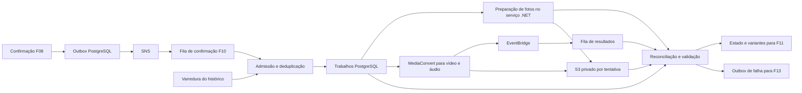

# F10 — Processamento de mídias

## 1. Visão técnica

A F10 prepara variantes privadas de cada arquivo confirmado pela F08. O registro recebe seu recibo assim que o envio é confirmado. O processamento ocorre em segundo plano, inclusive depois do prazo de envio. Pelo menos 95% dos arquivos confirmados devem ficar prontos em até cinco minutos no perfil de carga documentado. Um registro somente em texto ou um envio rejeitado gera zero trabalhos. [PRD, funcionalidades e aceite](../PRD.md#6-funcionalidades) · [Spec da F08](../F08-envio-e-confirmacao/spec.md)

| Entrada | Variantes obrigatórias por arquivo | Critério de disponibilidade |
| --- | --- | --- |
| Foto JPEG, PNG ou HEIC/HEIF | `image` JPEG de até 2.048 px no maior lado e `thumbnail` JPEG de até 400 px | As duas saídas estão verificadas e associadas ao arquivo. Orientação aplicada aos pixels, proporção preservada, sem ampliação e sem dados de localização. |
| Vídeo MP4, MOV ou WebM | `playback` MP4 com H.264 e AAC quando há faixa de áudio | Vídeo de até 1080p e 30 fps, limitado também pela resolução e cadência de origem. Preserva a orientação e a proporção de exibição. Vídeo mudo continua mudo. |
| Áudio MP3, M4A, WAV, OGG ou WebM | `playback` M4A com AAC | Contêiner MPEG-4 de áudio com extensão `.m4a`, faixa de áudio decodificável e duração coerente com a fonte. |

A disponibilidade é independente por arquivo. Um conjunto de fotos já confirmado pode ter arquivos em estados diferentes. O estado e as referências privadas alimentam a F11. Depois de autorizar a consulta, a F11 pode apresentar “Processando”, a variante pronta ou “Mídia temporariamente indisponível.” A política de abertura, a emissão e renovação de URLs assinadas e a interface da galeria pertencem à F11. O recibo da F08 permanece válido também em caso de falha. [PRD, integrações](../PRD.md#integração-entre-funcionalidades) · [Galeria S29](../design-system/screens/S29.md) · [Reprodução S30](../design-system/screens/S30.md)

Na falha definitiva, a F10 registra um fato operacional consumível pela F13 com evento, registro, arquivo, etapa, instante e correlação. A F13 é responsável por encaminhar o alerta. Reprocessamento operacional após correção usa o mesmo arquivo e uma nova tentativa rastreável. Os originais continuam íntegros e privados. [PRD, funcionalidades](../PRD.md#6-funcionalidades)

## 2. Impacto na arquitetura

O backend continua em um único serviço. A confirmação, o publicador, os consumidores e a execução agendada compartilham o serviço .NET. Application Services decidem elegibilidade, transições e efeitos. O repositório registra as operações na transação indicada pelo Service. Infrastructure adapta PostgreSQL, SNS, SQS, S3, MediaConvert e os processos de mídia. [HLD](../HLD.md) · [Backend](../guidelines/backend.md) · [Mensageria](../guidelines/mensageria.md)



- **Admissão.** O publicador reivindica `record.media-confirmed.v1` por tipo e envia o envelope existente em padrão SNS. A assinatura SQS Standard filtra pelo atributo `type`. A F10 tem ativação independente da F09, mesmo se ambas compartilharem o tópico. O consumidor confere a Outbox, o vínculo `evento → registro → arquivo`, a validade do arquivo e o original `stored`. Grava deduplicação, trabalho e variantes pendentes juntos antes de confirmar a entrega. Falha de publicação esgotada preserva o fato e gera o registro operacional quando a identidade é comprovada.
- **Execução.** Um worker reivindica trabalhos elegíveis com lote limitado, `FOR UPDATE SKIP LOCKED` e lease renovável. A tentativa e suas chaves existem antes dos efeitos externos. O commit de resultados compara lease, versão, perfil e tentativa ativa. Uma entrega antiga pode ajudar a reconciliar a tentativa à qual pertence. Somente a tentativa autorizada pode publicar variantes prontas. O trabalho e a deduplicação no banco permitem retomar após queda de qualquer réplica.
- **Resultados.** O EventBridge filtra a fila de jobs, a conta, a região e os resultados terminais esperados. O consumidor grava o avanço durável da tentativa ou a necessidade de reconciliação antes do ACK. Um verificador periódico consulta o provedor quando falta notificação ou há conflito. O `COMPLETE` indica que houve gravação no S3. A F10 confere os objetos privados, versões e propriedades antes de vincular as saídas. [Eventos `COMPLETE` da AWS](https://docs.aws.amazon.com/mediaconvert/latest/ug/ev_status_complete.html)
- **Ativação e reversão.** `MediaProcessing__Enabled` vem desabilitado. Habilitar requer perfis, storage versionado, filas e identidades coerentes. Em interrupção planejada, pausar admissão e novas submissões antes de drenar ou persistir as tentativas em andamento. Na retomada, reconciliar os jobs conhecidos e reabrir a admissão. O rollback da aplicação preserva recibos, originais, variantes prontas e Outbox. [Operação e observabilidade](../guidelines/observabilidade.md)

## 3. Decisões técnicas

### Perfis de conversão

- **Foto.** Reutilizar o ImageMagick e o isolamento adotados na F08. Normalizar orientação e cor antes de redimensionar. Gerar JPEG sRGB com fundo branco para transparência e qualidade inicial 85. Remover EXIF, IPTC, XMP e outros campos de localização. Aplicar o limite de cada saída em relação ao original já orientado, com arredondamento de até um pixel. Reutilizar os orçamentos de bytes, pixels, memória, disco temporário e tempo da F08 como base, com validação das duas saídas sob concorrência. [Validação da F08](../F08-envio-e-confirmacao/spec.md) · [Processamento de mídia](../guidelines/mensageria.md)
- **Vídeo.** Calcular o tamanho pelo aspecto de exibição após a rotação, dentro de 1.920 × 1.080 em paisagem, 1.080 × 1.920 em retrato ou 1.080 × 1.080 no quadrado. Usar dimensões suportadas pelo encoder, com arredondamento para baixo e preservação do aspecto dentro da tolerância de arredondamento. Configurar ajuste sem ampliação, sem corte, sem bordas e sem interpolar quadros para aumentar a cadência. Conservar a cadência menor e limitar a saída a 30 fps, incluindo fontes de cadência variável. Validar a rotação e proporção exibidas no artefato final. Perfil inicial proposto com H.264 QVBR qualidade 7, teto de 5 Mb/s, AAC-LC 96 kb/s mono ou 128 kb/s estéreo e MP4 em modo de reprodução progressiva. [Ajuste de dimensões do MediaConvert](https://docs.aws.amazon.com/mediaconvert/latest/ug/video-scaling-fit-without-upscaling.html) · [API de jobs](https://docs.aws.amazon.com/mediaconvert/latest/apireference/jobs.html)
- **Áudio.** Gerar saída MP4 somente com a faixa principal, codec AAC-LC, extensão `.m4a` e tipo `audio/mp4`. A proposta inicial usa 48 kHz e 96 kb/s mono ou 128 kb/s estéreo. Escolher a faixa principal pelos mesmos critérios da F08 e verificar a duração considerando atraso do codec e granularidade do contêiner. [Formatos de áudio do MediaConvert](https://docs.aws.amazon.com/mediaconvert/latest/ug/audio-only-output.html) · [API de jobs do MediaConvert](https://docs.aws.amazon.com/mediaconvert/latest/apireference/jobs.html)
- **Compatibilidade.** Fechar uma matriz por contêiner, codec e tipo de faixa confirmado pela F08, com evidência na AWS. Usar entrada direta quando suportada, incluindo WebM de vídeo VP8/VP9 com Opus ou Vorbis. Para combinações incompatíveis, como áudio somente em WebM, preparar entrada intermediária privada com o FFmpeg já fixado na imagem do serviço. Preferir remultiplexação sem recodificar. Usar PCM/WAV para normalização de áudio quando a cópia da faixa for inviável. Confirmar em homologação que as combinações da F08 têm caminho suportado, inclusive mídia fragmentada e variantes de navegador. Incompatibilidade sem adaptação comprovada bloqueia a ativação do formato afetado na F10. A conversão pesada e as saídas finais de áudio e vídeo seguem no MediaConvert. [Entradas do MediaConvert](https://docs.aws.amazon.com/mediaconvert/latest/ug/reference-codecs-containers-input.html) · [Entradas de áudio](https://docs.aws.amazon.com/mediaconvert/latest/ug/reference-codecs-containers-input-audio-only.html)

Os parâmetros de qualidade e bitrate acima são propostas para o perfil 1. A homologação fecha os ajustes de qualidade, proporção, cor, VFR, compatibilidade e orçamento. O trabalho persiste seu perfil efetivo. Mudança posterior que altere a saída usa nova versão e preserva a leitura das variantes do perfil ativo durante a migração. [Decisões em aberto do HLD](../HLD.md)

### Identidade, privacidade e reconciliação

- Fixar a entrada pela versão S3 e checksum persistidos na F08. Foto lê a versão explícita. Para o job do MediaConvert, criar uma entrada privada imutável por tentativa a partir da versão registrada ou da normalização verificada dessa versão. Usar chaves distintas para a entrada e as saídas. Roles e políticas impedem escrita de aplicação, convidado ou limpeza sobre originais por esse fluxo. `SELF_CONTAINED` e o escopo da role do MediaConvert restringem referências externas de MOV/MP4. Os subprocessos usam filesystem, formatos e recursos limitados, sem rede. [Referências externas no MediaConvert](https://docs.aws.amazon.com/mediaconvert/latest/ug/mp4-mov-external-references.html) · [Proteção da F08](../F08-envio-e-confirmacao/spec.md)
- Correlacionar `CreateJob` com `request_key` persistida, prefixo por tentativa e metadados técnicos opacos. Gravar `provider_submit_started_at` antes da chamada. Usar o mesmo token e as mesmas configurações se houver repetição autorizada dentro do orçamento proposto de 45 segundos desde a primeira chamada. Conferir o lease e a janela imediatamente antes de cada chamada, incluir a duração máxima da chamada no cálculo e desabilitar retries opacos nessa operação. O provedor documenta deduplicação por um minuto após uma chamada bem-sucedida. [Idempotência do MediaConvert](https://docs.aws.amazon.com/mediaconvert/latest/apireference/idempotency.html)
- Após resultado indeterminado, manter uma única tentativa ativa em `unknown` e o trabalho em `reconciling`. Se houver ID, consultar `GetJob`. Sem ID, correlacionar notificações e consultar uma janela limitada de jobs da fila pelo metadado persistido. Ausência em uma consulta isolada mantém a reconciliação. Nova submissão fora da janela exige falha conclusiva do job anterior ou evidência operacional de que a submissão anterior ficou sem efeito. Após o prazo de reconciliação, sinalizar para intervenção e suspender novas submissões daquele trabalho até resolver a incerteza.
- Validar a trilha de origem, conta, região, fila e job. Para promover uma saída, conferir a chave esperada, a versão S3 e tamanho, e inspecionar contêiner, codec, dimensões, cadência, duração e metadados aplicáveis em processo com orçamento. Saídas parciais ficam fora da projeção. A limpeza recebe o objeto e sua versão e verifica a ausência de vínculo com variante pronta, dentro do prefixo da tentativa encerrada. A role de limpeza alcança apenas intermediários e derivados elegíveis. Reentregas, callbacks antigos e retomadas convergem para um único conjunto de variantes.

### Parâmetros operacionais propostos

| Controle | Valor inicial e comportamento |
| --- | --- |
| Execução | Até 2 preparações de foto e 2 operações de preparação/validação de áudio e vídeo por réplica. Limitar jobs simultâneos globalmente pela fila e quota aprovadas em homologação. Usar leases iniciais de 2 minutos, renovados a cada 30 segundos enquanto houver trabalho local, e limitar separadamente CPU, RAM e disco da mídia. |
| Retentativa | Até 5 tentativas de execução por arquivo e ciclo, com intervalos-base de 5, 15, 30 e 60 segundos e jitter limitado. Falha permanente encerra o ciclo. Falhas de transporte e de consulta têm seus próprios orçamentos e evitam criar jobs novos quando há resultado incerto. |
| Reconciliação | Reexaminar trabalhos vencidos em lotes a cada 30 segundos, com recuo até 5 minutos para consultas do provedor. Após 24 horas sem conclusão verificável, alertar a operação e manter a intenção recuperável. |
| Mensagens | Fila com retenção de 4 dias, DLQ de 14 dias e até 5 recebimentos. Replay ordinário até 30 dias inclusive desde o fato original, com deduplicação por ao menos 37 dias e enquanto houver estado recuperável. Antes de replay fora da janela, recuperar a proteção junto ao efeito persistido e auditar a origem. Entrega duplicada preserva `messageId`. |
| Histórico | A proposta é reconciliar na primeira ativação os arquivos confirmados e verificáveis sem trabalho para o perfil ativo. Paginar por ID em lotes iniciais de até 100 e reservar capacidade para envios novos. Em retomada, usar os trabalhos já persistidos para descartar arquivos admitidos. Verificar a identidade e o instante no fato da F08. Quando o fato histórico faltar, exigir evidência persistida equivalente antes de admitir o arquivo. Registrar casos inconclusivos para intervenção. Medir o histórico separadamente a partir da admissão e preservar o instante original. |

A recuperação manual é restrita à operação. Permite selecionar arquivos e perfil, simular, registrar causa e revisão corretiva, e reabrir um ciclo de trabalho comprovadamente recuperável. O replay da fila preserva o ciclo atual. A reabertura auditada cria um novo ciclo de tentativas sob o mesmo trabalho lógico. Em caso de ambiguidade externa, somente uma reconciliação conclusiva libera nova execução. [Retenção e reprocessamento](../guidelines/mensageria.md)

Registrar logs estruturados, métricas e traces para fila, idade do arquivo confirmado, publicação, execução por tipo, reconciliação, variante pronta, DLQ e falha definitiva. Medir intervalos de espera e execução separadamente. Usar dimensões de baixa cardinalidade, como ambiente, perfil, tipo e etapa. Restringir correlação e identificadores técnicos à operação autorizada. Segredos, conteúdo, URLs e referências privadas ficam fora de logs e metadados enviados ao provedor. [Observabilidade](../guidelines/observabilidade.md)

## 4. Componentes

Os caminhos partem da raiz do workspace. As extensões de classes e portas seguem as dependências da arquitetura existente. [Índice do projeto](../README.md) · [Padrões de backend](../guidelines/backend.md)

| Caminho | Situação | Responsabilidade |
| --- | --- | --- |
| `scrapbook-service/ScrapBook.Application/Services/PhotoSubmissionService.cs` | Existente, fonte do fato | Confirmar todos os arquivos e gravar um fato por arquivo na mesma transação. |
| `scrapbook-service/ScrapBook.Application/Services/OutboxPublisherService.cs`, `scrapbook-service/ScrapBook.Infrastructure/Repositories/OutboxRepository.cs` e `scrapbook-service/ScrapBook.Infrastructure/Messaging/SnsOutboxPublisher.cs` | Existentes, adaptar | Reutilizar reivindicação e transporte com roteamento explícito por tipo. Preservar a validação, o resultado e o isolamento da F09. |
| `scrapbook-service/ScrapBook.Application/Codecs/MediaConfirmedCodec.cs` e `scrapbook-service/ScrapBook.Application/Services/MediaPreparationService.cs` | Propostos | Projeção e validação do envelope, admissão, transições, tentativa, disponibilidade e falha. |
| `scrapbook-service/ScrapBook.Application/Services/MediaPreparationRecoveryService.cs` | Proposto | Reconciliar jobs, varrer histórico e conduzir reprocessamento autorizado. |
| `scrapbook-service/ScrapBook.Domain/Interfaces/IMediaPreparationRepository.cs`, `scrapbook-service/ScrapBook.Domain/Interfaces/IMediaTranscodingProvider.cs` e `scrapbook-service/ScrapBook.Domain/Interfaces/IMediaVariantStorage.cs` | Propostos | Portas de persistência, conversão e armazenamento privado. Contratos e modelos ficam no Domain. |
| `scrapbook-service/ScrapBook.Infrastructure/Repositories/MediaPreparationRepository.cs` e `scrapbook-service/ScrapBook.Infrastructure/Persistence/ScrapBookDbContext.cs` | Proposto e existente | Acesso SQL/EF sobre o DbContext único, com escopo por arquivo, leases e atualizações condicionais. |
| `scrapbook-service/ScrapBook.Infrastructure/Decoders/MagickPhotoDecoder.cs` e `scrapbook-service/ScrapBook.Infrastructure/Storage/S3PhotoSubmissionStorage.cs` | Existentes, referência e reuso | Reaproveitar os mecanismos de isolamento, leitura de versão e integridade que a F08 já valida. |
| `scrapbook-service/ScrapBook.Infrastructure/Decoders/PhotoVariantProcessor.cs`, `scrapbook-service/ScrapBook.Infrastructure/Storage/S3MediaVariantStorage.cs` e `scrapbook-service/ScrapBook.Infrastructure/Messaging/MediaConvertProvider.cs` | Propostos | Produzir JPEGs, fixar e verificar versões S3, submeter e consultar jobs. A normalização de compatibilidade usa os binários isolados da imagem existente. |
| `scrapbook-service/ScrapBook.Api/Program.cs`, `scrapbook-service/ScrapBook.Api/Options/MediaProcessingOptions.cs`, `scrapbook-service/ScrapBook.Api/Workers/MediaPreparationWorker.cs` e `scrapbook-service/ScrapBook.Api/Runners/MediaPreparationRecoveryRunner.cs` | Composição existente e adições propostas | Ativação, DI, agendamento, consumidores com escopos próprios e execução operacional auditável. |
| `scrapbook-infrastructure/config/messaging/event-structural-lock.template.json` e `scrapbook-infrastructure/config/media/media-processing.template.json` | Referência existente e template proposto | Provisionar assinatura por tipo, filas, DLQs, EventBridge, IAM, limites e configuração do MediaConvert. |
| `scrapbook-liquibase/db.changelog-master.yaml` e `scrapbook-liquibase/changelogs/sprint-1/sql/003-registros.sql` | Existentes | Incluir changeset aditivo pelo changelog e manter o SQL-base aplicado como histórico. |

## 5. Contratos de API e mensagens

### Interface HTTP e contrato de entrada

O cliente continua usando os endpoints de envio e recibo da F08. A F10 tem entrada assíncrona e recuperação por runner operacional. Os estados para a galeria permanecem internos até a autorização da F11. [Contratos da F08](../F08-envio-e-confirmacao/spec.md) · [Padrão de mensagens](../guidelines/mensageria.md#2-envelope-de-mensagem)

A F08 persiste `eventId`, `recordId`, `fileId` e `confirmedAt` no payload. O publicador projeta o payload para o envelope abaixo, preservando a identidade e a correlação da Outbox. IDs de negócio são strings decimais positivas e os instantes são UTC. Formato e referência do original são resolvidos em `files` e `storage_objects`, com escopo pelo registro e evento. O envelope SNS usa `type` como atributo e o consumidor compara a entrega com o fato persistido. Mensagem inválida, incompatível, fora do escopo ou sem origem comprovada segue para quarentena, com motivo técnico. [Envelope interno](../guidelines/mensageria.md#2-envelope-de-mensagem)

```json
{
  "messageId": "d18a3cd1-bbf8-461a-a05f-705bd811c310",
  "type": "record.media-confirmed.v1",
  "version": 1,
  "occurredAt": "2026-11-27T14:00:00.000Z",
  "eventId": "200",
  "correlationId": "159c9246-d1d4-4841-bc26-cee6c7c6a6d1",
  "data": {
    "recordId": "560",
    "fileId": "701",
    "confirmedAt": "2026-11-27T14:00:00.000Z"
  }
}
```

### Contrato interno para a F11

`fileId` identifica o arquivo no registro autorizado. `pending` e `processing` fornecem apenas o estado de preparação. `available` fornece as variantes `ready` do perfil ativo, cada uma apontando para um objeto privado e sua versão. `failed` fornece indisponibilidade por arquivo. Projeções pendentes e falhas carregam uma lista de variantes vazia. A F11 aplica as regras de autorização e traduz o estado para a interface prevista. [PRD, galeria](../PRD.md#6-funcionalidades)

```json
{
  "fileId": "701",
  "state": "available",
  "profileVersion": 1,
  "variants": [
    {
      "kind": "playback",
      "storageObjectId": "901",
      "versionId": "s3-example-version",
      "mediaType": "audio/mp4"
    }
  ]
}
```

### Falha definitiva para a F13

O tipo proposto é `record.media-preparation.failed.v1`. Os estágios são `publish`, `admission`, `prepare`, `transcode` e `verify`. A identidade do resultado deriva do fato de confirmação e do ciclo lógico da falha. A decisão de encerrar o ciclo e a gravação do resultado ocorrem na mesma transação. Uma falha de transporte antes de existir trabalho usa a identidade do fato e o estágio de origem. A F13 pode encaminhar o resultado quando sua rota for ativada. [PRD, monitoramento](../PRD.md#6-funcionalidades)

```json
{
  "messageId": "8501b223-6e51-4c60-a23a-983417434010",
  "type": "record.media-preparation.failed.v1",
  "version": 1,
  "occurredAt": "2026-11-27T14:02:20.000Z",
  "eventId": "200",
  "correlationId": "159c9246-d1d4-4841-bc26-cee6c7c6a6d1",
  "causationId": "d18a3cd1-bbf8-461a-a05f-705bd811c310",
  "data": {
    "recordId": "560",
    "fileId": "701",
    "profileVersion": 1,
    "stage": "transcode",
    "code": "MEDIA_ATTEMPTS_EXHAUSTED"
  }
}
```

## 6. Modelo de dados

Os changesets de registros, operação e permissões da Onda 7 já oferecem as tabelas principais e DML à role `scrapbook_app`. Conferir o esquema aplicado em cada ambiente antes da ativação. A relação do trabalho, das tentativas, das variantes e das referências privadas com o mesmo arquivo é condição de persistência, com as FKs de escopo do schema e atualização transacional. [Modelo relacional](../db/README.md) · [SQL](../guidelines/sql.md) · [Liquibase](../guidelines/liquibase.md)

| Estrutura existente | Tipos, estados e proteções usados |
| --- | --- |
| `records`, `files` | Associações por `bigint`, confirmação do registro e `files.validation_state = 'valid'`. A F10 controla `files.processing_state` de `pending` a `processing` e depois `available` ou `failed`. `profile_version integer` seleciona a versão ativa. `records` continua sendo a autoridade sobre confirmação e recibo. |
| `processing_jobs` | Escopo pelo arquivo, tipo `photo_prepare` ou `av_transcode`, perfil `integer` e snapshot `jsonb`. `uq_processing_jobs_file_profile` limita um trabalho por arquivo, tipo e versão. `ix_processing_jobs_eligible` atende reivindicação por `next_attempt_at`, com token `uuid` e expiração `timestamptz`. |
| `processing_attempts` | Número monotônico por trabalho. `request_key uuid` único, `provider_job_id text`, hash `bytea` de 32 bytes e `output_prefix text`. `uq_processing_attempts_active` garante uma tentativa ativa inclusive em `unknown`. `uq_processing_attempts_provider_job` protege a identidade externa derivada de conta, região e ID do provedor. |
| `storage_objects`, `file_variants` | Originais e derivados com chave S3 `text`, versão `text`, tamanho `bigint` e checksum quando disponível. Derivado referencia a tentativa no mesmo arquivo. Uma variante única por arquivo, `kind` e perfil aponta para objeto verificado ao ficar `ready`. As duas variantes da foto e o estado `available` entram no mesmo commit. |
| `outbox_messages`, `processed_messages` | IDs técnicos `uuid` e payload `jsonb` com até 16 KiB na Outbox. Deduplicação interna por consumidor, fonte e `message_id`. Resultado do provedor usa `external_hash` sobre conta, região, job e transição, com validação de campos canônicos e preservação de estados terminais. |
| `cleanup_jobs` | Intenção `delete_object` por objeto e ação. A remoção exige a versão registrada, tentativa encerrada e inexistência de referência pronta. |

Propor changeset aditivo para guardar a identidade da confirmação após a retenção da Outbox e fixar a janela da chamada externa. A confirmação usa `timestamptz` para medir latência e deduplicar com o instante F08. Datas de negócio continuam na representação existente em `America/Sao_Paulo`. A primeira tentativa do ciclo usa `retry_cycle = 1`. Em reabertura auditada, incrementar o ciclo e reinicializar o contador do ciclo sob bloqueio do trabalho. O número da tentativa continua monotônico para toda a vida do trabalho. [Datas e SQL](../guidelines/sql.md)

```sql
ALTER TABLE scrapbook.processing_jobs
    ADD COLUMN confirmation_message_id uuid,
    ADD COLUMN confirmation_correlation_id uuid,
    ADD COLUMN confirmed_at timestamptz,
    ADD COLUMN retry_cycle integer NOT NULL DEFAULT 1,
    ADD CONSTRAINT ck_processing_jobs_confirmation CHECK (
        num_nonnulls(confirmation_message_id, confirmation_correlation_id, confirmed_at) IN (0, 3)
        AND retry_cycle >= 1
    );

ALTER TABLE scrapbook.processing_attempts
    ADD COLUMN provider_submit_started_at timestamptz,
    ADD CONSTRAINT ck_processing_attempts_provider_submit_started_at CHECK (
        provider_submit_started_at IS NULL
        OR (provider = 'mediaconvert' AND provider_submit_started_at >= started_at)
    );
```

Preencher os três campos de confirmação no momento da admissão de cada trabalho F10. Linhas preexistentes com contexto incompleto passam por recuperação verificável. Preservar os changesets já aplicados e validar a migração numa base nova e numa base com dados F08. Testar rollback do binário, subida com ambos os binários e procedimento de rollback do schema em base descartável. Após habilitar a execução, privilegiar correção aditiva para preservar identidades e janelas de submissão persistidas. [Procedimentos Liquibase](../guidelines/liquibase.md)

## 7. Estratégia de testes

Os caminhos e nomes a seguir são propostos. Testar os fluxos de confirmação e recibo da F08 em conjunto com o candidato F10. Guardar evidências por etapa na pasta da feature. [Documentação por feature](../README.md#documentação-por-feature) · [Critérios do PRD](../PRD.md#9-critérios-de-aceitação)

| Nível e caminho | Cenários e verificações |
| --- | --- |
| Unitário em `scrapbook-service/ScrapBook.UnitTests/Services/MediaPreparationServiceTests.cs` | `AdmitAsync_DoesNotDuplicateWork`, `CompleteAsync_PublishesAllRequiredVariants`, `RetryAsync_ReconcilesUnknownJobBeforeResubmission` e `FailAsync_RegistersOneFailurePerCycle`. Cobrir fronteiras do lease, replay, backoff e variante de outro arquivo. |
| Unitário em `scrapbook-service/ScrapBook.UnitTests/Services/OutboxPublisherServiceTests.cs` e `scrapbook-service/ScrapBook.UnitTests/Services/MediaPreparationRecoveryServiceTests.cs` | Preservar o comportamento da F09, provar roteamento independente, manter o fato original, verificar reabertura auditada, justiça entre histórico e envios novos e retomada de scan. |
| Integração local em `scrapbook-tests/media_processing_stack.py` | `test_confirmed_files_enqueue_once`, `test_expired_lease_recovers_without_duplicate_variant`, `test_late_provider_event_cannot_replace_variant`, `test_definitive_failure_preserves_receipt_and_original`, `test_backfill_resumes_and_prioritizes_new_files`. Usar PostgreSQL real, S3 versionado e SNS/SQS locais, JPEGs reais e adaptador de contrato para o MediaConvert. Incluir duas réplicas, reinício entre chamada externa e commit, `COMPLETE` antes da gravação do ID, expiração do token, DLQ e reprocessamento além do horizonte. |
| E2E em `scrapbook-tests/media-processing/media-preparation.spec.ts` | Confirmar pela interface da F08 fotos, áudio e vídeo. Verificar o recibo após atraso, conversão concluída e falha. Observar estado e vínculo das variantes com fixture interna do ambiente, sem expor referências na interface. Exercitar texto, envio rejeitado, prazo vencido durante o processamento e mídia entre eventos. |
| Validação defensiva em `scrapbook-tests/media_processing_stack.py` | Confirmar ausência de leitura anônima, rejeição de chave e job alheios, restrição de IAM, limites de subprocessos, ausência de dados GPS e conteúdo em logs, e proteção de original e variante pronta durante limpeza e recuperação. |
| Desempenho em `scrapbook-tests/media_processing_load.py` | `run_mixed_confirmation_burst` e `report_media_readiness` medem fila, processamento, confirmação do recibo, taxa de prontidão em 300 s e percentis 50, 95 e 99. Incluir simultaneidade de fotos e transcodificação, reinício e recuperação do histórico em execução separada. |
| Homologação AWS com `scrapbook-tests/media_processing_stack.py` e `scrapbook-tests/media_processing_load.py` | Executar com bucket e IAM reais, MediaConvert, EventBridge e SQS. Inspecionar artefatos reais com `ffprobe` e ferramenta de metadados. Testar todas as famílias de entrada confirmadas, vídeo rotacionado, quadrado e anamórfico, vídeos acima/abaixo de 30 fps e VFR, áudio WebM, fotos pequenas, HEIC e GPS. Exercitar resultado duplicado, reconciliar resultado perdido e confirmar ausência de efeitos duplicados. |

### Aceite rastreado ao PRD

| Requisito | Evidência para aceite |
| --- | --- |
| F08 → F10 | Recibo permanece válido e intacto. Um trabalho por arquivo válido com original verificado. Texto e conjuntos rejeitados ficam sem trabalho. Arquivos já confirmados e verificados são capturados pela varredura inicial ou por fluxo normal, com a mesma identidade lógica. |
| Formatos, qualidade e privacidade | JPEG real sem GPS com os dois limites medidos. MP4 H.264 com AAC quando aplicável e M4A AAC decodificáveis. Registrar dimensões orientadas, proporção, fps, duração, versão e integridade do original. Obter evidência real da AWS para áudio/vídeo. |
| Processamento e prazo | Usar como ponto de partida a rajada da F08 com 200 envios, 170 arquivos em dois eventos, sendo 90 fotos, 40 áudios e 40 vídeos. Complementar em rodada de borda com formatos e durações representativos dos limites. Registrar distribuição, tamanhos, duração, quota, número de réplicas, capacidade e comportamento durante a carga. A prontidão usa `confirmedAt` até o commit que marca todas as variantes obrigatórias. Pendentes e falhas no limite contam como fora da meta. Passar com ≥95% em 300 s no total e registrar também o resultado por tipo. [Perfil de carga da F08](../F08-envio-e-confirmacao/test-performance/f08-story-005-dev.md) |
| Recuperação e saída F13 | Simular queda, reentrega, resultado tardio, falha permanente e tentativas esgotadas. Comprovar uma única promoção por arquivo e perfil, estado de falha coerente, fato definitivo por ciclo e correlação, e reprocessamento preservando o original. |
| Disponibilidade para F11 | Conferir isolamento por evento e por arquivo, tipos de variante e perfil ativo. A F11 recebe apenas referências prontas da mídia autorizada e usa os estados previstos nas telas. [S29](../design-system/screens/S29.md) · [S30](../design-system/screens/S30.md) |

O ambiente local comprova a orquestração, a persistência, as regras e a geração de fotos. O aceite dos codecs produzidos pelo provedor, das combinações suportadas e do objetivo de cinco minutos exige evidência do candidato na AWS. [Aceite da F10 no PRD](../PRD.md#9-critérios-de-aceitação)
