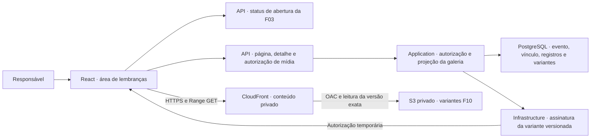

# Especificação técnica da F11 — Galeria e reprodução

## 1. Visão técnica

A F11 completa a área de lembranças dos responsáveis. Depois que o servidor confirma o vínculo e a abertura do evento, a galeria exibe contribuições confirmadas em ordem de recebimento, com autoria e legenda. Os responsáveis podem abrir uma lembrança, voltar à mesma posição e percorrer a sequência. Áudio e vídeo começam quando a pessoa aciona **Reproduzir**. Terminar a reprodução mantém o item atual. [PRD](../PRD.md#f11-galeria-e-reprodução-1) · [Galeria S29](../design-system/screens/S29.md) · [Visualizador S30](../design-system/screens/S30.md)

### Escopo e contratos de entrada

| Origem | Dados usados pela F11 |
| --- | --- |
| F03 | Sessão reconhecida pela API, vínculo vigente de qualquer responsável, modo de abertura, data de liberação, versão da política e avaliação pelo relógio do servidor em Brasília. [F03](../F03-eventos-e-politica-de-abertura/spec.md) |
| F08 | Evento e registro confirmados, categoria, formato, instante civil de recebimento, autoria, texto ou arquivos válidos na ordem de posição e legenda do registro. [F08](../F08-envio-e-confirmacao/spec.md) |
| F10 | Estado do arquivo, perfil ativo e referências privadas e versionadas de `thumbnail` e `image` para foto e `playback` para áudio e vídeo. [F10](../F10-processamento-de-midias/spec.md) |

A F11 entrega página, detalhe e autorização temporária de leitura para a interface do responsável. Busca por autoria, edição, download pela interface, exclusão e avanço automático ficam fora do escopo definido pelo PRD. A F03 mantém a política de abertura. A F08 confirma a contribuição e a F10 prepara os artefatos. [Limites de escopo](../PRD.md#7-fora-de-escopo)

### Regras de negócio e jornada

1. **Abertura.** A rota `/meus-eventos/{eventId}/lembrancas` reaproveita a consulta `opening-status`. Enquanto a confirmação estiver pendente, a tela mostra estado neutro. No evento fechado, mostra apenas a data e a contagem regressiva da F03. Sem sessão ou vínculo, orienta o retorno à autenticação ou a Meus eventos. Nenhuma dessas três situações busca a galeria ou seus objetos. [Lembranças guardadas S28](../design-system/screens/S28.md)
2. **Galeria.** O filtro inicial é **Tudo**. **Depoimentos** e **Momentos** reiniciam a consulta e a posição. Cada foto de um conjunto conta como um item e repete a autoria e a legenda do registro. Um conjunto pode atravessar páginas sem duplicação ou perda. O vazio, o carregamento e a falha de rede têm estados distintos. Só a página autorizada mostra `Processando` ou `Mídia temporariamente indisponível.`
3. **Visualizador.** O item é selecionado na galeria e seu detalhe é revalidado. Texto é renderizado como texto. Foto usa a variante `image` e preserva proporção. Áudio e vídeo exibem metadados autorizados e controles acessíveis de reprodução, pausa, volume e posição quando aplicáveis. Exigir **Reproduzir** antes de carregar bytes de `playback`. Oferecer somente as ações de mídia previstas na interface, incluindo o tratamento de controles nativos que apresentem download. **Anterior** e **Próximo** são explícitos e respeitam o filtro e as bordas entre páginas. Na volta, recuperar filtro, âncora de rolagem e foco no item de origem enquanto a mesma sessão, evento e autorização forem válidos.
4. **Perda de acesso.** Ao detectar bloqueio, troca de conta/evento, sessão inválida ou perda de vínculo, cancelar pedidos, invalidar respostas em voo, parar o player, retirar `src`/URLs do DOM e descartar conteúdo, cursores e seleções em memória. No bloqueio, voltar à S28 e reconsultar a data no servidor. Sem sessão ou vínculo, exibir a orientação correspondente. Em retomada de aba, foco, retorno do cache de navegação e alteração local de política, voltar a confirmar a abertura antes de reexibir conteúdo. [Política vigente da F03](../F03-eventos-e-politica-de-abertura/spec.md)

## 2. Impacto na arquitetura



- **API e Application.** Controllers MVC verificam a identidade pelo guard existente, normalizam os parâmetros HTTP e propagam `CancellationToken`. Application Services concentram autorização, política temporal, seleção da variante e composição de resposta. Domain contém contratos, projeções e exceções. O `GlobalExceptionHandler` produz Problem Details sanitizado. [Backend](../guidelines/backend.md) · [API](../guidelines/api.md)
- **Infrastructure.** O repositório usa o `ScrapBookDbContext` scoped e consulta PostgreSQL com parâmetros e projeções limitadas. O assinador recebe a referência autorizada e produz a URL temporária. UI e API ficam fora do caminho dos bytes. O bucket versionado e os processadores F08/F10 continuam sendo as fontes dos artefatos. [HLD](../HLD.md) · [Origem privada com OAC](https://docs.aws.amazon.com/AmazonCloudFront/latest/DeveloperGuide/private-content-restricting-access-to-s3.html)
- **Frontend.** React e TypeScript usam o cliente HTTP da aplicação, estado em memória no contexto da página e os componentes/tokens do shell responsável. A consulta de abertura existente verifica o servidor a cada 15 s em aba visível, em eventos de foco/visibilidade e ao receber atualização entre abas. Esse intervalo serve à detecção da interface. Cada chamada de conteúdo volta a autorizar no servidor. [Frontend](../guidelines/frontend.md) · [Acessibilidade e navegação](../design-system/navigation-accessibility.md)
- **Ambientes.** Laboratório descartável usa sessão de teste explícita, PostgreSQL, S3 emulado e entrega HTTP de mídia restrita ao loopback, com asserções de prazo, versão e Range. Homologação comprova o comportamento do CloudFront e as políticas S3/KMS reais, com variantes F10 publicadas e identidade de responsável válida. A ativação F10 em homologação permanece pendente. [Entrega da F10](../F10-processamento-de-midias/delivery/f10-story-005.md)

## 3. Decisões técnicas

| Tema | Decisão proposta e consequência |
| --- | --- |
| Autorização de cada operação | Checar vínculo e abertura antes da consulta de conteúdo. Fazer nova leitura da autorização vigente, com snapshot atualizado, antes de liberar resposta ou URL preparada. Se o vínculo sumir ou o evento fechar, descartar a resposta. Se a versão da política mudar e o conteúdo continuar aberto, refazer a projeção uma vez dentro do orçamento e falhar de forma retentável se mudar novamente. A verificação final é o marco lógico de autorização. Uma leitura autorizada antes do commit de fechamento já em voo segue a tolerância do PRD. |
| Ordenação e cursor | Usar a chave crescente `(records.received_at, records.id, position)`. Texto usa posição lógica `0`. Mídia usa a posição persistida. Ler um item extra e devolver até 10. Cursor opaco com finalidade própria no Data Protection, vinculado à conta, evento, filtro e ordenação. Reaproveitar o padrão criptográfico da F03 e prever key ring compartilhado e protegido entre réplicas, com isolamento por ambiente. O limiar preserva as posições dentro do conjunto, sem depender do arquivo estar pronto. |
| Visibilidade durante a navegação | Paginação reflete a base no momento de cada consulta. Novos registros à frente da fronteira podem aparecer nas páginas seguintes. Confirmações tardias com ordenação anterior à fronteira entram ao atualizar ou reiniciar o filtro. Posição e foco ficam em memória na página da F03. Mudanças de filtro cancelam pedidos antigos. |
| Entrega e renovação | Gerar URL de até **120 s** para uma variante e sua versão exata, com `versionId` coberto pela assinatura e expiração em UTC arredondada para baixo ao segundo inteiro. A galeria devolve miniaturas de fotos disponíveis no mesmo pedido, até 10. Detalhe retorna metadados. A leitura de imagem e a reprodução pedem liberação explícita da variante. URL expirada é renovada pela mesma operação com nova autorização. Uma transferência iniciada pode terminar. Um Range GET novo após o vencimento depende de URL renovada. [Expiração e Range](https://docs.aws.amazon.com/AmazonCloudFront/latest/DeveloperGuide/private-content-signed-urls.html) · [Consulta na origem](https://docs.aws.amazon.com/AmazonCloudFront/latest/DeveloperGuide/QueryStringParameters.html) |
| Imagem de vídeo | Os perfis atuais da F10 produzem apenas `playback` para áudio e vídeo. A F11 usa a composição neutra do visualizador antes de reproduzir vídeo. A miniatura fotográfica sempre vem do perfil vinculado e pronto no banco. |
| Dados e operação | Reutilizar o esquema e os índices de galeria existentes. Avaliar com plano de execução e carga representativa antes de propor índice incremental no Liquibase. A F11 lê confirmações e variantes, sem emitir fatos de processamento. |

### Entrega privada, expiração e invalidação

- Propor distribuição privada para lembranças, separada da distribuição pública de capas. Configurar key group confiável, OAC com assinatura dos pedidos à origem, S3 privado e HTTPS. Limitar OAC à distribuição do ambiente, `s3:GetObjectVersion` aos prefixos de variantes finais `submissions/derived/*` e `submissions/transcode-output/*`, e `kms:Decrypt` à chave e ao contexto de mídia aplicáveis. A seleção no serviço exige objeto derivado associado ao arquivo/variante e versão persistida. O assinador valida o destino e o prefixo configurados pelo ambiente. As roles habituais não ganham nova leitura direta. [Key groups](https://docs.aws.amazon.com/AmazonCloudFront/latest/DeveloperGuide/private-content-trusted-signers.html) · [OAC e SSE-KMS](https://docs.aws.amazon.com/AmazonCloudFront/latest/DeveloperGuide/private-content-restricting-access-to-s3.html) · [GetObject por versão](https://docs.aws.amazon.com/AmazonS3/latest/API/API_GetObject.html)
- Forward de `versionId` à origem e separação por versão em eventual cache de borda. Começar com cache de respostas de mídia desabilitado na borda e `Cache-Control: no-store` para o cliente. Conferir `GET`, `HEAD` e Range sob assinatura. Permitir CORS para a origem do frontend e preflight estritamente quando exigido, sem entrega de conteúdo nessa resposta. O par de chaves de assinatura é próprio por ambiente, com chave privada somente no serviço por segredo gerenciado e rotação com sobreposição até as URLs emitidas expirarem. [CloudFront e query strings](https://docs.aws.amazon.com/AmazonCloudFront/latest/DeveloperGuide/QueryStringParameters.html) · [Rotação de signatários](https://docs.aws.amazon.com/AmazonCloudFront/latest/DeveloperGuide/private-content-trusted-signers.html)
- A interface não persiste conteúdo em storage, cache de aplicação ou histórico do navegador. Usa `Referrer-Policy: no-referrer`, CSP com as origens de mídia estritamente necessárias e `Cache-Control: no-store` nas respostas privadas, inclusive erros. Logs e métricas usam rota normalizada, decisão e resultado controlado, duração e identificadores técnicos permitidos. Omitir consultas, URLs assinadas, caminho de objeto, chaves, versão, conteúdo, nomes e legendas de logs da API, CDN e ferramentas de telemetria. [Frontend](../guidelines/frontend.md) · [Observabilidade](../guidelines/observabilidade.md)
- A autorização recusada limpa imediatamente a superfície sob controle da interface. Respostas atrasadas não repovoam um contexto fechado ou trocado. Na reprodução interrompida por expiração ou falha de rede, apresentar **Tentar novamente**, pedir nova autorização e retomar o ponto conhecido quando o navegador permitir. Reproduzir ou avançar exige ação da pessoa. Após bloqueio, URLs anteriores mantêm apenas a validade original. Conteúdo já entregue pode permanecer no dispositivo. [PRD](../PRD.md#f11-galeria-e-reprodução-2) · [Expiração no CloudFront](https://docs.aws.amazon.com/AmazonCloudFront/latest/DeveloperGuide/private-content-signed-urls.html)

### Rastreabilidade

- **FR-019** define a galeria, a ordem, os filtros e a navegação. A política da **FR-018** controla cada leitura. A **FR-020** fornece às telas S29/S30 o estado de preparação e as variantes prontas da F10. [Mapeamento PRD](../PRD.md#8-grafo-de-dependências)
- Os blocos Consome, Capacidades, Experiência e Tratamento de erros sustentam as seções 1 e 5. Os critérios da própria F11 e os contratos F03 → F11, F08 → F11 e F10 → F11 sustentam a matriz da seção 7. [Integração no PRD](../PRD.md#integração-entre-funcionalidades)

## 4. Visão dos componentes

Os caminhos novos são propostos para implementação e seguem os sufixos do projeto.

| Caminho | Estado | Responsabilidade |
| --- | --- | --- |
| `scrapbook-service/ScrapBook.Api/Controllers/EventGalleryController.cs` | Novo | Contratos HTTP e validação de origem para emissão de URLs. |
| `scrapbook-service/ScrapBook.Application/Services/EventGalleryService.cs` | Novo | Coordenação de autorização, paginação, detalhe e concessão. Usa a regra temporal de `EventOpeningService.cs`. |
| `scrapbook-service/ScrapBook.Domain/Interfaces/IEventGalleryRepository.cs`, `scrapbook-service/ScrapBook.Domain/Interfaces/IGalleryMediaSigner.cs` e `scrapbook-service/ScrapBook.Domain/Interfaces/IGalleryCursorCodec.cs` | Novos | Portas de consulta escopada, assinatura de referência versionada e proteção do cursor. |
| `scrapbook-service/ScrapBook.Domain/Requests/GalleryMediaAccessRequest.cs` | Novo | Entrada tipada da concessão e renovação. |
| `scrapbook-service/ScrapBook.Domain/Responses/EventGalleryPageResponse.cs`, `scrapbook-service/ScrapBook.Domain/Responses/GalleryItemResponse.cs` e `scrapbook-service/ScrapBook.Domain/Responses/GalleryMediaAccessResponse.cs` | Novos | Contratos seguros de página, item e URL temporária. |
| `scrapbook-service/ScrapBook.Api/Codecs/GalleryCursorCodec.cs` | Novo | Cursor autenticado de galeria com finalidade distinta do cursor de eventos. |
| `scrapbook-service/ScrapBook.Api/Program.cs` e `scrapbook-service/ScrapBook.Api/ExceptionHandlers/GlobalExceptionHandler.cs` | Extensão | Composição das portas e mapeamento das exceções específicas de consulta e mídia. |
| `scrapbook-service/ScrapBook.Infrastructure/Repositories/EventGalleryRepository.cs` | Novo | Consulta indexada por evento, com expansão de item e junções ao perfil atual. |
| `scrapbook-service/ScrapBook.Infrastructure/Storage/CloudFrontGalleryMediaSigner.cs` | Novo | URL temporária da versão exata, sem depender do acesso aos bytes no serviço. |
| `scrapbook-ui/src/features/events/EventMemoriesPage.tsx` e `scrapbook-ui/src/features/events/useEventOpeningStatus.ts` | Reuso e integração | Entrada existente, estado da F03 e invalidação temporal. |
| `scrapbook-ui/src/features/gallery/EventGallery.tsx`, `scrapbook-ui/src/features/gallery/GalleryViewer.tsx` e `scrapbook-ui/src/features/gallery/galleryService.ts` | Novos | S29/S30, navegação, autorização de mídia, foco e limpeza do DOM. |
| `scrapbook-infrastructure/config/media/gallery-delivery.template.json` e `scrapbook-infrastructure/config/media/photo-submissions.template.json` | Novo e extensão | Distribuição privada, papéis de entrega, grants de S3/KMS e parâmetros de ambiente. |
| `scrapbook-liquibase/changelogs/sprint-1/sql/003-registros.sql` | Existente | Índices e relações de referência, já versionados no catálogo. |

## 5. Contratos de API

Base proposta `/api/v1/events/{eventId}/gallery`. `eventId` é decimal positivo canônico em string. Os três endpoints exigem identidade autenticada, vínculo e evento aberto. Identidade de desenvolvimento permanece restrita ao laboratório e desabilitada por padrão. Respostas `200` e Problem Details usam `Cache-Control: no-store`. Orçamento inicial de execução de **2 s** por operação, incluindo PostgreSQL e assinatura, com cancelamento propagado. O p95 visado continua **500 ms** para as operações comuns, fora da transferência de bytes. [Padrão HTTP](../guidelines/api.md) · [Meta do PRD](../PRD.md#4-objetivos)

| Operação | Entrada |
| --- | --- |
| `GET /{eventId}/gallery` sob `/api/v1/events` | Sem body. `filter` opcional, `all` por padrão, aceita `all`, `testimonial` ou `moment`. `cursor` base64url opaco opcional, com tamanho máximo de 512 caracteres. Sem parâmetro de tamanho. A mesma operação obtém as páginas consecutivas. |
| `GET /{eventId}/gallery/{itemId}` sob `/api/v1/events` | Sem body. `itemId` é o identificador devolvido na página, `text-<recordId>` ou `file-<fileId>`. Busca escopada pelo mesmo evento. |
| `POST /{eventId}/gallery/{itemId}/media-access` sob `/api/v1/events` | JSON estrito com o único campo `variant`, corpo de até 1 KiB e origem validada nos canais de sessão existentes. Foto aceita `thumbnail` ou `image`. Áudio e vídeo aceitam `playback`. Renovação usa o mesmo contrato. |

A página inclui `items`, `nextCursor` nulo na última página e `hasMore` coerente com o cursor. `receivedAt` segue o contrato civil de Brasília, sem offset. `recordId` identifica o registro original. `mediaType` é um dentre `text`, `photo`, `audio`, `video`. Cada item inclui `category`, `senderName`, `caption` quando preenchida, `state` (`available`, `processing`, `unavailable`) e `thumbnail` nula para outros formatos ou enquanto indisponível. A miniatura, quando emitida, tem `url` e `expiresAt` em UTC. `hasMore` e `nextCursor` pertencem apenas à página autorizada.

Exemplo de resposta da página.

```json
{
  "items": [
    {
      "id": "file-101",
      "recordId": "100",
      "category": "moment",
      "mediaType": "photo",
      "receivedAt": "2026-11-28T10:24:31",
      "senderName": "Convidada de exemplo",
      "caption": "Uma lembrança do evento.",
      "state": "processing",
      "thumbnail": null
    }
  ],
  "nextCursor": null,
  "hasMore": false
}
```

O detalhe devolve um objeto individual com os mesmos campos descritivos. `text` contém o corpo do depoimento textual e vale `null` nos outros formatos. `durationSeconds` contém a duração numérica da variante pronta de áudio/vídeo, quando conhecida, ou `null`. As URLs são emitidas pelas operações de página e concessão. Exemplo de resposta do detalhe.

```json
{
  "id": "text-102",
  "recordId": "102",
  "category": "testimonial",
  "mediaType": "text",
  "receivedAt": "2026-11-28T10:25:04",
  "senderName": "Convidado de exemplo",
  "caption": null,
  "state": "available",
  "text": "Que bom rever este dia!",
  "durationSeconds": null
}
```

Exemplo de requisição e resposta da concessão. A URL é ilustrativa. A versão, a chave e o bucket internos não são campos do contrato.

```json
{
  "variant": "playback"
}
```

```json
{
  "url": "https://midia.example.invalid/variante.mp4?versionId=fixture&Expires=1795881600&Signature=fixture&Key-Pair-Id=fixture",
  "expiresAt": "2026-11-28T16:00:00Z",
  "contentType": "video/mp4"
}
```

### Erros e evolução de estado

| HTTP / código | Condição e reação do cliente |
| --- | --- |
| `400 REQUEST_VALIDATION_FAILED` | Filtro, cursor adulterado/incompatível, identificador ou variante inválidos. Cursor inválido reinicia a página apenas após nova confirmação de acesso. |
| `401 IDENTITY_AUTHENTICATION_REQUIRED` | Sessão ausente ou expirada. Limpar contexto e orientar autenticação. |
| `403 EVENT_CONTENT_LOCKED` | Responsável vinculado em evento fechado. Limpar contexto e consultar somente o status de abertura permitido. Nenhum corpo de erro revela itens, pessoas, estados de mídia ou quantidade. |
| `403 REQUEST_ORIGIN_REJECTED` | Origem recusada no pedido de mídia, com o mesmo código do guard de evento. |
| `404 RESOURCE_NOT_FOUND` | Evento inexistente ou sem vínculo, ou item inexistente/não elegível nesse evento. Sem distinguir item de outro evento. Conferir status de abertura em caso de perda de acesso durante navegação. |
| `409 GALLERY_MEDIA_NOT_READY` | Variante permitida para o tipo, porém indisponível no perfil ativo. Reconsultar o detalhe autorizado antes de mostrar o estado e oferecer nova consulta. |
| `415 UNSUPPORTED_MEDIA_TYPE` / `413 REQUEST_TOO_LARGE` | Operação de mídia requer JSON com limite declarado. |
| `503 DEPENDENCY_UNAVAILABLE` | Falha operacional conhecida ou orçamento esgotado. Se apenas o assinador estiver indisponível, manter a página autorizada em `200` com miniaturas nulas e retornar `503` na concessão explícita. |

Exemplo de Problem Details para evento fechado. O servidor pode incluir `traceId` conforme o middleware vigente. Os dados de abertura são obtidos na rota própria da F03.

```json
{
  "type": "about:blank",
  "title": "As lembranças estarão disponíveis na data de abertura.",
  "status": 403,
  "detail": "As lembranças estarão disponíveis na data de abertura.",
  "code": "EVENT_CONTENT_LOCKED",
  "correlationId": "97dfba56-bdf4-49ba-8f64-3cf9e14c134a"
}
```

O navegador pode receber uma falha de CDN sem JSON. Ausência de resposta válida do status de acesso limpa a área de conteúdo e oferece revalidação. Se o acesso à API continuar válido e só a transferência falhar, apresentar “Não foi possível reproduzir. Tente novamente.” A F11 não infere bloqueio temporal a partir de um erro da CDN. [Erros do PRD](../PRD.md#f11-galeria-e-reprodução-1)

## 6. Modelo de dados

| Fonte existente | Campos e tipo relevantes | Invariantes e acesso |
| --- | --- | --- |
| `scrapbook.events` e `scrapbook.event_members` | PKs `bigint`, `opening_mode varchar(16)`, `opens_at timestamp without time zone` opcional, `access_version bigint`; vínculo por FKs de evento e conta. | Mesmo identificador para verificar vínculo e data em todas as consultas; unicidade de vínculo por evento/conta. Aplicar a conversão de Brasília da F03. |
| `scrapbook.records` | Evento/PK `bigint`, `category varchar(16)`, `format varchar(8)`, `sender_name varchar(120)`, `message varchar(5000)`, `caption varchar(500)`, `received_at` e `confirmed_at timestamp without time zone`, `redacted_at timestamptz`. | `confirmed_at IS NOT NULL` identifica a confirmação canônica, inclusive em estados confirmados posteriores previstos pelo esquema. Excluir registros rejeitados e redigidos. O índice parcial `ix_records_gallery` atende Tudo. `ix_records_gallery_category` atende filtro por categoria. |
| `scrapbook.files` | PK/registro `bigint`, `position smallint`, `validation_state varchar(24)`, `processing_state varchar(24)`, `profile_version integer`. | Usar arquivo válido e pertencente ao registro confirmado do evento. `uq_files_record_position` mantém a posição por registro. A falta de variantes não desloca o item. |
| `scrapbook.file_variants` | PK e FKs `bigint`, `kind varchar(16)`, `profile_version integer`, `state varchar(24)`, `media_type varchar(128)`, `duration numeric(12,6)` e dimensões `integer`. | `uq_file_variants_file_kind_profile` identifica a variante ativa sem duplicar o item. `ready` exige referência de objeto e horário de prontidão. Foto disponível exige `image` e `thumbnail`. Áudio/vídeo disponível exige `playback`. |
| `scrapbook.storage_objects` | PK/FK do arquivo e tentativa `bigint`, estado, tipo e `version_id text`. | Só objeto derivado em `stored`, com versão não nula, do mesmo arquivo e associado pela variante ativa. Conservar as FKs e verificações de escopo da F10. |

Consultar pela chave composta e buscar arquivos de um mesmo registro na sua ordem. A expansão deve acontecer antes do limite de itens. A consulta não deve reordenar nem materializar todo o evento a cada página. O detalhe resolve o ID discriminado e repete os predicados do evento e da confirmação. Para mídia pendente, não requisitada ou em execução, devolver `processing`. Falha definitiva ou inconsistência entre estado `available` e artefato verificado resulta em `unavailable`, com sinal sanitizado para operação. Texto confirmado fica disponível sem trabalho F10. Conferir `EXPLAIN (ANALYZE, BUFFERS)` com filtro, sem filtro e cursor no meio de um conjunto. [Modelo físico](../db/DB-Modelagem.md) · [Guideline SQL](../guidelines/sql.md)

Nenhuma migration está prevista na entrega inicial. Se o plano de execução indicar índice adicional, preparar changeset aditivo com rollback e validar em bases nova e atualizada com a role de aplicação.

## 7. Estratégia de testes

| Nível e caminho proposto | Cenários verificáveis |
| --- | --- |
| xUnit em `scrapbook-service/ScrapBook.UnitTests/Services/EventGalleryServiceTests.cs` | `ListAsync_DeniesBeforeReadingGalleryWhenClosed`, `ListAsync_SplitsPhotoSetAtPageBoundary`, `GetAsync_DoesNotExposeAnotherEvent`, `GrantAsync_RequiresReadyVariantOfActiveProfile`, `GrantAsync_DiscardsUrlWhenPolicyClosesDuringRequest`. Cobrir renovação, 120 s, fallback de miniatura, ausência de original e cancelamento. |
| xUnit em `scrapbook-service/ScrapBook.UnitTests/Codecs/GalleryCursorCodecTests.cs` e `scrapbook-service/ScrapBook.UnitTests/Storage/CloudFrontGalleryMediaSignerTests.cs` | `Decode_RejectsChangedScopeAndTampering`, `Encode_RoundTripsCivilPrecision`, `Sign_UsesExactVersionAndDeadline`. Verificar consumo alternado por duas réplicas e separação entre ambientes. |
| Vitest e Testing Library em `scrapbook-ui/src/features/gallery/EventGallery.test.tsx` e `scrapbook-ui/src/features/gallery/GalleryViewer.test.tsx` | `retorna à posição após visualizar`, `troca filtro e ignora a resposta antiga`, `solicita reprodução apenas sob ação`, `interrompe a mídia e invalida as respostas ao fechar`, `renova URL em tentativa explícita`. Cobrir foco, teclado, carregamento, estado vazio e erro acessível. |
| HTTP/PostgreSQL em `scrapbook-tests/event_gallery_stack.py` | `test_gallery_cursor_splits_confirmed_moments`, `test_closing_event_revokes_new_gallery_and_grants`, `test_gallery_uses_only_active_verified_variants`. Incluir empates no recebimento, confirmação tardia, itens rejeitados, perfil antigo, perda de vínculo simulada na fixture e fronteira do horário de Brasília. |
| Playwright em `scrapbook-tests/gallery/event-gallery.spec.ts` | `responsável percorre lembranças e volta ao mesmo filtro`, `evento fechado interrompe player em outra aba`, `áudio e vídeo terminados mantêm o item`. Exercitar S28, S29 e S30 em desktop e móvel, pausa, busca de posição, URLs vencidas e duas sessões. |
| Segurança defensiva e homologação em `scrapbook-tests/event_gallery_stack.py` e execução autorizada no ambiente AWS | Comparar sessão ausente, responsável válido, conta de outro evento e vínculo revogado. Conferir estados/headers sem vazamento, chave/versão e prazo exatos, rejeição de leitura anônima, origem privada, papéis KMS e CDN por ambiente e ausência de URLs e conteúdo nos logs. Validar um pedido novo após expiração e registrar a transferência já iniciada. |
| Desempenho em `scrapbook-tests/load/event-gallery.js` | Medir p50/p95/p99 e erros das operações comuns em páginas iniciais e profundas, com dois eventos e composição realista da F08, incluindo um conjunto partido. Reportar separadamente os bytes da CDN, busca de posição, transferência e latência de emissão. Conferir p95 de até 500 ms das operações comuns da API. |

### Matriz de aceite

| Fonte | Evidência esperada |
| --- | --- |
| F03 → F11 e FR-018 | Ambos os responsáveis vinculados acessam após abertura. Fechamento, sessão inválida e perda de vínculo negam chamadas novas e renovações. S28 não revela conteúdo, autoria, contagem ou componentes de mídia. A UI interrompe reprodução ao detectar a perda de acesso. |
| F08 → F11 e FR-019 | A ordem segue recebimento com desempate estável. A quebra de página dentro de um conjunto conserva todas as fotos, autoria e legenda. Filtros funcionam em páginas de até dez itens. Tentativas rejeitadas ou sem confirmação ficam fora. |
| F10 → F11 e FR-020 | Estado e variante correspondem exclusivamente ao arquivo e ao perfil ativo. A foto usa miniatura/imagem. Áudio e vídeo usam playback. Processando e indisponível aparecem apenas após autorização, sem emitir original. |
| Aceite F11 | Navegação manual, retorno com contexto, reprodução explícita e sem ações de download, edição ou exclusão. Exatidão do prazo até 120 s e comprovação separada do que ocorre com transferências iniciadas, pedidos Range novos e revalidação de acesso. |

Registrar separadamente laboratório e homologação. O ensaio com CloudFront, S3/KMS e os artefatos gerados em homologação depende do ambiente provisionado e da ativação da F10. A cobertura local demonstra os contratos e o comportamento da interface. [Critérios da F11](../PRD.md#f11-galeria-e-reprodução-2) · [Compatibilização de bloqueio](../guidelines/README.md#compatibilização-entre-prd-e-hld)
