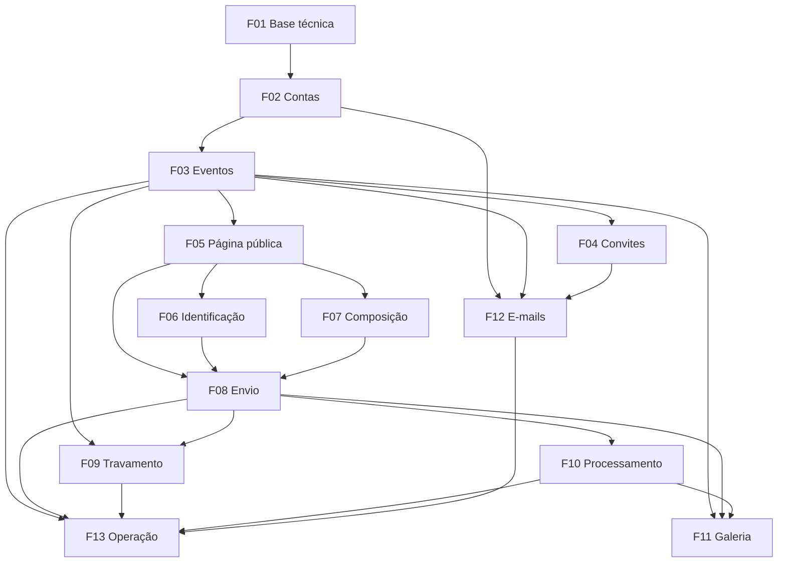

# Scrap Book

## 1. Resumo executivo

O Scrap Book é uma plataforma web para reunir e revisitar lembranças de casamentos, aniversários e encontros entre amigos e familiares. Convidados acessam a página do evento por link ou QR code, pelo navegador, e enviam depoimentos em foto, vídeo, áudio ou texto e momentos em fotos ou vídeo. O fluxo é pensado para celulares e também funciona em computadores.

Os responsáveis usam contas individuais e administram seus próprios eventos, com até dois responsáveis por evento. Eles podem acompanhar as lembranças imediatamente ou guardá-las como cápsula do tempo para uma data futura. Quando o acesso está liberado, a galeria reúne as contribuições em ordem de recebimento e oferece visualização em sequência.

O casamento de Diórgenes Backes será o piloto. O produto terá cadastro público para que outras pessoas possam criar eventos independentes. A primeira versão deve estar em produção com testes controlados concluídos até **15/10/2027**.

## 2. Problema e oportunidade

**Registros dispersos**

- Fotos e vídeos espontâneos ficam espalhados em celulares, conversas e redes sociais.
- Publicações temporárias podem desaparecer antes que os responsáveis consigam recuperá-las.
- Os responsáveis perdem cenas registradas por convidados enquanto participam de outras atividades do evento.

**Mensagens que perdem contexto**

- Recados escritos registram as palavras, mas deixam de fora a voz e a entonação.
- Fotos e vídeos espontâneos ganham contexto quando vêm acompanhados de autoria ou legenda.
- Enviar mensagem pessoal e compartilhar cenas do evento são intenções diferentes e pedem opções distintas de contribuição.

**Barreiras para participar**

- O piloto prevê de 90 a 100 convidados, com idades e familiaridade tecnológica variadas.
- Instalação de aplicativo, criação de conta e permissões de câmera podem interromper a contribuição.
- Wi-Fi compartilhado e falhas de rede durante o envio podem levar a abandono ou repetição.

**Abertura antecipada de lembranças**

- A cápsula do tempo perde a surpresa quando o conteúdo vaza antes da data escolhida.
- Quantidades, miniaturas e nomes de remetentes também revelam informações sobre os envios.
- Em eventos com dois responsáveis, ambos precisam receber a mesma decisão de acesso.

**Oportunidade**

- Reunir os registros de cada evento em uma galeria privada e cronológica, com autoria informada pelo convidado.
- Oferecer formatos diferentes para depoimentos e momentos, com revisão e legenda opcional para mídias.
- Permitir ingresso por link ou QR code sem conta, com captura no navegador, seleção de arquivo e retentativa da mesma contribuição.
- Aplicar a abertura por evento e por data no servidor, protegendo conteúdo e metadados enquanto a cápsula estiver fechada.

## 3. Público-alvo

### Usuários principais

**Responsáveis por eventos**

- Organizam casamentos, aniversários ou encontros e podem administrar vários eventos pela mesma conta.
- Compartilham o link ou o QR code dos convidados. Podem convidar uma segunda pessoa para dividir a responsabilidade, com as mesmas permissões.
- Escolhem quando o conteúdo pode ser visto e voltam à galeria para revisitar as lembranças.

**Convidados**

- Incluem pessoas de aproximadamente 10 a 90 anos, com diferentes níveis de familiaridade com celulares e computadores.
- Acessam o evento por link ou QR code e identificam seus envios com nome ou apelido.
- Podem gravar uma mensagem pessoal, compartilhar cenas espontâneas ou fazer várias contribuições ao longo do evento.

Os dois perfis usam a interface em português do Brasil e precisam de ações claras em celulares e computadores. No local do evento, a conexão pode alternar entre Wi-Fi compartilhado e rede móvel. O desenvolvimento e a operação inicial ficam a cargo de um responsável técnico, com alertas e procedimentos de recuperação.

## 4. Objetivos

| Objetivo | Métrica e condição de medição |
| --- | --- |
| **Estimular** a participação e facilitar os envios sem assistência. | Pelo menos 70% dos presentes no casamento piloto enviam ao menos uma contribuição, aproximadamente 63 a 70 pessoas para 90 a 100 presentes. A participação é estimada, pois nome ou apelido não identifica convidados de forma única. Nos testes do protótipo, medir a proporção que envia sem ajuda e definir o percentual de aceite para o piloto antes do lançamento. |
| **Preservar** as lembranças confirmadas e o sigilo da abertura programada. | Zero registros confirmados perdidos nos cenários de recuperação cobertos e zero exposições indevidas de conteúdo, contagens ou remetentes nos cenários de autorização. Validar separadamente o acesso residual de URLs emitidas antes do bloqueio, dentro da validade aprovada de até 2 minutos. |
| **Sustentar** a carga inicial e disponibilizar mídia para reprodução. | Suportar 200 envios simultâneos em 2 eventos, com 100 convidados por evento e uma mistura documentada de tipos e tamanhos. Nesse perfil, medir p95 de até 500 ms nas operações comuns de API, excluída a transferência de mídias, e pelo menos 95% das mídias prontas em até 5 minutos após a confirmação. A página pública deve estar pronta para uso em até 3 segundos no perfil 4G estável documentado. |
| **Operar** o serviço com recuperação verificável. | Disponibilidade mensal de 99,9% em produção. Em testes, detectar e disparar alerta de indisponibilidade em até 2 minutos e recuperar o serviço em até 10 minutos nos cenários cobertos. |
| **Validar** a primeira versão antes do piloto. | Aprovar 100% dos critérios aplicáveis, zerar defeitos críticos ou de alta gravidade em aberto e concluir testes controlados em produção até 15/10/2027. |

## 5. Histórias de usuários

### F01. Base da aplicação e ambientes

- Como pessoa responsável pela operação, quero executar a aplicação e o banco isoladamente em cada ambiente para testar mudanças sem afetar eventos reais.
- Como sistema, quero publicar frontend, backend e mudanças de banco conforme o fluxo do projeto para manter implantação e recuperação verificáveis.

### F02. Contas e sessões

- Como responsável, quero criar uma conta, confirmar meu e-mail e entrar para administrar meus eventos.
- Como responsável, quero sair da conta e alterar meu nome, e-mail ou senha para manter meus dados atualizados.
- Como responsável, quero recuperar o acesso com um código no meu e-mail e encerrar as sessões antigas após redefinir minha senha.

### F03. Eventos e política de abertura

- Como responsável, quero criar e listar meus eventos independentes para gerenciar cada celebração.
- Como responsável, quero editar nome, data, horário, capa e boas-vindas enquanto o evento permitir mudanças.
- Como responsável, quero escolher entre acesso imediato e abertura futura para decidir quando ver as lembranças.
- Como responsável de um evento fechado, quero ver a data e a contagem regressiva sem descobrir o que já foi enviado.

### F04. Convite do segundo responsável

- Como responsável, quero gerar um convite por QR code ou e-mail para dividir a administração do evento.
- Como pessoa convidada, quero entrar ou criar uma conta e aceitar um convite válido para ter acesso ao evento com as mesmas permissões.

### F05. Página pública, QR code e prazos

- Como responsável, quero copiar o link dos convidados e baixar um QR code para imprimir e distribuir.
- Como convidado, quero abrir a página pelo link ou QR code, reconhecer o evento e ver quando posso contribuir sem criar uma conta.

### F06. Identificação do convidado

- Como convidado, quero informar nome ou apelido e concordar com o aviso de acesso para identificar a contribuição.
- Como convidado, quero reutilizar meus dados no mesmo evento e poder corrigir o nome antes de um novo envio.

### F07. Composição e revisão

- Como convidado, quero escolher o formato de depoimento ou momento, gravar na página ou selecionar arquivos e revisar o resultado.
- Como convidado, quero escrever um depoimento ou adicionar uma legenda opcional com indicação do espaço disponível.
- Como convidado, quero refazer ou descartar o conteúdo antes de enviar e receber um aviso se estiver prestes a perder o trabalho.

### F08. Envio e confirmação

- Como convidado, quero acompanhar a transferência e a validação, repetir uma tentativa interrompida e saber quando o envio estiver confirmado.
- Como convidado, quero que meu conjunto de fotos seja confirmado integralmente e poder iniciar outra contribuição se a janela continuar aberta.

### F09. Travamento após primeiro registro

- Como sistema, quero travar os dados estruturais e os convites após o primeiro registro confirmado para preservar a configuração usada pelo evento.

### F10. Processamento de mídias

- Como responsável com acesso liberado, quero reconhecer mídias em preparação e poder reproduzi-las quando estiverem prontas.
- Como sistema, quero preparar novas versões para visualização e repetir falhas transitórias preservando os originais confirmados.

### F11. Galeria e reprodução

- Como responsável com acesso liberado, quero filtrar a galeria e percorrer as lembranças em ordem para revisitar o evento.
- Como responsável, quero ver autoria e legenda e decidir quando reproduzir ou avançar cada item.

### F12. E-mails de evento

- Como responsável, quero solicitar o envio do convite por e-mail e poder compartilhar o QR code caso o encaminhamento falhe.
- Como responsável, quero receber um e-mail quando as lembranças forem liberadas para acessar o evento pela minha conta.

### F13. Operação e auditoria

- Como pessoa responsável pela operação, quero receber alertas de indisponibilidade e falhas de envio ou processamento para recuperar o serviço.
- Como pessoa responsável pela operação, quero consultar alterações sensíveis e correlacionar falhas sem abrir conteúdo de convidados.

## 6. Funcionalidades

### F01. Base da aplicação e ambientes

#### Capacidades

- Organizar a solução nos seis repositórios de frontend, backend, documentação, testes, Liquibase e infraestrutura. A aplicação web usa React e TypeScript e o backend .NET é um serviço único em Clean Architecture. PostgreSQL guarda os dados estruturados e Liquibase controla as alterações de schema. Os contratos e componentes estão detalhados no [HLD](HLD.md) e nos [guidelines](guidelines/README.md).
- Manter ambiente local e dois ambientes AWS, homologação e produção, com recursos, dados e permissões isolados em uma região. Homologação e produção aplicam as mesmas regras de negócio. Usar HTTPS nas interfaces públicas e manter as mídias de lembranças em armazenamento privado.
- Proteger os fluxos com limites de requisição e tentativas de login calibrados para a carga, incluindo convidados que compartilham o mesmo IP. A identidade de desenvolvimento é explícita, local e desabilitada por padrão.
- Atender celulares e computadores nas duas versões principais mais recentes de Chrome, Safari, Edge e Firefox, nas plataformas aplicáveis. Validar Android, iPhone, computadores, teclado, contraste, campos e leitores de tela conforme a meta WCAG 2.2 AA. A revisão de acessibilidade deve abranger também os critérios aplicáveis ao conteúdo enviado por convidados.

#### Experiência

- No ambiente local, iniciar a aplicação, preparar o banco com Liquibase e verificar saúde e prontidão. Homologação e produção são promovidas separadamente pelo fluxo documentado. Mudanças de schema têm aplicação e recuperação pelo fluxo do Liquibase.
- Nas interfaces de usuário, apresentar rótulos e estados identificáveis por texto, teclado e tecnologia assistiva. Mensagens de falha descrevem a ação possível. Interface e e-mails são em português do Brasil.

#### Tratamento de erros

- Dependência indisponível ao iniciar. Sinalizar operacionalmente “Ambiente indisponível” e manter o serviço fora do tráfego até a prontidão.
- Alteração de banco malsucedida. Registrar “Falha ao aplicar a alteração de banco” com correlação e seguir o procedimento de recuperação do Liquibase.
- Serviço temporariamente indisponível no navegador. Exibir “Serviço temporariamente indisponível. Tente novamente em instantes.” e preservar o trabalho em andamento quando a página ainda tiver os dados.

### F02. Contas e sessões

#### Fornece

- Contato de responsável com identificador da conta e e-mail confirmado (usado por F12).

#### Capacidades

- Cadastro público com nome, e-mail e senha. Entrar com e-mail e senha exige confirmação inicial do endereço. Oferecer visualização opcional da senha. A política registrada prevê pelo menos 6 caracteres, incluindo uma letra maiúscula e uma minúscula. Antes do aceite, comprovar a política, a cobertura dos fluxos e a acessibilidade em português nas telas gerenciadas do Cognito.
- Sessão individual de até 7 dias. O navegador usa cookie seguro e HttpOnly para a sessão local. Credenciais são geridas pelo Cognito e seus tokens ficam fora do JavaScript.
- Permitir editar nome, e-mail e senha. Exigir a senha atual para trocar e-mail ou senha. Confirmar o novo endereço antes de substituir o anterior.
- Na recuperação, o Cognito envia um código por e-mail com validade de 1 hora. Para pedidos elegíveis, a meta é encaminhar o e-mail ao SES em até 1 minuto. Troca ou recuperação de senha encerra todas as sessões da conta, inclusive em outros dispositivos.

#### Experiência

- A pessoa cria a conta, confirma o endereço e entra. Após autenticação, segue para os próprios eventos ou retoma o convite pelo qual chegou. Na área da conta, altera o nome diretamente ou confirma a senha atual ao alterar credenciais.
- A pessoa que perdeu acesso informa o e-mail, recebe a orientação de verificar a caixa de entrada, insere o código e escolhe a nova senha. A tela concluída direciona para um novo login. A saída encerra a sessão em uso.

#### Tratamento de erros

- Credenciais inválidas ou tentativa excessiva. Exibir “Não foi possível entrar. Confira os dados ou tente novamente mais tarde.”
- E-mail ainda sem confirmação. Exibir “Confirme seu e-mail para entrar.”
- Senha atual incorreta ou alteração rejeitada. Exibir “Não foi possível alterar os dados. Confira sua senha e os campos informados.” e manter os dados anteriores.
- Código de recuperação inválido ou expirado. Exibir “Código inválido ou expirado. Confira o código ou solicite outro.”
- Sessão expirada ou revogada. Exibir “Sua sessão terminou. Entre novamente.”

### F03. Eventos e política de abertura

#### Fornece

- Evento com identificador, dados públicos (nome, capa, mensagem de boas-vindas), data e horário de início (usado por F05).
- Evento com identificador, vínculos dos responsáveis e estado do travamento (usado por F04, F09).
- Política de abertura com identificador do evento, modo, data de liberação e vínculos dos responsáveis (usado por F11, F12).
- Alteração de abertura com identificador do evento, autoria, instante, política anterior e nova e correlação (usado por F13).

#### Capacidades

- Cada conta pode criar ou participar de vários eventos. O criador se torna responsável do novo evento. O servidor filtra eventos e autoriza operações pelo vínculo de responsabilidade. Cada evento funciona com um ou dois responsáveis, ambos com as mesmas permissões.
- Exigir nome, data e horário do evento em `America/Sao_Paulo`. Oferecer capa e mensagem padrão, com personalização antes do travamento estrutural. Confirmar formatos, limites e proporção da capa personalizada no detalhamento funcional.
- Usar abertura futura como padrão, sugerindo 1 ano após a data do evento. Para 29 de fevereiro, sugerir 28 de fevereiro do ano seguinte. Liberar às 00h de Brasília na data escolhida. A data deve ser posterior ao dia atual e a abertura deve ocorrer depois do encerramento dos envios. Se a data sugerida não atender a essas regras, solicitar outra antes de salvar. A política abrange depoimentos e momentos.
- Configurar o modo na criação e permitir a troca durante a janela de novos envios, que termina ao meio-dia do dia seguinte ao evento. A tolerância de conclusão até 13h não altera esse limite. Ao meio-dia, uma abertura futura fica travada. Se o evento estiver no modo imediato, permitir uma única mudança posterior para abertura futura, já travada. Reavaliar qualquer trava já efetiva antes de mudar a data ou o horário do evento.
- Revalidar vínculo e regra temporal a cada pedido de acesso. Enquanto o evento estiver fechado, ocultar conteúdo, quantidades, remetentes, miniaturas e novas autorizações de mídia. A liberação começa ao atingir a data configurada, independentemente do envio do aviso.

#### Experiência

- Em “Meus eventos”, o responsável cria um evento, informa nome, data e horário, revisa capa e boas-vindas e confirma o modo de acesso. Depois, pode editar as informações do evento e a política de abertura em controles próprios, de acordo com as travas aplicáveis.
- No evento fechado, a área de lembranças mostra a data e a contagem regressiva em dias, horas e minutos. Ao mudar de imediato para futuro, a interface interrompe consultas e reprodução quando detecta o bloqueio e limpa as mídias sob seu controle. URLs anteriores conservam seu vencimento original, de até 2 minutos. Transferências já iniciadas podem seguir conforme o serviço de entrega, e dados já recebidos podem permanecer no dispositivo.

#### Tratamento de erros

- Nome, data ou horário ausente ou inválido. Exibir “Confira os campos destacados antes de salvar.”
- Acesso sem vínculo. Exibir “Evento indisponível para esta conta.”
- Edição estrutural após a trava. Exibir “As informações deste evento estão travadas.”
- Abertura futura inválida. Exibir “Escolha uma data futura depois do encerramento dos envios.”
- Mudança depois da trava da política. Exibir “A data de abertura deste evento está travada.”

### F04. Convite do segundo responsável

#### Consome

- **F03** Evento com identificador, vínculos dos responsáveis e estado do travamento.

#### Fornece

- Solicitação de convite com identificador, evento, destinatário informado, link e validade (usado por F12).

#### Capacidades

- Com 1 responsável e o evento estruturalmente aberto a alterações, criar até 1 convite pendente por evento. O convite expira em 24 horas, é de uso único e é substituído ao gerar outro.
- Restringir aceite a uma conta confirmada. Revalidar o convite, a vaga e o travamento no aceite. Se duas contas disputarem a última vaga, somente uma pode ser vinculada. O uso do convite e o vínculo são registrados juntos.
- Após o travamento estrutural, bloquear geração e aceite, inclusive de convites dentro da validade.

#### Experiência

- A tela de responsáveis exibe o QR code ao gerar o convite. Oferece pedir o envio por e-mail. Quem recebe abre o convite, entra ou cria e confirma a conta, aceita e passa a encontrar o evento em “Meus eventos”.

#### Tratamento de erros

- Convite inválido, expirado ou substituído. Exibir “Este convite não está mais disponível. Solicite um novo.”
- Convite utilizado. Exibir “Este convite já foi usado.”
- Evento já tem dois responsáveis. Exibir “Este evento já tem dois responsáveis.”
- Geração ou aceite após travamento. Exibir “Os convites deste evento estão travados.”
- Falha no encaminhamento por e-mail. Exibir “Não foi possível enviar o convite por e-mail. Compartilhe o QR code ou tente novamente.”

### F05. Página pública, QR code e prazos

#### Consome

- **F03** Evento com identificador, dados públicos (nome, capa, mensagem de boas-vindas), data e horário de início.

#### Fornece

- Contexto público com identificador do evento (usado por F06).
- Janela de contribuição com identificador do evento, estado de novos envios e horários de início, encerramento de novos envios e limite de conclusão (usado por F07, F08).

#### Capacidades

- Disponibilizar 1 página pública por evento por link e QR code, sem login nem senha adicional. Mostrar nome, capa, boas-vindas e QR code. O QR dos convidados aponta para a página pública do evento e é distinto do convite a responsável.
- Abrir novos envios no horário de início menos 2 horas e aceitar novos pedidos até antes das 12h do dia seguinte. Pedidos admitidos no prazo podem concluir até 13h inclusive do dia seguinte. Calcular os horários em Brasília pelo servidor.
- Expor apenas a personalização e as informações necessárias para participar. Conteúdo enviado, remetentes e contagens são privados.

#### Experiência

- O responsável copia o link público ou baixa o QR code para impressão. Escanear a impressão leva à página do evento correto.
- Antes do horário inicial, a página informa quando os envios abrem. Durante a janela, mostra “Deixe um depoimento” e “Registre um momento”. Ao meio-dia do dia seguinte, informa o encerramento e deixa de oferecer novos envios. Link inválido apresenta “Evento indisponível.”

### F06. Identificação do convidado

#### Consome

- **F05** Contexto público com identificador do evento.

#### Fornece

- Identificação de convidado com identificador do evento, nome ou apelido e concordância com o aviso de acesso (usado por F08).

#### Capacidades

- Exigir nome ou apelido preenchido e concordância com o aviso para 100% dos depoimentos e momentos. Informar que apenas os responsáveis pelo evento podem acessar as contribuições conforme a política definida no evento.
- Guardar nome e concordância no navegador por evento e reutilizar nas duas categorias. Mudança de nome ou perda dos dados locais exige nova concordância. O nome informado é autodeclarado.

#### Experiência

- Antes do envio, solicitar nome ou apelido e concordância quando faltarem. Nos próximos envios, mostrar o nome registrado e permitir edição. Ao alterar o nome, pedir concordância antes de permitir o envio. Em outro evento, pedir os dados no contexto desse evento.

#### Tratamento de erros

- Nome vazio ou só com espaços. Exibir “Informe seu nome ou apelido.”
- Concordância ausente ou invalidada pela troca de nome. Exibir “Confirme que você leu o aviso para continuar.”
- Dados locais indisponíveis. Exibir “Informe seu nome e confirme o aviso para este evento.” e manter o conteúdo já preparado na página.

### F07. Composição e revisão

#### Consome

- **F05** Janela de contribuição com identificador do evento e estado de novos envios.

#### Fornece

- Contribuição revisada com identificador do evento, categoria, formato, corpo de texto ou arquivos (ordem, formato, tamanho e duração quando aplicável) e legenda opcional (usado por F08).

#### Capacidades

| Categoria e formato | Quantidade por contribuição | Limites |
| --- | --- | --- |
| Depoimento em foto | 1 foto | 20 MB |
| Depoimento em vídeo | 1 vídeo | 500 MB e 5 minutos |
| Depoimento em áudio | 1 áudio | 50 MB e 5 minutos |
| Depoimento em texto | 1 texto preenchido | 5.000 caracteres, incluindo espaços e pontuação |
| Momento em fotos | 1 a 10 fotos | 20 MB por foto |
| Momento em vídeo | 1 vídeo | 500 MB e 1 minuto |

- Aceitar um formato por contribuição. Formatos iniciais de foto são JPEG, PNG e HEIC/HEIF. Para vídeo, MP4, MOV e WebM. Para áudio, MP3, M4A, WAV, OGG e WebM. O suporte a containers e codecs deve ser comprovado nos dispositivos previstos. Gravações podem ter qualquer duração positiva dentro do limite, desde que gerem um arquivo válido.
- Permitir câmera para foto e vídeo e microfone para áudio. Sempre oferecer seleção de arquivo como alternativa. Para mídias, permitir uma legenda opcional de até 500 caracteres, compartilhada entre as fotos de um conjunto.

#### Experiência

- O convidado escolhe a categoria e um formato, captura, seleciona ou escreve. A gravação indica tempo restante e termina automaticamente no limite, abrindo a revisão. O depoimento escrito mostra o contador quando faltam 500 caracteres. Em mídias, “Deseja adicionar uma legenda?” abre o campo, e o aviso aparece quando faltam 100 caracteres. Digitação e colagem respeitam os limites sem impedir correções e remoção de texto. Interface e servidor devem adotar a mesma unidade de contagem. O contrato de envio deve explicitar essa unidade e a equivalência dos limites em MB para bytes.
- Na revisão, mostrar a prévia e permitir refazer a gravação, trocar arquivos, editar texto ou legenda e descartar o conteúdo. “Enviar” é uma ação explícita. Se a pessoa tentar sair com trabalho pendente, avisar “Você pode perder o trabalho em andamento.” Ao fechar ou recarregar, a apresentação do aviso depende do navegador. O trabalho permanece disponível enquanto a página e seu conteúdo estiverem preservados.

#### Tratamento de erros

- Câmera ou microfone negado ou indisponível. Exibir “Permita o acesso no navegador ou selecione um arquivo do dispositivo.”
- Gravação interrompida ou prévia indisponível. Exibir “Não foi possível preparar a prévia. Tente novamente ou escolha outro arquivo.”
- Arquivo vazio, inválido ou acima do tamanho ou duração. Identificar o arquivo e mostrar o limite aplicável, como “Este vídeo de momento deve ter até 1 minuto e 500 MB.”
- Texto em branco ou acima do limite. Exibir “Escreva um depoimento de até 5.000 caracteres.”
- Legenda acima do limite. Exibir “A legenda deve ter até 500 caracteres.”

### F08. Envio e confirmação

#### Consome

- **F05** Janela de contribuição com identificador do evento, estado de novos envios e horários de início, encerramento de novos envios e limite de conclusão.
- **F06** Identificação de convidado com identificador do evento, nome ou apelido e concordância com o aviso de acesso.
- **F07** Contribuição revisada com identificador do evento, categoria, formato, corpo de texto ou arquivos (ordem, formato, tamanho e duração quando aplicável) e legenda opcional.

#### Fornece

- Primeiro registro confirmado com identificadores do evento e do registro e instante de confirmação (usado por F09).
- Mídia confirmada com identificadores do evento, registro e arquivo, formato, referência ao original privado e instante de confirmação (usado por F10).
- Registro confirmado com identificadores do evento e do registro, horário de recebimento, categoria, formato, autoria, corpo de texto ou arquivos com identificadores e ordem, e legenda opcional (usado por F11).
- Falha de envio com identificador da tentativa, etapa, classificação, instante e correlação (usado por F13).

#### Capacidades

- A decisão de admitir o envio usa o instante em que o servidor recebe o pedido feito após “Enviar”. Escolher arquivos ou gravar na página não reserva prazo. Guardar a janela admitida. Evidência de recebimento integral até 13h permite validar ou preparar a mídia depois.
- Abrir uma sessão de envio por tentativa lógica com idempotência. Transferir os arquivos diretamente ao S3 privado com autorizações temporárias restritas aos arquivos esperados. Usar transferência em partes para vídeos grandes. Na retentativa, reaproveitar a sessão e as partes válidas quando couber.
- No servidor, revalidar identificação, concordância, categoria, quantidade, texto, legenda, tamanho, formato real, integridade e duração. Confirmar apenas após persistir todos os dados e originais, com os efeitos assíncronos registrados na mesma transação dos dados. Uma foto ausente ou rejeitada impede a confirmação de todo o conjunto. Submeter arquivos incompletos ou rejeitados à limpeza após 24 horas e validar o atraso operacional desse processo.

#### Experiência

- Ao iniciar um envio, desabilitar novos acionamentos e o início de outra contribuição. Exibir porcentagem real de transferência e a etapa de validação separadamente. Consultar o estado a cada 5 segundos enquanto houver etapa pendente. Se a conexão cair ou a resposta se perder, manter o conteúdo disponível na página e recuperar a mesma tentativa enquanto permitido. Se o envio já estiver confirmado, mostrar seu resultado mesmo depois da janela, sem repetir a gravação.
- Na confirmação, mostrar recibo genérico sem prévia. Oferecer “Deixar outro depoimento” e “Registrar um momento” enquanto novos pedidos estiverem abertos. A confirmação e o estado da tentativa não concedem acesso posterior ao texto, aos arquivos ou à exclusão.

#### Tratamento de erros

- Fora do intervalo de novos envios. Exibir “Novos envios ainda não estão disponíveis.” ou “O prazo para novos envios terminou.”, conforme o horário.
- Prazo de uma tentativa admitida encerrado sem recebimento integral. Exibir “O prazo para concluir este envio terminou.”
- Conexão ou autorização temporária interrompida. Exibir “O envio foi interrompido. Tente novamente.” se ainda houver prazo.
- Validação rejeitada. Identificar o arquivo e o motivo. Para conjuntos, informar “O conjunto não foi enviado. Confira os arquivos indicados.”
- Confirmação incerta. Exibir “Estamos verificando o estado do envio.” e consultar a tentativa existente antes de permitir nova ação sobre a contribuição.

### F09. Travamento após primeiro registro

#### Consome

- **F03** Evento com identificador e estado do travamento.
- **F08** Primeiro registro confirmado com identificadores do evento e do registro e instante de confirmação.

#### Fornece

- Resultado de travamento com identificador do evento, instante de confirmação, instante de travamento ou falha e correlação (usado por F13).

#### Capacidades

- O primeiro registro confirmado, inclusive texto, provoca travamento de nome, capa, boas-vindas, data, horário, geração e aceite de convites. A meta é concluir em até 5 segundos após a confirmação, em condições normais. É aceita a janela eventual em que edição ou aceite ainda podem ocorrer.
- Registrar o fato com o registro confirmado em Outbox e aplicar a trava em consumo idempotente. Repetição de mensagem ou chegada posterior de outro registro preserva a primeira trava aplicada.
- Após o travamento, preservar as transições de abertura que ainda forem permitidas pelo prazo e modo do evento.

#### Experiência

- O convidado recebe a confirmação assim que os dados estão persistidos. Quando a trava é aplicada, os responsáveis veem as ações afetadas desabilitadas e continuam tendo acesso aos controles de abertura permitidos. Operações diretas no backend recebem a mesma decisão.

#### Tratamento de erros

- Registro rejeitado ou inconcluso. Manter a configuração editável e mostrar “Estamos verificando o estado do envio.” ou a mensagem específica de rejeição, sem registrar travamento.
- Falha transitória no processamento do fato. Retentar e registrar “Travamento do evento pendente” para investigação operacional.
- Tentativas esgotadas. Preservar o fato para recuperação e alertar “Falha ao travar o evento após confirmação.”

### F10. Processamento de mídias

#### Consome

- **F08** Mídia confirmada com identificadores do evento, registro e arquivo, formato, referência ao original privado e instante de confirmação.

#### Fornece

- Estado de mídia com identificador do arquivo, estado de preparação e referências privadas das variantes disponíveis (usado por F11).
- Falha definitiva de mídia com identificadores do evento, registro e arquivo, etapa, instante e correlação (usado por F13).

#### Capacidades

- Preparar mídias em segundo plano, com meta de disponibilizar pelo menos 95% em até 5 minutos depois da confirmação. Preservar os originais privados e admitir processamento depois do horário limite de envio.
- Gerar vídeo MP4 com H.264 e áudio AAC, até 1080p e 30 fps, sem ampliar resolução ou taxa de quadros. Gerar áudio M4A com AAC. Para fotos, gerar JPEG com maior lado de até 2.048 pixels e miniatura de até 400 pixels. Preservar orientação, proporção e imagens menores, e retirar dados de localização das versões exibidas.
- Usar filas e processamento idempotente, com novas tentativas automáticas e possibilidade de reprocessamento após correção. Definir quantidade de tentativas e limites operacionais no detalhamento do processamento e comprovar os formatos e codecs em homologação.

#### Experiência

- Quando o acesso estiver liberado, mostrar “Processando” enquanto a variante não estiver pronta e permitir reprodução após a conclusão. Em falha definitiva, indicar “Mídia temporariamente indisponível.” A confirmação de recebimento permanece válida.

#### Tratamento de erros

- Conversão falha temporariamente. Manter “Processando” enquanto o trabalho é repetido e preservar o original.
- Tarefa interrompida ou resultado incerto. Registrar “Preparação de mídia pendente de reconciliação”, manter o trabalho recuperável e consultar o estado antes de disparar nova conversão.
- Tentativas esgotadas. Marcar mídia indisponível, preservar o original e alertar “Falha definitiva na preparação da mídia.”

### F11. Galeria e reprodução

#### Consome

- **F03** Política de abertura com identificador do evento, modo, data de liberação e vínculos dos responsáveis.
- **F08** Registro confirmado com identificadores do evento e do registro, horário de recebimento, categoria, formato, autoria, corpo de texto ou arquivos com identificadores e ordem, e legenda opcional.
- **F10** Estado de mídia com identificador do arquivo, estado de preparação e referências privadas das variantes disponíveis.

#### Capacidades

- Oferecer galeria e visualização em sequência com filtros “Depoimentos”, “Momentos” e “Tudo”. Ordenar do primeiro recebimento ao último e manter ordem determinística quando houver empate. Paginar por cursor, até 10 itens por resposta, contando cada foto de um conjunto como um item. Repetir a autoria e a legenda compartilhada em cada foto do conjunto.
- Revalidar autorização antes de buscar ou entregar qualquer lembrança. Emitir URLs de mídia assinadas com até 2 minutos de validade. Renovar somente após nova verificação de vínculo e abertura. Preservar o acesso dos responsáveis enquanto a plataforma for mantida, observados os procedimentos de privacidade. As credenciais técnicas de uso habitual não concedem leitura direta das lembranças.

#### Experiência

- O responsável abre a galeria liberada, escolhe um filtro e abre uma lembrança. A visualização exibe autoria e legenda quando houver, ou o texto no formato correspondente. Áudio e vídeo começam com “Reproduzir”. “Próximo” é uma ação explícita, inclusive depois do fim de um vídeo ou áudio. Ao voltar, preservar filtro e posição enquanto a sessão e a autorização permitirem.
- Ao detectar que um evento voltou ao modo fechado, interromper a consulta e a reprodução sob controle da interface e voltar à contagem regressiva.

#### Tratamento de erros

- Conta sem vínculo ou sessão válida. Exibir “Entre com uma conta responsável por este evento.”
- Acesso ainda bloqueado ou revogado. Exibir “As lembranças estarão disponíveis na data de abertura.” e mostrar apenas a experiência fechada.
- URL vencida ou falha temporária de reprodução. Exibir “Não foi possível reproduzir. Tente novamente.” Ao repetir, solicitar nova autorização.
- Mídia em preparação ou com falha definitiva. Exibir “Processando” ou “Mídia temporariamente indisponível.” somente se o acesso estiver liberado.

### F12. E-mails de evento

#### Consome

- **F02** Contato de responsável com identificador da conta e e-mail confirmado.
- **F03** Política de abertura com identificador do evento, modo, data de liberação e vínculos dos responsáveis.
- **F04** Solicitação de convite com identificador, evento, destinatário informado, link e validade.

#### Fornece

- Resultado de encaminhamento com tipo, identificador do evento, estado, instantes de solicitação e encaminhamento e correlação (usado por F13).

#### Capacidades

- Encaminhar ao SES os convites solicitados em até 1 minuto. Comprovar o encaminhamento na configuração real.
- Acionar diariamente às 00h de Brasília a busca de eventos já liberados com aviso pendente. Encaminhar aviso aos responsáveis em até 5 minutos da abertura programada, com link que exige autenticação. Usar somente a política vigente e contatos dos responsáveis vinculados. O disparo de e-mail é independente da autorização de visualização.
- Usar português do Brasil e manter tentativas, resultados e controle de repetição da mesma notificação. As metas medem encaminhamento ao SES. O tempo de chegada à caixa de entrada depende do provedor do destinatário.

#### Experiência

- O e-mail de convite apresenta o evento, a validade de 24 horas e a ação de aceitar. O aviso de abertura conduz ao evento protegido pela sessão, sem mostrar lembranças, remetentes ou contagens no corpo.
- Quando o encaminhamento do convite falhar, manter disponível a alternativa de compartilhamento por QR code. Uma falha no aviso de abertura deixa a galeria acessível para os responsáveis a partir do horário programado.

#### Tratamento de erros

- Serviço de e-mail temporariamente indisponível. Retentar e registrar “Encaminhamento de e-mail pendente” no acompanhamento operacional.
- Endereço rejeitado. Mostrar “Confira o endereço do convite ou compartilhe o QR code.” quando houver ação disponível na interface.
- Reentrega da mesma tarefa. Reconhecer o estado existente e evitar novo encaminhamento de mensagem já registrada como encaminhada.
- Abertura alterada antes do disparo. Descartar a tarefa obsoleta e registrar “Aviso de abertura desatualizado.”

### F13. Operação e auditoria

#### Consome

- **F03** Alteração de abertura com identificador do evento, autoria, instante, política anterior e nova e correlação.
- **F08** Falha de envio com identificador da tentativa, etapa, classificação, instante e correlação.
- **F09** Resultado de travamento com identificador do evento, instante de confirmação, instante de travamento ou falha e correlação.
- **F10** Falha definitiva de mídia com identificadores do evento, registro e arquivo, etapa, instante e correlação.
- **F12** Resultado de encaminhamento com tipo, identificador do evento, estado, instantes de solicitação e encaminhamento e correlação.

#### Capacidades

- Correlacionar saúde, latência, erros, falhas de envio, travamentos, filas, preparação de mídia e e-mails, além das mudanças sensíveis auditáveis. Registrar autoria, instante e contexto das mudanças de acesso. Guardar registros técnicos e de auditoria por 180 dias com acesso restrito e proteção de integridade.
- Disparar alerta por e-mail de indisponibilidade em até 2 minutos, de 3 envios distintos com erro em uma janela de 5 minutos e de falhas definitivas de mídia ou tarefas em fila de falha. Medir disponibilidade mensal a partir das verificações de produção.
- Permitir investigação e recuperação por uma pessoa com as ferramentas operacionais. Excluir conteúdo, identidades dos convidados, credenciais, códigos, URLs utilizáveis e metadados que revelem recebimento bloqueado da telemetria e dos alertas. Restringir informações de auditoria à finalidade operacional autorizada.

#### Experiência

- A pessoa responsável pela operação recebe o alerta com ambiente, tipo de falha e correlação, consulta a evidência autorizada e segue o procedimento documentado. Após recuperação, verifica disponibilidade, integridade dos registros confirmados e estado dos trabalhos retomados.

#### Tratamento de erros

- Coleta interrompida. Exibir “Telemetria indisponível” na ferramenta operacional e manter a falta de evidência visível.
- Falha de encaminhamento do próprio alerta. Preservar o evento operacional e registrar “Falha ao encaminhar alerta” para investigação.
- Exposição de dado sensível em telemetria. Acionar “Incidente de privacidade em telemetria” com acesso restrito e seguir o procedimento operacional de contenção.

## 7. Fora de escopo

- **Plataforma e idiomas.** Aplicativo nativo, operação offline, recuperação de rascunhos após saída ou recarga, tradução da interface ou dos e-mails e seleção de fuso horário.
- **Identidade e papéis.** Conta ou login de convidado, vínculo com lista oficial, mais de dois responsáveis, papel de administrador de evento e autenticação em duas etapas. CAPTCHA no uso normal.
- **Lembranças e eventos.** Edição, corte ou montagem de mídia, busca por nome ou apelido, download, edição ou exclusão de lembranças pela interface, exclusão de eventos pela interface, reprodução e avanço automáticos.
- **Prazos, operação e infraestrutura.** Extensão automática dos prazos em caso de indisponibilidade, recuperação multirregião, coordenação automatizada de publicações entre repositórios e proteção contra alteração deliberada de permissões por um administrador privilegiado.
- **Comercial.** Planos, cobrança e integração funcional com ferramentas de gestão do projeto.

## 8. Grafo de dependências

### Parte 1. Tabela de dependências

| # | Funcionalidade | Prioridade | Dependências |
| --- | --- | --- | --- |
| F01 | Base da aplicação e ambientes | 1 | Nenhuma |
| F02 | Contas e sessões | 1 | F01 |
| F03 | Eventos e política de abertura | 1 | F02 |
| F04 | Convite do segundo responsável | 2 | F03 |
| F05 | Página pública, QR code e prazos | 1 | F03 |
| F06 | Identificação do convidado | 1 | F05 |
| F07 | Composição e revisão | 1 | F05 |
| F08 | Envio e confirmação | 1 | F05, F06, F07 |
| F09 | Travamento após primeiro registro | 1 | F03, F08 |
| F10 | Processamento de mídias | 1 | F08 |
| F11 | Galeria e reprodução | 1 | F03, F08, F10 |
| F12 | E-mails de evento | 2 | F02, F03, F04 |
| F13 | Operação e auditoria | 1 | F03, F08, F09, F10, F12 |

A numeração anterior aparece na [matriz de telas](design-system/screen-matrix.md) e na [rastreabilidade da modelagem](db/DB-Modelagem.md#rastreabilidade-funcional). A correspondência abaixo orienta a leitura das referências históricas.

| Requisitos anteriores | Funcionalidade atual |
| --- | --- |
| FR-001, FR-002 | F02 |
| FR-003, FR-017, FR-018 | F03 |
| FR-004 | F04 |
| FR-005, FR-006 | F05 |
| FR-007 | F06 |
| FR-008, FR-009, FR-010, FR-011, FR-012, FR-013 | F07, com validação e atomicidade no recebimento em F08 |
| FR-014, FR-015 | F08 |
| FR-016 | F09 |
| FR-019 | F11 |
| FR-020 | F10 |
| FR-021 | F12 para e-mails de evento e F02 para confirmação e recuperação de conta |
| FR-022 | F13 |

### Parte 2. Funcionalidades de fundação

- **F01. Base da aplicação e ambientes** prepara as estruturas comuns de frontend, API, banco, roteamento, configuração e promoção entre ambientes. A identidade e as sessões de F02 usam essa base.

### Parte 3. Ondas de execução

Uma onda começa após a conclusão das anteriores. Funcionalidades na mesma onda podem ser implementadas em paralelo. Quando várias funcionalidades de fundação estiverem na mesma onda de um projeto novo, suas estruturas compartilhadas são preparadas em sequência.

- **Onda 1** F01
- **Onda 2** F02
- **Onda 3** F03
- **Onda 4** F05, F04
- **Onda 5** F06, F07, F12
- **Onda 6** F08
- **Onda 7** F09, F10
- **Onda 8** F11, F13

### Parte 4. Níveis de prioridade

- **1. Essencial.** Necessária à experiência principal ou às garantias de lançamento.
- **2. Importante.** Acrescenta valor significativo à primeira versão.
- **3. Desejável.** Amplia a experiência de forma incremental.

### Parte 5. Diagrama

## 9. Critérios de aceitação

### F01. Base da aplicação e ambientes

- A base inicia localmente com banco preparado pelo Liquibase, saúde e prontidão observáveis. Uma dependência obrigatória indisponível impede a prontidão. Uma falha de migração aciona a recuperação testada conforme o fluxo documentado.
- Homologação e produção usam recursos e identidades isolados. Uma conta, autorização ou objeto de um ambiente não pode ser usado no outro. A identidade local permanece desabilitada por padrão.
- Fluxos críticos passam em Android, iPhone e computadores na matriz de navegadores aplicável. Validações automatizadas e manuais cobrem teclado, contraste, campos, leitor de tela e os critérios de mídia aplicáveis da WCAG 2.2 AA.

### F02. Contas e sessões

- Uma pessoa cadastra nome, e-mail e senha, confirma o e-mail e entra. Antes da confirmação, o login é bloqueado. Credenciais inválidas, tentativas excessivas e sessão expirada produzem feedback seguro.
- Alterar nome funciona sem senha atual. Alterar e-mail exige senha atual e mantém o endereço anterior até confirmar o novo. Senha atual incorreta não altera dados.
- Em homologação, o e-mail de recuperação elegível é encaminhado ao SES em até 1 minuto. O código Cognito é recusado quando inválido ou depois de 1 hora. Trocar ou redefinir a senha torna inválidas todas as sessões anteriormente abertas. Sair encerra a sessão em uso. Nenhuma sessão ultrapassa 7 dias.

### F03. Eventos e política de abertura

- Uma conta cria e administra vários eventos independentes, com capa e mensagem padrão ou personalizada. Outra conta sem vínculo não consegue consultar nem editar a configuração.
- A criação sugere abertura em 1 ano, ajusta 29 de fevereiro para 28 de fevereiro do ano seguinte e rejeita data passada ou incompatível com os prazos de envio.
- Durante a janela de novos envios, a política pode alternar entre imediato e futuro. Ao meio-dia, um evento em modo futuro trava a data. Um evento em modo imediato permite uma única mudança posterior para futuro. A tolerância das 13h e uma mudança na data do evento não desfazem uma trava já efetiva.
- Até a meia-noite da data escolhida, a interface mostra somente data de abertura e contagem regressiva na área fechada. O backend não entrega conteúdo, miniaturas, quantidades ou remetentes. A partir da meia-noite, o responsável passa pela autorização sem depender do agendador.

### F04. Convite do segundo responsável

- Um evento com um responsável é utilizável. Seu responsável gera um QR de convite, e uma conta confirmada que o aceita ganha as mesmas permissões e vê o evento.
- Gerar um convite novo invalida o anterior. Convite após 24 horas, já usado, substituído ou bloqueado não cria vínculo. Aceites concorrentes não criam um terceiro responsável.

### F05. Página pública, QR code e prazos

- O link e o QR impresso abrem, sem conta, a página correta com nome, capa, boas-vindas e ações de participação quando disponíveis. A página pública e o QR não revelam lembranças nem informações de recebimento.
- Em Brasília, o estado muda no início menos 2 horas e ao meio-dia seguinte. Um link inválido ou um evento fora da janela deixa indisponíveis as ações correspondentes.

### F06. Identificação do convidado

- O navegador reutiliza nome e concordância nas duas categorias do mesmo evento. Em outro evento, após limpar os dados locais ou após mudar o nome, o fluxo pede a identificação ou concordância necessária.
- Nome vazio e concordância ausente impedem o envio e mostram a orientação específica.

### F07. Composição e revisão

- A interface oferece os formatos e quantidades por categoria. Recusa um depoimento com duas fotos e um momento com 11 fotos, dois vídeos, áudio ou texto. Testar arquivos válidos no limite e acima dele, além de arquivos vazios, corrompidos e com formato incompatível.
- Gravar mostra o tempo restante, encerra no limite e abre revisão sem transmitir. Com câmera ou microfone negado, a seleção de arquivo permanece disponível.
- Texto e legenda exibem aviso com 500 e 100 caracteres restantes respectivamente, aceitam exatamente 5.000 e 500 caracteres e tratam colagem excessiva sem impedir edição. Um conjunto exibe uma única legenda opcional.
- A revisão permite refazer, trocar, editar e descartar. Sair com trabalho em andamento aciona aviso nas navegações controladas pela aplicação.

### F08. Envio e confirmação

- O servidor aceita iniciar no instante de abertura e recusa a partir de 12h. Uma tentativa admitida pode concluir com evidência de recebimento integral até 13h inclusive. Conclusão física posterior é recusada. Recebimento integral até o limite pode ser validado e confirmado depois.
- O estado mostra transferência, validação e confirmação separadamente. A conexão interrompida, uma autorização expirada ou a perda da resposta podem ser tratadas recuperando a mesma tentativa dentro das regras de prazo e sem duplicar o registro.
- Arquivos e metadados são revalidados no servidor. Uma foto inválida ou ausente impede confirmar todo o conjunto. Confirmação só aparece após persistência integral. Incompletos e rejeitados são elegíveis à limpeza após 24 horas e o prazo efetivo do mecanismo é verificado.
- Recibo de confirmação não mostra o conteúdo. O convidado não consegue visualizá-lo nem excluí-lo, e só recebe opções de iniciar outro envio enquanto a janela de novos pedidos estiver aberta.

### F09. Travamento após primeiro registro

- O primeiro registro confirmado trava dados estruturais e convites em até 5 segundos nas condições normais definidas para o teste. Testar edição e aceite concorrentes antes e depois da aplicação da trava, incluindo a janela eventual aprovada.
- Envio rejeitado não trava o evento. Repetir a mensagem de confirmação não altera a trava original. Após retentar uma falha de consumo, o evento converge para o estado travado, com as mudanças válidas de abertura preservadas.

### F10. Processamento de mídias

- Pelo menos 95% das mídias confirmadas ficam prontas em até 5 minutos no perfil de carga. Validar containers e codecs reais, saídas, limites de dimensões e quadros, orientação, proporção e ausência de dados de localização nas variantes exibidas.
- Mensagem duplicada ou interrupção não cria efeitos duplicados. Ao esgotar as tentativas, o estado indica indisponibilidade, o original permanece íntegro e a falha definitiva é registrada para alerta e recuperação.

### F11. Galeria e reprodução

- Responsáveis autorizados podem filtrar por categoria e percorrer registros em ordem de recebimento. Em página de até 10 itens, um conjunto que cruza o limite tem suas fotos exibidas individualmente e conserva autoria e legenda. A reprodução e o avanço exigem ações explícitas.
- Ao mudar de imediato para futuro, chamadas novas e renovações recusam acesso. A interface interrompe reprodução e limpa mídias sob seu controle. URLs anteriores vencem em até 2 minutos a partir da emissão, e o teste registra o comportamento das transferências já iniciadas. A interface não oferece download nem exclusão de lembranças.

### F12. E-mails de evento

- Com integrações reais em homologação, o convite solicitado é encaminhado ao SES em até 1 minuto. O aviso de abertura é encaminhado em até 5 minutos após a meia-noite programada, com link que exige autenticação.
- Repetição de tarefa não reencaminha mensagem já registrada como encaminhada. Configuração obsoleta é ignorada. Falha no envio do aviso não impede o acesso às lembranças no horário programado.

### F13. Operação e auditoria

- Um teste de indisponibilidade dispara alerta em até 2 minutos. Três envios distintos com erro em 5 minutos e uma falha definitiva de mídia disparam os alertas correspondentes. O acompanhamento mensal mede a meta de 99,9% de disponibilidade.
- A auditoria registra autoria, instante e correlação das alterações sensíveis. Consultas operacionais autorizadas permitem recuperar essas informações e validar a retenção de 180 dias. Amostras de logs e alertas não contêm textos, identidades dos convidados, segredos, URLs utilizáveis nem metadados de lembranças bloqueadas.
- Em cenários de falha regionalmente cobertos e documentados, a recuperação demonstra retorno em até 10 minutos e zero perda de registros confirmados.

### Aceite da primeira versão

- Documentar dispositivos, rede 4G estável, distribuição e tamanho dos arquivos. Medir página pública pronta em até 3 segundos, 200 envios simultâneos em dois eventos e p95 de até 500 ms nas operações comuns sem transferência de mídias.
- Medir conclusão de envio sem ajuda no protótipo com pessoas de diferentes idades, incluindo pessoas idosas, e fixar o percentual de aceite antes do lançamento. Verificar o Wi-Fi do local do piloto sob uso compartilhado e ensaiar a orientação para usar a rede móvel ou gravar no dispositivo e tentar no prazo original.
- Concluir a revisão de privacidade antes do lançamento público. Aprovar aviso aos convidados, tratamento da participação de menores, política de retenção e canal externo de atendimento a pedidos de exclusão.
- Automatizar os testes unitários das regras na rotina de merge. Executar manualmente as suítes de integração, ponta a ponta, compatibilidade, autorização, carga e recuperação conforme o ambiente. Validar integrações reais em homologação. Executar a validação controlada em produção com eventos de teste até 15/10/2027, após aprovação de todos os critérios aplicáveis e resolução dos defeitos críticos e de alta gravidade.

### Integração entre funcionalidades

- **F03 → F04.** Um convite aceito adiciona o segundo vínculo ao evento correto. Com o evento travado ou as duas vagas ocupadas, o mesmo fluxo recusa o aceite.
- **F03 → F05.** Mudanças permitidas de nome, capa, boas-vindas e horário aparecem no link e no QR públicos do evento e atualizam os horários de contribuição.
- **F05 → F06.** Abrir páginas de dois eventos no mesmo navegador permite identificar e obter concordância separadamente pelo identificador de cada evento.
- **F05 → F07.** A composição iniciada pela página aberta mantém o evento correto. Uma página recém-carregada fora da janela não oferece ingresso para compor novo envio.
- **F05 → F08.** A sessão de envio recebe a janela do evento correto, aplica a borda das 12h no início e usa a tolerância das 13h apenas para uma tentativa admitida.
- **F06 → F08.** O nome confirmado é persistido como autoria da contribuição no evento correto. Concordância faltante, invalidada ou de outro evento impede confirmar.
- **F07 → F08.** O envio persiste a categoria, o formato, o texto ou os arquivos na ordem revisada e a legenda, sem confirmar um conjunto incompleto ou ultrapassar os limites do formato.
- **F03 → F09.** O travamento usa o evento indicado e preserva seus vínculos. Depois de aplicado, a política de abertura continua aceitando somente suas transições válidas.
- **F08 → F09.** A primeira confirmação transmite identificadores e horário ao travamento. Um envio parcial ou rejeitado deixa o evento editável.
- **F08 → F10.** O processamento recebe o original privado e o formato da mídia do registro confirmado. Um registro somente em texto ou um conjunto rejeitado não gera trabalho de mídia.
- **F03 → F11.** Vínculo e política vigentes controlam lista, detalhe, reprodução e renovação. Uma tentativa de outro evento ou antes da liberação não recebe conteúdo nem metadados protegidos.
- **F08 → F11.** Registros confirmados aparecem na categoria e ordem de recebimento, com texto ou mídias, autoria e legenda. Arquivos da mesma contribuição mantêm sua ordem. Tentativas rejeitadas não aparecem.
- **F10 → F11.** A galeria associa a variante ao identificador do arquivo correto e distingue mídia em preparação, pronta e temporariamente indisponível, somente sob autorização.
- **F02 → F12.** O aviso de abertura usa o e-mail confirmado de cada responsável. Um endereço novo ainda não confirmado não substitui o contato de envio.
- **F03 → F12.** O agendamento seleciona a data, o modo e os vínculos vigentes. Uma política obsoleta não causa aviso e um atraso de encaminhamento não impede a abertura.
- **F04 → F12.** O e-mail solicitado usa o destinatário, o link e a validade do convite correspondente. Um QR válido continua disponível diante de falha no encaminhamento.
- **F03 → F13.** Uma alteração aceita de abertura gera auditoria consultável por evento, com autoria, instante, política anterior e nova e correlação.
- **F08 → F13.** Falhas de envio carregam tentativa, etapa, classificação, instante e correlação. Três envios distintos com falha dentro da janela configurada disparam o alerta sem incluir conteúdo.
- **F09 → F13.** O resultado do travamento correlaciona o instante da confirmação com o da aplicação da trava ou falha e permite medir a meta de 5 segundos.
- **F10 → F13.** Falha definitiva de mídia aciona alerta com correlação e etapa, preservando o sigilo da lembrança e os identificadores técnicos restritos à operação autorizada.
- **F12 → F13.** Os resultados de encaminhamento permitem medir prazo e falhas por tipo, ambiente e correlação sem expor o endereço do destinatário no alerta.
