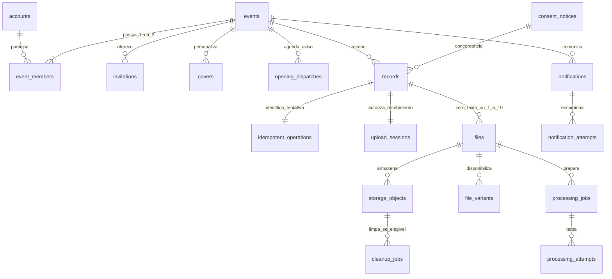
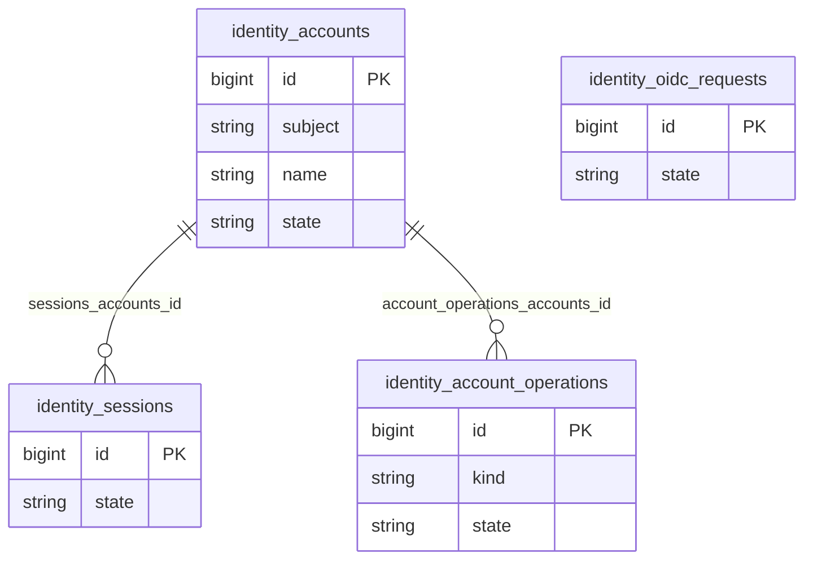
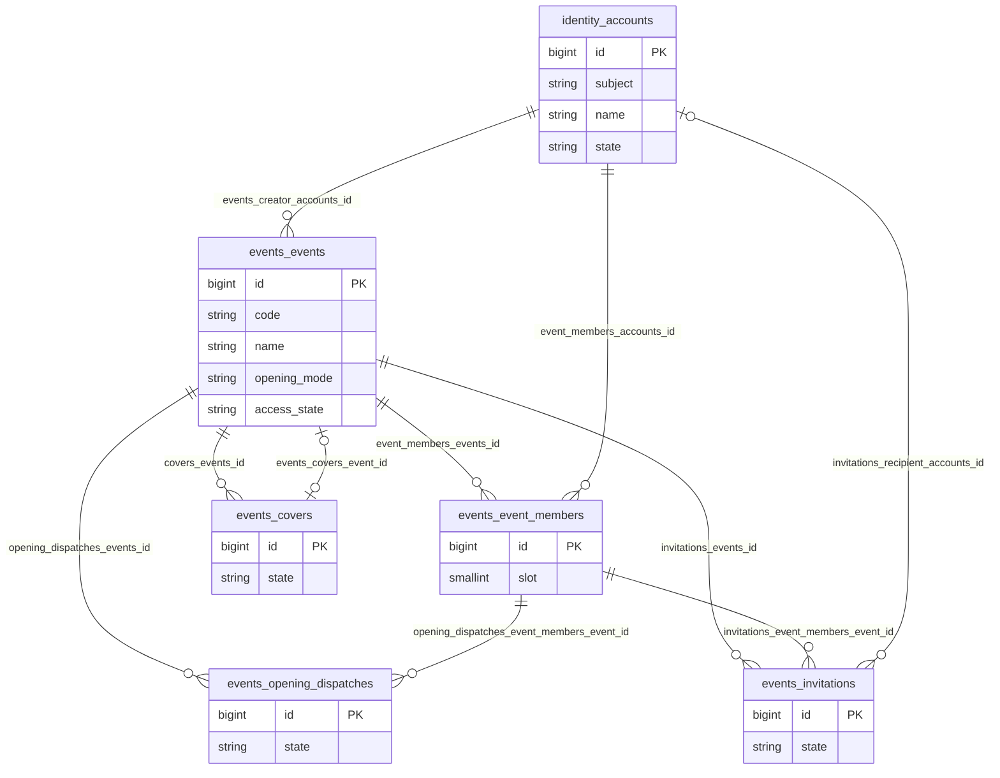
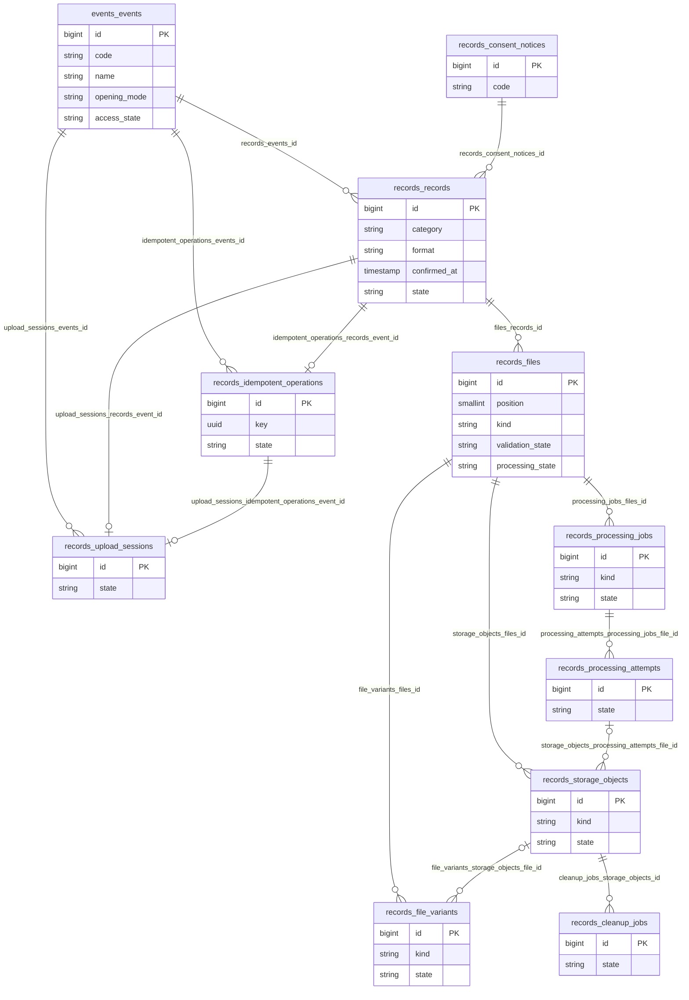
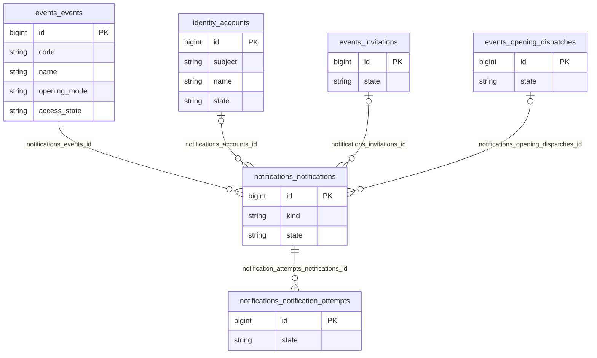
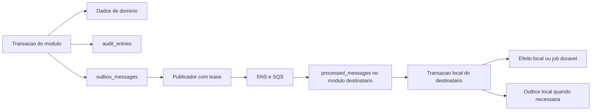
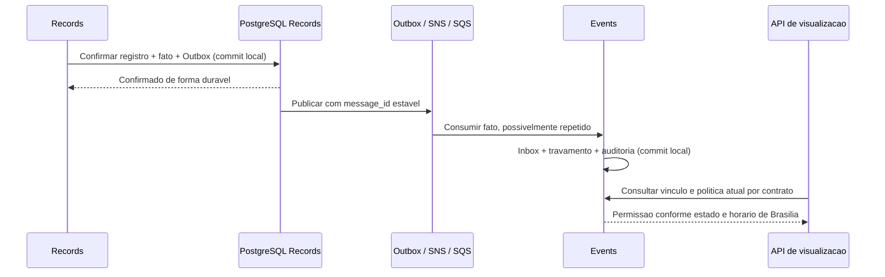

# Diagramas de entidade e relacionamento

[Modelagem](DB-Modelagem.md) · [Dicionário físico](DB-Modelo-Fisico.md) · [Índice](README.md)

Data inicial: **2026-11-11**. Diagramas do modelo de referência. Scripts correspondentes foram criados em **2026-11-12** no [componente Liquibase](https://github.com/diorgenesbackes/scrapbook-liquibase/blob/main/README.md). O dicionário é a referência completa de colunas, FKs compostas, CHECKs e índices; os diagramas exibem somente um recorte dos atributos.

## Visão de negócio

As relações 1:1 de registro/operação/sessão são invariantes da transação local, além de UNIQUE/FK. Limites 1..2 e 1..10 são mais restritos que a notação “muitos”. Um arquivo confirmado possui um original durável; os vários objetos incluem temporários e derivados. Notificação de abertura é por responsável/versão; não por registro.

## Relações físicas por módulo

Prefixos de entidade identificam o schema, por exemplo `records_files` = `records.files`. Atributos exibidos são um recorte. Linhas abaixo representam FKs físicas e sua opcionalidade; relações lógicas e invariantes agregadas não são convertidas em FKs artificiais.

### Contas e Acesso — `identity`

### Eventos e Convites — `events`

### Registros e Mídias — `records`

### Notificações — `notifications`

## Estruturas técnicas locais

O padrão abaixo existe em cada um dos quatro schemas, totalizando doze tabelas. Os IDs de agregado/assunto nas estruturas técnicas são referências lógicas tipadas; não há FK polimórfica ou transação global.

A publicação pode repetir. Inbox e efeito local compartilham commit, com ACK posterior. Chamada S3/Cognito/MediaConvert/SES fica fora da transação; persistir intenção, tentativa e estado incerto para reconciliação.

## Travamento eventual e autorização

Entre confirmação e consumo existe a janela eventual aceita no HLD (meta de 5 segundos em condições normais). `events.events.first_record_id` é referência lógica, sem FK; uma manutenção excepcional no registro não reabre o evento. O Scheduler de e-mail não participa da autorização.
