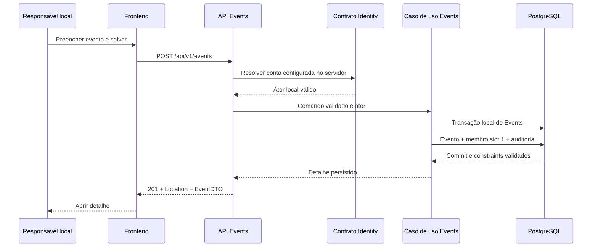
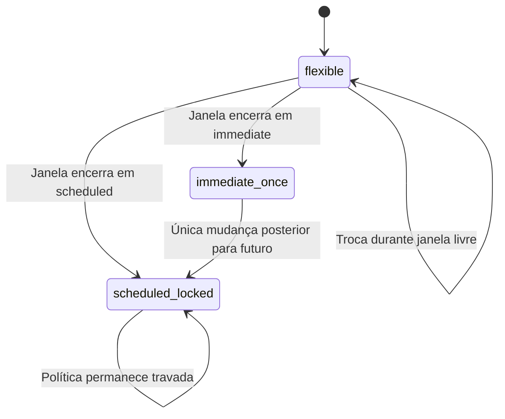

### FDD: Gestão de Eventos

Versão: 0.2 (implementada e validada localmente na feature GE-STORY-001; sem publicação)
Data: 2026-11-12
Responsável: Diórgenes Backes

---

### 1. Contexto e motivação técnica

Esta entrega permite criar, listar, consultar e editar eventos, com boas-vindas e configuração de abertura. O requisito principal é [FR-003](../../PRD.md#fr-003-criação-e-gestão-de-múltiplos-eventos), com as regras necessárias de FR-006, FR-016, FR-017 e FR-018. Capa customizada permanece posterior; isso não representa atendimento integral do FR-003.

Backend, telas React e testes manuais estão implementados na branch `feature/GE-STORY-001`, com EF/PostgreSQL, casos de uso e cinco endpoints. A API mantém cinco projetos diretamente na raiz e `/health` independente. A base física continua com 33 tabelas/47 changesets, sem alteração de histórico. Consulte [desenvolvimento](2-desenvolvimento.md), [testes e matriz de aceites](3-testes.md) e [operação local](4-operacao.md). Esta revisão documenta implementação/validação local, sem homologação ou deploy.

Por orientação do responsável, autenticação real será desenvolvida depois. O desenho propõe uma identidade simulada exclusivamente local, preservando o vínculo de responsável e as FKs, sem exigir Cognito, SES, S3 ou MediaConvert nesta entrega.

**Referências**

- [Prompt de FDD](../../prompts/FDD.md), [PRD](../../PRD.md), [HLD](../../HLD.md) e [compatibilização PRD/HLD](../../guidelines/README.md#compatibilização-entre-prd-e-hld).
- [Modelagem](../../db/DB-Modelagem.md), [dicionário físico](../../db/DB-Modelo-Fisico.md) e [Liquibase](https://github.com/diorgenesbackes/scrapbook-liquibase/blob/main/README.md).
- Guidelines de [backend](../../guidelines/backend.md), [frontend](../../guidelines/frontend.md), [API](../../guidelines/api.md), [SQL](../../guidelines/sql.md), [mensageria](../../guidelines/mensageria.md) e [observabilidade](../../guidelines/observabilidade.md).
- [Operação local](https://github.com/diorgenesbackes/scrapbook-infrastructure/blob/main/README.md) e [índice dos FDDs](../README.md).

**Atores e limites**

- Responsável atual: conta obtida pelo servidor por contrato de Identity; cria e administra os eventos aos quais está vinculado.
- Segundo responsável: possui as mesmas permissões se o vínculo já existir; geração/aceite de convites não pertence a esta entrega.
- Operador local: prepara credenciais DML e fixture de identidade; não usa credenciais de migração no runtime da API.
- Módulo Events: proprietário de eventos, membros, política de abertura e auditoria local. Identity é consultado por contrato interno, sem HTTP para a própria aplicação nem leitura direta de suas tabelas pelo EventsDbContext.

**Hipóteses e propostas de detalhamento**

| Referência | Proposta desta versão |
| --- | --- |
| H-01 | Cinco rotas/DTOs e telas da seção 5 implementados. OpenAPI em `/openapi/v1.json` somente em Development. Listagem inclui `serverTime` UTC, adição explícita à proposta 0.1. |
| H-02 | Identidade de desenvolvimento fixa por configuração do servidor, com fixture sintética local e ativação explícita. Não há escolha de conta por header, query ou body. |
| H-03 | Implementados 32 KiB, páginas 20/máximo 50, cursor 24h, API 5s compartilhados e UI 10s incluindo um retry GET transitório após 250ms. Carga local 200 eventos/10 concorrentes/60s aprovada; resultado e limites em `3-testes.md`. |
| H-04 | Capa `event-cover-default-v1.svg` local e mensagem “Seja bem-vindo! Compartilhe uma lembrança deste evento.” implementadas como defaults v1. Preservar seu conteúdo após publicação. |
| H-05 | Criação não terá idempotência persistente nesta primeira entrega. Resposta perdida terá recuperação assistida pela listagem, sem repetição automática do POST. Uma garantia de criação idempotente exige especificação e persistência próprias em Events. |

Nome até 120 e boas-vindas até 2.000 escalares seguem P-01. Trim Unicode inclui BOM/NEL; NUL e surrogate isolado são rejeitados. IDs/versões bigint são strings decimais; datas civis representam Brasília sem offset. Implementação permanece sujeita à revisão/aceite antes de promoção; autenticação real foi adiada.

---

### 2. Objetivos técnicos

- Entregar o fluxo frontend → API → PostgreSQL, sem dependência operacional de serviços AWS.
- Criar evento, membro inicial no slot 1 e auditoria de sucesso no mesmo commit de Events; falha em qualquer etapa não deixa evento órfão.
- Consultar e modificar somente eventos vinculados à conta resolvida no servidor.
- Impedir perda de atualização: versão esperada é comparada atomicamente e conflitos não sobrescrevem dados.
- Aplicar abertura futura/imediata e congelamento da política conforme FR-017, inclusive ao mover a data de um evento sem registros.
- Manter a confirmação de registros e o travamento estrutural sob a consistência eventual já aprovada no HLD.
- Retornar somente configuração permitida, sem consultar ou expor registros, contagens, nomes de convidados ou mídia privada.
- Usar o schema existente com mapeamentos explícitos e credenciais DML, mantendo Liquibase como único executor de DDL.
- Adotar p95 de até 500ms para operações comuns como meta a medir; não considerar desempenho validado pela existência deste documento.

---

### 3. Escopo e exclusões

**Incluído**

- Telas de listagem, criação e detalhes/edição de eventos, em português do Brasil e com uso móvel.
- Nome, data/hora de Brasília, mensagem padrão ou personalizada e capa padrão.
- Criação com abertura futura por padrão, sugestão de um ano e tratamento de 29/02.
- Configuração de acesso imediato ou programado, com as transições permitidas após o encerramento.
- Mapeamentos e unidade de trabalho de Events, resolução de identidade simulada pelo módulo Identity e configuração DML local.
- Vínculo inicial do criador e leitura de vínculos existentes, sem hierarquia de permissões entre os slots.
- Erros padronizados, concorrência otimista, auditoria local e instrumentação mínima.
- Testes unitários nos projetos de aplicação e cenários HTTP/PostgreSQL/navegador acionados manualmente em `scrapbook-tests/`.
- OpenAPI dos contratos propostos e documentação dos comandos de preparação/execução.

**Excluído**

- Cadastro, login, sessão real, Cognito, recuperação de senha e publicação da simulação em homologação/produção.
- Convites, alteração de responsáveis e remoção de vínculos.
- Upload/personalização de capa, S3, URLs assinadas, processamento de mídia e limpeza remota.
- Página dos convidados, QR code, contribuições, galeria, download e exclusão de eventos.
- Implementação do produtor Records e do consumidor de primeiro registro; o estado persistido de travamento será respeitado e exercitado por fixtures de teste.
- Envio de e-mails, Scheduler, filas SNS/SQS e infraestrutura AWS.
- Novas tabelas, alterações dos 47 changesets aplicados, migrations EF ou criação de schema no startup.

---

### 4. Fluxos detalhados e diagramas

**Fluxo principal**

1. Preparar o PostgreSQL local e conferir migrations atualizadas pelos comandos da infraestrutura.
2. Provisionar explicitamente uma identidade DML e uma fixture de conta sintética por mecanismo local idempotente. O bootstrap é separado do startup normal da API e não entra no master Liquibase.
3. Configurar o ID retornado pela fixture no servidor. O adaptador de Identity verifica que a conta está ativa e pertence ao conjunto reservado de fixtures de desenvolvimento. Não assumir que o ID da conta é `1`.
4. O usuário abre a listagem e escolhe criar evento. O formulário coleta nome, data/hora, mensagem opcional e modo/data de abertura.
5. O endpoint valida o contrato, resolve o ator e chama o caso de uso de Events, que normaliza campos e calcula a janela e a política de abertura com relógio do servidor.
6. Events abre transação local, insere evento, membro no slot 1 e auditoria. O código público é gerado no servidor com 32 bytes aleatórios em base64url, separado da PK; não é usado como credencial.
7. Salvar e confirmar a transação, incluindo a execução das constraints diferíveis. Somente após commit devolver `201` e o detalhe persistido.
8. O frontend abre o detalhe e permite salvar informações e configuração de abertura por ações separadas. Não apresentar duas gravações HTTP independentes como uma operação atômica.
9. Listagem e detalhe consultam o PostgreSQL por projeções mínimas; a listagem usa cursor e não calcula quantidade de lembranças.

**Fluxos alternativos e exceções**

- Sem ator confiável: responder `401` antes de consultar eventos; a tela local informa configuração de desenvolvimento ausente, sem simular login real.
- Evento inexistente ou sem vínculo: mesma resposta `404`, sem revelar sua existência.
- Formulário inválido: manter dados em memória e mostrar erros por campo; não executar a transação.
- Evento travado: impedir alteração estrutural; configuração de acesso segue sua própria regra temporal.
- Versão divergente: `409`, recarregar a versão atual e exigir nova ação do usuário para reconciliar a edição.
- Falha antes do commit: rollback local; não emitir sucesso nem manter somente o vínculo ou somente o evento.
- Resposta perdida após possível commit: estado indeterminado no cliente. Oferecer acesso à listagem/detalhe para conferência, sem repetir automaticamente o POST/PUT ou declarar que nada foi salvo.
- Eventos com mesmo nome/data são permitidos. Procurar por esses campos não comprova identidade de uma operação anterior.
- Banco indisponível: erro sanitizado `503`, mantendo formulário em memória e oferecendo recuperação segura.
- Alteração de abertura: cancelar obrigações antigas de `events.opening_dispatches` ainda pending/requested, se existirem, no mesmo commit de Events; preservar histórico dispatched. Não criar envio ou escrever em Notifications nesta feature. O futuro Scheduler poderá gerar a obrigação da versão vigente.
- Um segundo responsável já vinculado recebe os mesmos recursos; testes podem preparar esse vínculo por fixtures válidas, sem criar endpoint de convite nesta entrega.

**Identidade simulada e isolamento local**

| Configuração proposta | Regra |
| --- | --- |
| `DevelopmentIdentity:Enabled` | Default false; exige ativação explícita e ambiente Development. Ativação em outro ambiente falha na inicialização. |
| `DevelopmentIdentity:AccountId` | Obrigatório quando habilitado; ID local validado pelo contrato de Identity, nunca recebido do navegador. |
| Fixture | Conta com identificador reservado `development:gestao-eventos:owner` e e-mail sintético em `example.invalid`. Deve atender às constraints de conta ativa, mas não representa identidade Cognito confirmada. |
| Banco da fixture | Conexão local dedicada; preparar/validar por comando explícito que recuse alvo remoto e colisão com conta não sintética. |
| Rede local | API vinculada a loopback e frontend pelo proxy Vite. Origem de navegador validada nas mutações; não aceitar arbitrariamente qualquer Origin. |
| `DevelopmentIdentity:AllowedOrigins` | Default proposto `["http://127.0.0.1:5173"]`; permitir somente origens explicitamente configuradas. Requisições sem Origin são admitidas para ferramentas locais, com a API em loopback e o modo de simulação ativo. |
| Fora da simulação | Com a flag desativada e sem provedor real, operações de gestão negam acesso com `401` e `/health` continua operacional. Flag indevidamente ativada fora de Development impede a inicialização. |

O provedor real de identidade será encaixado posteriormente na mesma porta interna. Nenhuma regra de negócio recebe um `accountId` editável pelo cliente. Sem cookies de autenticação nesta etapa, não há sessão real nem token de login; a validação de origem e de Content-Type continua necessária. Após integrar sessão real, aplicar o mecanismo CSRF correspondente.

**Persistência, concorrência e auditoria**

- Organizar código em `ScrapBook.Domain/Modules/Events`, `ScrapBook.Application/Modules/Events`, `ScrapBook.Infrastructure/Modules/Events` e `ScrapBook.Api/Modules/Events`; os projetos permanecem diretamente na raiz da solution.
- Criar `EventsDbContext` scoped, com mapeamento explícito de `events.events`, `events.event_members`, `events.audit_entries` e obrigações de abertura necessárias. Identity utiliza infraestrutura e contrato próprios.
- Mapeamentos incluem FK com nomes compostos, identity ALWAYS, tamanhos, nulabilidade e timestamps. Datas civis usam representação sem conversão implícita para UTC; instantes técnicos mantêm UTC.
- Leituras usam conta atual + vínculo no banco, parâmetros, projeção e paginação. Não consultar outro módulo pelo DbContext de Events nem expor `IQueryable`.
- Na atualização, usar transação curta, lock do evento, revalidar vínculo/travas e comparar a versão esperada. O UPDATE também exige a versão original no predicado; ausência de linha afetada é conflito.
- Não atribuir `version` a partir do body. O trigger mantém `version` e `updated_at`; ler os valores finais e os campos derivados alterados pelos triggers antes de construir a resposta, após commit.
- Um no-op efetivo não avança versão. Materializar uma transição temporal pendente é uma mudança efetiva.
- SQLSTATE de concorrência/constraint é traduzido por catálogo conhecido; não devolver SQL, nomes internos de constraint, conexão ou stack trace.
- Auditoria usa ações propostas `events.created`, `events.structure_updated` e `events.access_updated`, com ator, evento, correlação e retenção de 180 dias.
- `before_state/after_state` respeitam a allowlist já implementada, como `starts_at`, `opening_mode`, `opens_at`, `access_state` e `access_version`. Não inserir nome, mensagem, campos arbitrários ou `version` genérico fora da allowlist. Renomear pode registrar ação com estados vazios e motivo de catálogo.
- Esta feature não depende de publicação de mensagem para salvar evento. Não inventar consumidores ou enfileirar evento sem contrato; o futuro fato de primeiro registro continua sendo produzido em Records.

**Datas e política de abertura**

| Regra | Implementação verificável |
| --- | --- |
| Janela de envio | Derivar `submission_opens_at = starts_at - 2h`, fechamento às 12h do dia seguinte e conclusão às 13h. Recalcular atomicamente ao alterar data/hora permitidas. |
| Entrada civil | `startsAt` sem `Z`/offset; `openingDate` é data civil. Timezone fixo, não editável pelo cliente. |
| Abertura inicial | Default scheduled; sem data explícita, sugerir um ano após a data do evento, às 00h. Em 29/02 usar 28/02 do ano seguinte. Validar a sugestão como qualquer entrada. |
| Validade | Abertura futura deve ser posterior ao dia atual de Brasília e ao fechamento dos envios. Rejeitar aritmética/datas não representáveis pelo contrato, sem overflow ou truncamento. |
| Eventos passados | Não acrescentar uma proibição de data passada ausente no PRD. Aplicar janela, abertura e congelamento coerentes com a data informada. |
| `flexible` | Troca livre enquanto a janela anterior não encerrou. Reavaliar o relógio após espera relevante. |
| `scheduled_locked` | Janela terminou em scheduled: modo/data não mudam. |
| `immediate_once` | Janela terminou em immediate: pode continuar assim ou consumir uma única transição para scheduled_locked com data válida. |
| Mudança estrutural de data | Avaliar o fechamento da janela antiga antes de gravar a nova, preservando `access_frozen_at` e impedindo destravamento indireto. |
| Versões | `version` controla a linha; `access_version` muda apenas com alteração efetiva de modo/data de abertura. |
| Primeiro registro | Respeitar `locked_at` persistido. Não consultar Records para tentar substituir a janela eventual aprovada por um bloqueio imediato entre módulos. |

A tolerância até 13h não estende a liberdade de mudar abertura. Configurar a abertura não implementa acesso à galeria nesta entrega. A futura leitura de lembranças continuará autorizada por pedido, sem depender de Scheduler ou e-mail.

**Frontend**

- Rotas propostas: `/events`, `/events/new` e `/events/:eventId`, organizadas em `src/features/events` e no roteamento de `src/app`.
- Estados explícitos: carregando, lista vazia, edição, salvando, sucesso, conflito, indisponível e resultado de escrita indeterminado.
- Formulários separados para informações e abertura; bloquear acionamento duplicado enquanto a chamada estiver pendente.
- Boas-vindas nulas/ausentes na criação usam o default v1. String vazia ou só espaços é normalizada para NULL; conteúdo personalizado mantém o texto após normalização definida. A edição estrutural sempre envia o campo, inclusive NULL para restaurar o padrão.
- Contar caracteres Unicode de forma compatível com PostgreSQL e API; no .NET usar escalares Unicode, não `string.Length` como contagem equivalente. Não converter IDs/versões para `Number`.
- Datas civis permanecem valores de data/hora locais de Brasília, sem serialização acidental por `toISOString()`.
- Capa padrão é asset versionado do frontend, selecionado pelo `assetKey`; não fazer chamada ao S3.
- Não mostrar contagem de registros, nomes de convidados, miniaturas, data do primeiro registro ou `first_record_id`. Capacidade de edição é informação operacional mínima, sem explicar sua origem por dados de recebimento.
- Acessibilidade: labels, erros associados aos campos, foco após falha, operação por teclado, status anunciável e uso sem dependência de cor.

**Diagramas**





---

### 5. Contratos públicos (assinaturas, endpoints, headers, exemplos)

Contratos H-01 implementados em `/api/v1`, registrados no OpenAPI gerado pelo host (`GET /openapi/v1.json`, somente Development). Exemplos abaixo são sintéticos. Entradas são case-sensitive e rejeitam campos desconhecidos; expectedVersion é string obrigatória e não nula. A consulta/decisão usa somente conta resolvida no servidor.

**Semântica comum de campos, headers e limites**

| Item | Contrato |
| --- | --- |
| Ator | Resolvido no servidor. Campos `accountId`, criador, membro, versão armazenada e estados internos enviados como entrada indevida são rejeitados. `expectedVersion` é somente uma precondição de comparação. |
| Headers | `Content-Type: application/json` em mutações; sucesso em JSON e erro em `application/problem+json`; `Cache-Control: no-store`. |
| Correlação | `X-Correlation-Id` UUID opcional validado/gerado e devolvido; contexto W3C validado quando instrumentado. |
| Concorrência | PUT exige `expectedVersion` como string decimal não negativa. GET fornece `version`. Não usar ETag como versão de uma representação que muda com relógio/`serverTime`. |
| Nome | Após trim, 1 a 120 escalares Unicode; sem unicidade por nome/data. |
| Boas-vindas | Até 2.000 escalares Unicode; NULL significa default v1. O default v1 não pode ser alterado silenciosamente em uma release que afete eventos travados. |
| Datas | `startsAt: YYYY-MM-DDTHH:mm:ss`; `openingDate: YYYY-MM-DD`; instantes técnicos como `serverTime` usam UTC com `Z`. |
| Modos | `immediate` ou `scheduled`. `openingDate` deve ser NULL/ausente em immediate. |
| Body | Até 32 KiB UTF-8 por mutação; campos desconhecidos, enums inválidos e offsets indevidos resultam em `400`. Body acima do limite resulta em `413`. |
| Tempo | Orçamento proposto da API de 5s, incluindo banco; frontend cancela em até 10s por ação. Limitar espera por lock/SQL dentro desse orçamento e propagar cancelamento. |
| Taxa | Sem nova cota por conta nesta feature. Calibrar proteção global de entrada conforme HLD; o perfil de carga não é uma cota de uso. |
| Repetição | POST sem garantia idempotente persistente; PUT condicionado à versão. Não repetir mutações automaticamente. |
| Dados privados | Nenhum campo de quantidade, conteúdo ou identidade de convidado, histórico de primeiro registro ou URL privada de mídia. |
| Versão HTTP | Contratos v1; adições opcionais são toleradas. Alteração incompatível exige versão/transição explícita. |

**Criar evento**

- Tipo: endpoint.
- Assinatura/Rota: `POST /api/v1/events`.
- Método: POST.
- operationId: `CreateEvent`.
- Semântica de status/headers: `201` somente após commit; `Location: /api/v1/events/{id}`. Erros comuns na seção 6.
- `name` e `startsAt` obrigatórios. `welcomeMessage` é opcional; `openingMode` omitido usa scheduled. Em scheduled, `openingDate` ausente/NULL aplica a sugestão de um ano. Campo inválido não cai silenciosamente no default.
- `code` é gerado e persistido para a futura página pública; a resposta de gestão não precisa expô-lo nesta entrega.

**Exemplo de requisição**

```json
{
  "name": "Encontro de família",
  "startsAt": "2027-05-23T18:30:00",
  "welcomeMessage": null,
  "openingMode": "scheduled",
  "openingDate": null
}
```

**Exemplo de resposta**

```json
{
  "id": "101",
  "name": "Encontro de família",
  "startsAt": "2027-05-23T18:30:00",
  "timeZone": "America/Sao_Paulo",
  "welcomeMessage": null,
  "effectiveWelcomeMessage": "Seja bem-vindo! Compartilhe uma lembrança deste evento.",
  "cover": {
    "kind": "default",
    "assetKey": "event-cover-default-v1"
  },
  "openingMode": "scheduled",
  "openingDate": "2028-05-23",
  "opensAt": "2028-05-23T00:00:00",
  "submissionWindow": {
    "opensAt": "2027-05-23T16:30:00",
    "closesAt": "2027-05-24T12:00:00",
    "completionDeadlineAt": "2027-05-24T13:00:00"
  },
  "accessState": "flexible",
  "canEditStructure": true,
  "canEditAccess": true,
  "version": "0",
  "serverTime": "2026-11-12T15:00:00Z"
}
```

`welcomeMessage` é a configuração editável; `effectiveWelcomeMessage` resolve o default. `cover.assetKey` identifica asset estático do frontend. `accessState` e permissões refletem a política efetiva no relógio do servidor e não substituem a validação na próxima escrita. `serverTime` é amostra de relógio, não prazo ou versão.

**Listar eventos do responsável**

- Tipo: endpoint.
- Assinatura/Rota: `GET /api/v1/events?limit=20&cursor={cursor}`.
- Método: GET.
- operationId: `ListEvents`.
- Semântica de status/headers: `200`, inclusive com `items: []`. Sem body na requisição e sem total obrigatório.
- Limite 1 a 50, default 20. Ordenação fixa `created_at DESC, id DESC`, filtrada pelo vínculo da conta atual.
- Cursor opaco, autenticado, com formato v1, chave `created_at/id`, conta e ordem vinculadas; limite de 2.048 caracteres e TTL proposto de 24h. Proposta: ASP.NET Core Data Protection com propósito `Events.List.v1` e chave local persistente privada. Não usar cursor como autorização.
- Ler `limit + 1` para definir `hasMore`. Novo evento criado entre páginas aparecerá após reiniciar a listagem; não prometer snapshot estático.
- Consultar por uma operação SQL parametrizada com filtro de vínculo, cursor e limite, sem carregar todos os eventos para filtrar no frontend.

**Exemplo de requisição**

```http
GET /api/v1/events?limit=20
Accept: application/json
```

**Exemplo de resposta**

```json
{
  "items": [
    {
      "id": "101",
      "name": "Encontro de família",
      "startsAt": "2027-05-23T18:30:00",
      "cover": {
        "kind": "default",
        "assetKey": "event-cover-default-v1"
      },
      "openingMode": "scheduled",
      "openingDate": "2028-05-23",
      "version": "0"
    }
  ],
  "nextCursor": null,
  "hasMore": false,
  "serverTime": "2026-11-12T18:00:00.000Z"
}
```

**Consultar detalhe**

- Tipo: endpoint.
- Assinatura/Rota: `GET /api/v1/events/{eventId}`.
- Método: GET.
- operationId: `GetEvent`.
- Semântica de status/headers: `200` com EventDTO; `404` para inexistente ou sem vínculo. Sem body.
- `eventId` é string decimal positiva compatível com bigint. Existência do ID não autoriza acesso.

**Exemplo de requisição**

```http
GET /api/v1/events/101
Accept: application/json
```

**Exemplo de resposta**

```json
{
  "id": "101",
  "name": "Encontro de família",
  "startsAt": "2027-05-23T18:30:00",
  "timeZone": "America/Sao_Paulo",
  "welcomeMessage": null,
  "effectiveWelcomeMessage": "Seja bem-vindo! Compartilhe uma lembrança deste evento.",
  "cover": {
    "kind": "default",
    "assetKey": "event-cover-default-v1"
  },
  "openingMode": "scheduled",
  "openingDate": "2028-05-23",
  "opensAt": "2028-05-23T00:00:00",
  "submissionWindow": {
    "opensAt": "2027-05-23T16:30:00",
    "closesAt": "2027-05-24T12:00:00",
    "completionDeadlineAt": "2027-05-24T13:00:00"
  },
  "accessState": "flexible",
  "canEditStructure": true,
  "canEditAccess": true,
  "version": "0",
  "serverTime": "2026-11-12T15:00:00Z"
}
```

**Atualizar informações do evento**

- Tipo: endpoint.
- Assinatura/Rota: `PUT /api/v1/events/{eventId}`.
- Método: PUT.
- operationId: `UpdateEvent`.
- Semântica de status/headers: `200` após commit, com EventDTO final; `409` para versão ou travamento incompatíveis.
- Substitui somente nome, data/hora e boas-vindas. Esses três campos e `expectedVersion` são obrigatórios; NULL explícito restaura boas-vindas padrão.
- Não atualiza modo/data de abertura, responsáveis, código público, capa ou marcos calculados enviados pelo cliente.
- Mudança de data/hora revalida abertura e janela antiga. Se a abertura existente ficar incompatível, rejeitar toda a operação; não corrigi-la silenciosamente.

**Exemplo de requisição**

```json
{
  "name": "Encontro anual da família",
  "startsAt": "2027-05-23T18:30:00",
  "welcomeMessage": "Deixe uma lembrança deste encontro.",
  "expectedVersion": "0"
}
```

**Exemplo de resposta**

```json
{
  "id": "101",
  "name": "Encontro anual da família",
  "startsAt": "2027-05-23T18:30:00",
  "timeZone": "America/Sao_Paulo",
  "welcomeMessage": "Deixe uma lembrança deste encontro.",
  "effectiveWelcomeMessage": "Deixe uma lembrança deste encontro.",
  "cover": {
    "kind": "default",
    "assetKey": "event-cover-default-v1"
  },
  "openingMode": "scheduled",
  "openingDate": "2028-05-23",
  "opensAt": "2028-05-23T00:00:00",
  "submissionWindow": {
    "opensAt": "2027-05-23T16:30:00",
    "closesAt": "2027-05-24T12:00:00",
    "completionDeadlineAt": "2027-05-24T13:00:00"
  },
  "accessState": "flexible",
  "canEditStructure": true,
  "canEditAccess": true,
  "version": "1",
  "serverTime": "2026-11-12T15:00:00Z"
}
```

**Atualizar configuração de abertura**

- Tipo: endpoint.
- Assinatura/Rota: `PUT /api/v1/events/{eventId}/access`.
- Método: PUT.
- operationId: `UpdateEventAccess`.
- Semântica de status/headers: `200` com EventDTO final; `409` quando política ou versão não permitem a mudança.
- Exige `openingMode`, `openingDate` e `expectedVersion`. Em scheduled, a data é obrigatória e válida; em immediate, deve ser NULL.
- Pode continuar disponível após travamento estrutural, observando FR-017. Não libera galeria, não emite URLs e não envia e-mail.

**Exemplo de requisição**

```json
{
  "openingMode": "immediate",
  "openingDate": null,
  "expectedVersion": "1"
}
```

**Exemplo de resposta**

```json
{
  "id": "101",
  "name": "Encontro anual da família",
  "startsAt": "2027-05-23T18:30:00",
  "timeZone": "America/Sao_Paulo",
  "welcomeMessage": "Deixe uma lembrança deste encontro.",
  "effectiveWelcomeMessage": "Deixe uma lembrança deste encontro.",
  "cover": {
    "kind": "default",
    "assetKey": "event-cover-default-v1"
  },
  "openingMode": "immediate",
  "openingDate": null,
  "opensAt": null,
  "submissionWindow": {
    "opensAt": "2027-05-23T16:30:00",
    "closesAt": "2027-05-24T12:00:00",
    "completionDeadlineAt": "2027-05-24T13:00:00"
  },
  "accessState": "flexible",
  "canEditStructure": true,
  "canEditAccess": true,
  "version": "2",
  "serverTime": "2026-11-12T15:00:00Z"
}
```

**Resolver ator atual por contrato interno**

- Tipo: method.
- Assinatura: `Task<CurrentActor?> ICurrentActor.ResolveAsync(CancellationToken cancellationToken)`.
- Método HTTP: não se aplica; não criar rota de escolha de conta.
- Semântica: `CurrentActor.AccountId` é long interno; NULL significa ausência de ator e é traduzido em `401` pela fronteira HTTP.
- Na implementação local, o adaptador resolve a configuração confiável e consulta um contrato próprio de Identity para validar fixture/estado. Events não conhece Cognito nem lê a tabela de contas diretamente.
- Mantém cancelamento e o orçamento da chamada original, sem rede para a própria API e sem retry independente.

**Exemplo de requisição**

```csharp
var actor = await currentActor.ResolveAsync(cancellationToken);
```

**Exemplo de resposta**

```json
{
  "accountId": "101",
  "source": "development_fixture"
}
```

O JSON acima ilustra o resultado lógico interno; não é uma resposta HTTP nem uma credencial.

---

### 6. Erros, exceções e fallback

| Condição | HTTP / código | Tratamento |
| --- | --- | --- |
| JSON, campo, enum, data, limite ou cursor inválido | `400 REQUEST_VALIDATION_FAILED` | Erros por campo em camelCase; preservar formulário. Cursor vencido/adulterado reinicia a listagem por ação do usuário. |
| Ator ausente ou fixture inválida | `401 IDENTITY_AUTHENTICATION_REQUIRED` | Negar a operação, sem conta default implícita. Informar configuração local ausente na experiência de desenvolvimento. |
| Origin de navegador não permitido | `403 REQUEST_ORIGIN_NOT_ALLOWED` | Recusar mutação; código proposto específico desta fronteira local. |
| Evento inexistente ou sem vínculo | `404 RESOURCE_NOT_FOUND` | Mesma mensagem e nenhum detalhe do recurso alheio. |
| Estrutura travada | `409 EVENT_LOCKED` | Não salvar; mensagem genérica sobre indisponibilidade da edição, sem dados do recebimento que motivou a trava. |
| Abertura já congelada | `409 EVENT_OPENING_LOCKED` | Código proposto; manter política/data persistidas e orientar recarga. |
| Versão esperada diferente | `409 EVENT_VERSION_CONFLICT` | Recarregar/reconciliar; nunca sobrescrever automaticamente. |
| Body acima de 32 KiB | `413 REQUEST_TOO_LARGE` | Rejeitar antes do caso de uso. |
| Content-Type não aceito | `415 UNSUPPORTED_MEDIA_TYPE` | Não tratar formulário simples/texto como comando JSON. |
| Proteção de entrada acionada | `429 REQUEST_RATE_LIMITED` | Honrar Retry-After quando houver prazo conhecido; não habilitar retry de mutação. |
| Banco indisponível, timeout de dependência ou lock esgotado reconhecido | `503 DEPENDENCY_UNAVAILABLE` | Falha sanitizada e correlação; oferecer tentativa segura conforme tipo de operação. |
| Falha inesperada | `500 UNEXPECTED_ERROR` | Registrar uma vez no handler e devolver Problem Details sem conteúdo interno. |

**Exemplo de Problem Details**

```json
{
  "type": "about:blank",
  "title": "Conflict",
  "status": 409,
  "detail": "O evento foi alterado. Recarregue os dados antes de salvar novamente.",
  "code": "EVENT_VERSION_CONFLICT",
  "correlationId": "97dfba56-bdf4-49ba-8f64-3cf9e14c134a"
}
```

Em erros de validação, acrescentar `errors` por campo; em todos os erros, devolver `X-Correlation-Id`. Usar `type: about:blank` e `title` coerente com o status. `traceId` é opcional quando instrumentado; não inventar uma string sem trace real.

**Estratégias de resiliência**

- Propagar CancellationToken e impor os orçamentos H-03 sem manter transação aberta durante rede.
- GET pode ter uma repetição limitada, somente em falha transitória reconhecida e dentro do orçamento total de 10s; proposta de espera de 250ms. Não repetir `400/401/403/404/409`.
- Não habilitar retries transparentes de criação/atualização ou de transação com commit desconhecido. Avaliar estratégias do provider para não duplicar comandos.
- Não adicionar circuit breaker ou cache distribuído nesta primeira entrega local.
- Após timeout/cancelamento de escrita, não presumir rollback. Consultar o estado antes de nova ação.
- Fallback de capa é o asset padrão; indisponibilidade de banco não retorna lista vazia ou sucesso falso.

**Invariantes**

- Evento e criador/membro inicial não são confirmados separadamente.
- Identidade e vínculo são verificados no servidor; ID e cursor não autorizam acesso.
- Versão esperada não é substituída por um contador vindo do cliente.
- Travamento estrutural e congelamento de abertura não regridem.
- Horário de Brasília não depende do timezone do navegador/host.
- Nenhum dado de lembranças é consultado para esta feature.
- Fato de primeiro registro permanece eventual; este FDD não promete o consumidor ainda não implementado.

---

### 7. Observabilidade

**Métricas**

- `scrapbook.events.requests` e `scrapbook.events.duration_ms` por operação, método, status/outcome e ambiente.
- `scrapbook.events.version_conflicts`, `scrapbook.events.opening_conflicts` e `scrapbook.events.persistence_failures` para investigação agregada.
- Latência/erros de conexão e SQL pelo provider, sem texto de parâmetros.
- Não usar nome, ID do evento, conta ou correlação como dimensão de métrica. Sinais de travamento/recebimento permanecem restritos e agregados, sem feed de atividade por evento.

**Logs**

- JSON com timestamp UTC, nível, EventId/EventName de catálogo, versão/ambiente, module=events, operação, rota template, status, outcome, durationMs e correlação/trace quando presentes.
- Usar a faixa 4000 a 4999 para catálogo da feature, atribuindo nomes/IDs estáveis na implementação.
- Não registrar body, nome do evento, mensagem de boas-vindas, e-mail, credenciais, conexão com senha ou conteúdo de fixture como se fosse usuário real.
- Auditoria de sucesso na mesma transação de Events; tentativa negada pode ter evidência própria após rollback. Retenção de 180 dias conforme o modelo.
- Logging sensível do EF desabilitado. Arquivos locais de log sem credenciais e fora de commits.

**Tracing**

- Spans propostos: `events.create`, `events.list`, `events.get`, `events.update_structure` e `events.update_access`, com operações de banco e resolução de ator como dependências.
- Development: amostragem de 100% proposta para diagnóstico local; política de produção permanece a definir junto da observabilidade geral.
- Propagar contexto W3C válido e correlação. Não colocar dados pessoais ou segredos em tags/baggage.

**Dashboards e alertas**

- Relatório local/manual de latência, taxa de erros, conflitos e indisponibilidade do PostgreSQL.
- A instrumentação deve permitir futura composição no CloudWatch/X-Ray; não exigir provisionamento AWS para aceitar esta entrega.
- Metas globais de indisponibilidade em 2min e disponibilidade de 99,9% permanecem do HLD, sem alegação de validação aqui.

---

### 8. Dependências e compatibilidade

| Componente | Versão mínima | Observações |
| --- | --- | --- |
| Backend | .NET/ASP.NET Core 10; SDK 10.0.401 | Baseline existente; manter projetos na raiz e pacotes fixados. |
| EF Core/Relational | 10.0.15 | Instalados, fixados e validados; lockfiles versionados. |
| Npgsql.EntityFrameworkCore.PostgreSQL / Npgsql | 10.0.3 / 10.0.3 | Alvo explícito PostgreSQL 18; nenhuma migration EF ou retry de transação. |
| Microsoft.AspNetCore.OpenApi | 10.0.15 | OpenAPI gerado e enriquecido por transformer; contrato validado contra HTTP. |
| PostgreSQL | 18.x; local 18.6 | Compose persistente em `127.0.0.1:55432`; runtime com credencial DML própria. |
| Schema | Base inicial com 47 changesets | Eventos, membros, auditoria e obrigações já existem; não editar histórico aplicado. |
| Liquibase | 4.33.0 | Alterações estruturais futuras exigem novo changeset e rollback, se demonstradas necessárias. |
| Frontend | React 19.3.1, React Router 8.5.1, TypeScript 7.0.2, Vite 8.3.6 | Modo declarativo, parsing de respostas em runtime e datas civis sem dependência do fuso do dispositivo. |
| Node/npm | Node 26.13.0 e npm 11.20.0 | Baseline validada no workspace. |
| Testes unitários | xUnit 2.9.3; Vitest 5.1.0 e React Testing Library 16.3.3 | Conforme projetos existentes. |
| Validações não unitárias | Python 3.13.15 stdlib, probes .NET e Playwright 1.65.0 | Manual, PostgreSQL 18.6 descartável; Chromium/WebKit. Carga por threads HTTP Python; k6 não instalado. |
| Identidade local | Contrato H-02 e fixture reservada | Não depende de User Pool, sessão real ou e-mail externo. |
| Chaves de cursor | Proteção local persistente e privada | Necessária para manter cursor válido após restart; produção compartilhada entre réplicas será definida depois. |

Versões exatas estão nos manifests/lockfiles, com restore locked e builds validados. Referências primárias: [EF Core 10](https://learn.microsoft.com/en-us/ef/core/what-is-new/ef-core-10.0/whatsnew), [Npgsql EF 10](https://www.npgsql.org/efcore/release-notes/10.0.html), [OpenAPI/transformers](https://learn.microsoft.com/en-us/aspnet/core/fundamentals/openapi/customize-openapi?view=aspnetcore-10.0) e [React Router](https://reactrouter.com/api/declarative-routers/BrowserRouter).

**Garantias de compatibilidade**

- Esta é a primeira proposta das rotas de gestão; `GET /health` e seu proxy permanecem conforme o contrato existente.
- Introduzir EF e seus mapeamentos sem DDL, EnsureCreated, Database.Migrate ou seed estrutural no startup.
- Provisionar grants DML e fixture explicitamente por infraestrutura/contrato de Identity, inclusive para volume já existente. Modificar um arquivo de init não o reexecuta em volume inicializado.
- Manter dados locais e histórico Liquibase ao reiniciar serviços. Não apagar volume como recuperação de erro.
- O futuro provedor Cognito substituirá a resolução de ator sem mudar permissões por vínculo ou contratos funcionais de Events.
- Regras de travamento usam o estado persistido; o futuro consumidor precisa permanecer compatível com a atualização concorrente e o cancelamento de convites/obrigações.
- Avaliar planos com índices atuais de membros/eventos. Índice adicional depende de evidência e nova migration, não de criação automática pelo EF.
- Rollback de aplicação preserva os dados de eventos; desabilitar a simulação ou retornar à versão anterior não remove tabelas/linhas. Não confundir com o rollback destrutivo da base inicial, que exige tabelas vazias.
- Preparar etapas de planejamento, desenvolvimento, testes e operação conforme o avanço, sem preencher resultados de etapas ainda não executadas.

---

### 9. Critérios de aceite técnicos

Os itens são rastreados como AC-01…AC-26, na ordem abaixo, na [matriz de testes](3-testes.md). As evidências locais identificam escopo, revisão e limites. Aceite de homologação/publicação permanece separado; emulação não equivale a dispositivos físicos. O marco exato de 12h foi exercitado com tempo substituível nos unitários, complementado por PostgreSQL real com janela 12h/13h e eventos encerrados; não houve integração executada no minuto real do meio-dia.

- [x] Frontend permite criar, listar, consultar e editar eventos usando a API e o PostgreSQL real.
- [x] Criação bem-sucedida persiste evento, slot 1 e auditoria no mesmo commit; falha deliberada em um passo não deixa dados parciais.
- [x] Duas contas sintéticas, preparadas de forma válida, não consultam nem modificam eventos uma da outra. Ausente e alheio retornam o mesmo `404`.
- [x] Criador e segundo responsável já vinculados possuem permissões equivalentes, sem criar fluxo de convite.
- [x] Fixtures/identidade simulada só funcionam com ativação explícita em Development/local; requisição não escolhe a conta e fora desse modo as rotas negam acesso.
- [x] Runtime usa usuário DML sem DDL; migrador permanece separado e a aplicação não altera schema no startup.
- [x] Nome, boas-vindas, Unicode, campos desconhecidos, enum, body de 32 KiB, formatos de data e bigint são validados de forma consistente entre UI/API/banco.
- [x] Capa e boas-vindas padrão funcionam sem S3; mensagem personalizada pode ser criada/editada e restaurada a NULL enquanto permitido.
- [x] Abertura padrão sugere um ano, resolve 29/02 e rejeita datas incompatíveis. Timezone diferente no host/navegador não muda a data civil persistida.
- [x] Janela calculada corresponde a duas horas antes, 12h e 13h do dia seguinte; seus campos não são editáveis pelo cliente.
- [x] Estrutura travada rejeita atualização; configuração de acesso continua seguindo FR-017.
- [x] Testes cobrem imediatamente antes, no marco e após 12h; a tolerância até 13h não permite troca livre adicional.
- [x] Mover a data de evento sem registros após o encerramento anterior não restaura `flexible` nem apaga o marco de congelamento.
- [x] Modo imediato após encerramento admite uma única mudança válida para futuro; modo/data ficam travados depois.
- [x] Duas edições com a mesma versão não se sobrescrevem: uma vence e a outra conflita. No-op efetivo não avança versão.
- [x] Campos reescritos pelos triggers retornam com os valores finais; constraints diferíveis são verificadas antes da resposta de sucesso.
- [x] Resposta perdida de POST/PUT não provoca retry automático; a UI apresenta resultado indeterminado e recuperação por consulta.
- [x] Listagem respeita vínculos, limite, ordem e cursor; cursor inválido/adulterado/de outra conta falha sem ampliar acesso. Atualização da lista recupera eventos novos.
- [x] Obrigações de abertura antigas ainda pendentes são canceladas quando a política muda, sem escrita em Notifications ou envio externo.
- [x] HTTP, UI, logs e auditoria não retornam dados de contribuições, remetentes, contagens ou detalhes do primeiro registro.
- [x] Erros usam Problem Details, códigos estáveis e correlação; não há stack trace, SQL, senha ou body sensível em logs.
- [x] Navegação móvel, teclado, foco e mensagens de erro são avaliados; a UI não anuncia salvamento antes do commit confirmado.
- [x] Unitários passam no backend/frontend. HTTP, PostgreSQL, concorrência e navegador são executados manualmente em `scrapbook-tests/`, com evidência e ambiente identificados.
- [x] Perfil de performance proposto H-03: uma conta com 200 eventos sintéticos, 10 requisições concorrentes por 60s após aquecimento, avaliando listagem/detalhe e atualização com versões válidas. Registrar carga, hardware, rede, massa, erros e p95 por operação; meta de até 500ms. Isso não valida os 200 uploads simultâneos do PRD.
- [x] Usar relógio substituível nos unitários. Na integração, alinhar fixtures ao relógio real do PostgreSQL e testar sua validação temporal; um clock fake somente na API não controla `clock_timestamp()` dos triggers.
- [x] Atualizar README/OpenAPI, registrar escolhas de patch/dependências e vincular o FDD aos ciclos em `scrapbook-docs/testing/` quando esses ciclos existirem.

---

### 10. Riscos e mitigação

### Identidade simulada escapar do ambiente local

- **Probabilidade:** média.
- **Impacto:** operações de gestão poderiam usar uma identidade fixa sem autenticação real.
- **Mitigação:**
    - Ativação explícita, ambiente Development, banco local e bind em loopback.
    - Rejeitar seleção de ator pelo cliente e validar a fixture reservada por contrato.
    - Fora da simulação, negar acesso até integrar o provedor real.
- **Plano de contingência:** desabilitar a flag e as rotas funcionais, preservando banco e dados para corrigir a configuração.

### Divergência entre domínio, mapeamentos e triggers

- **Probabilidade:** média.
- **Impacto:** campos calculados incorretos, falsa confirmação ou conflitos tratados como erro interno.
- **Mitigação:**
    - Mapear o schema existente, ler valores finais e confirmar a transação antes de responder.
    - Exercitar constraints diferíveis, atualização concorrente e passagem dos marcos temporais no PostgreSQL real.
    - Traduzir somente constraints/SQLSTATE conhecidos, sem expor detalhes internos.
- **Plano de contingência:** interromper a operação e registrar correlação; corrigir o mapeamento ou criar migration incremental se uma necessidade de schema for comprovada.

### Duplicação de evento após resposta perdida

- **Probabilidade:** média.
- **Impacto:** responsável pode criar um segundo evento sem saber que o primeiro foi salvo.
- **Mitigação:**
    - Bloquear acionamento duplicado na UI e não repetir mutações automaticamente.
    - Mostrar resultado indeterminado e permitir conferir a listagem.
    - Não usar nome/data como chave única ou afirmar idempotência inexistente.
- **Plano de contingência:** manter os eventos preservados e revisar uma entrega de idempotência própria de Events antes de ampliar os canais de criação; não adicionar exclusão improvisada à interface.

### Inferência de recebimento pela edição ou observabilidade

- **Probabilidade:** média.
- **Impacto:** detalhes de trava, logs ou métricas podem prejudicar a surpresa.
- **Mitigação:**
    - Retornar só a capacidade operacional mínima e erro genérico, sem motivo vinculado a primeiro registro, contagem ou remetente.
    - Manter consultas em Events; não consultar Records para enriquecer telas de gestão.
    - Revisar a experiência conjunta de FR-016/FR-018: a indisponibilidade de edição já é observável e não deve ser apresentada como prova de recebimento.
- **Plano de contingência:** retirar detalhes e indicadores que exponham atividade, mantendo a regra de bloqueio e registrando qualquer mudança de produto necessária antes da publicação.

### Dependências e credenciais locais incompletas

- **Probabilidade:** média.
- **Impacto:** a implementação pode depender de usuário DDL, fixture inconsistente ou pacote incompatível.
- **Mitigação:**
    - Fixar patches compatíveis e testar restauração pelo lockfile.
    - Provisionar usuário DML e fixture explicitamente, sem modificar histórico de migrations.
    - Guardar senhas e chaves de cursor em configuração privada, preservando-as nos reinícios.
- **Plano de contingência:** falhar com diagnóstico sanitizado de configuração e corrigir o bootstrap local; não apagar volume nem usar credenciais administrativas na API.

### Escopo crescer para serviços externos

- **Probabilidade:** média.
- **Impacto:** atrasar o fluxo funcional local com autenticação, capa, convites e mídia.
- **Mitigação:**
    - Manter defaults estáticos e o contrato de identidade substituível.
    - Registrar itens excluídos como entregas posteriores, sem interfaces fictícias marcadas como prontas.
- **Plano de contingência:** concluir o fluxo de gestão especificado e revisar seu aceite separadamente das futuras integrações.
